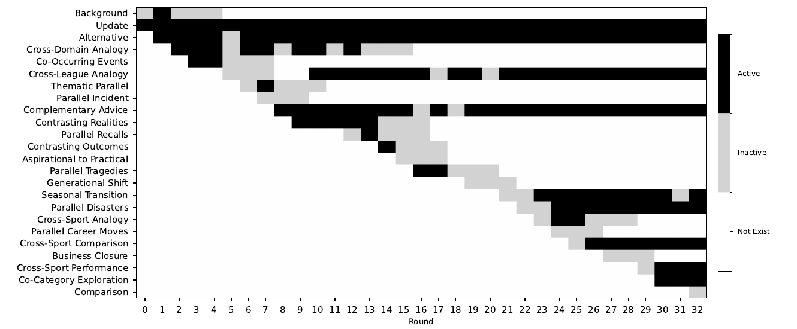

# 新闻互补推荐：LLM 每轮提新的文章关系标签，按关系分专家预估点击，删掉某个专家验证集 loss 不升就砍掉这个标签

关注我，每天为你精挑细选最优质、最新鲜的推荐算法paper，陪你一起保持进步、不断精进！

> [English version](drsd-news-complementary.full.en.md)

### 论文：Towards Dynamic Relationship Schema Discovery for Complementary News Recommendation
### 网址：https://doi.org/10.1145/3773078.3841261
### 公司：Kai Sugahara（署名 MicroAd，脚注注明是公司外的个人工作）
### 思想：关系标签自动发现、LLM 标注、门控 + 关系专家、验证集消融剪枝
### 方向：i2i（新闻文章的互补推荐）

## 解读：
**文章之间的关系标签不再人工定死，每轮让 LLM 提新标签、按标签训专家，删掉后验证集 loss 不升的标签就砍掉。**

场景是用户读完一篇新闻后推荐下一篇。作者认为读者这时想看的往往是功能不同的后续文章（交代来龙去脉的背景解读、事件的最新进展），并把这种文章对之间的依赖叫互补关系。已有工作要么不显式建模文章对的关系，要么先人工定一套关系标签（如「背景」「更新」）再去标注。问题是新闻热点和阅读习惯一直在变，哪些关系标签有用也在变，标签集定死就跟不上，没用的标签只会增加复杂度。

本文提出，把「该有哪些关系标签」也当成要优化的对象。CTR 模型由一个关系分类器和每个关系一个点击专家组成；每轮挑出现有标签解释不了的点击，让 LLM 提新标签并标注，重训后逐个去掉专家看验证集 loss，去掉不变差的标签就剪掉。

### 模型结构
模型预估用户读完查询文章后点目标文章的概率。做法是先判断这对文章是什么关系，再用这种关系专属的点击模型来预估。

举个例子（例子是我编的）。查询文章是「台风登陆浙江」，候选「今年台风为什么这么多」属于背景，候选「台风最新路径」属于更新。用户会不会点，在不同关系下规律不一样，所以每种关系单独一个点击模型。

**输入特征。** 两篇文章的标题和摘要各用 Sentence-BERT 编码成向量，再加实体重叠、类目、时间等文章对特征。下面的关系分类器和关系专家都是 LightGBM，用同一份特征。

#### 关系分类器
多分类模型，输出这对文章属于每种关系的概率（比如背景 0.7、更新 0.2、Unknown 0.1），论文叫门控。类别是当前标签集加一个 Unknown，训练标签来自 LLM 的标注（见下一节第（2）步）。Unknown 装的是现有标签都对不上的文章对，标签集还不全时，这些文章对不会被硬塞进不合适的关系。

#### 关系专家
每种关系（包括 Unknown）一个二分类 CTR 模型。训练时每个样本只喂给它所属关系的专家（论文叫硬路由），背景专家只见背景样本，更新专家只见更新样本，各个专家才能学出不同的点击规律，不会都学成同一个通用模型。

#### 最终点击率
关系分类器给的概率当权重，乘各专家的点击率再加总。接上例，最终点击率 = 0.7 × 背景专家的点击率 + 0.2 × 更新专家的点击率 + 0.1 × Unknown 专家的点击率。

### 每轮迭代：改标签集，重训网络
上面是标签集固定时的网络。标签集决定关系分类器分几类、有几个专家，迭代就是在网络训练外面再套一层循环，每轮改一次标签集、重训一次网络。四步里，（1）用当前网络的预估挑样本，（2）加新标签（网络随之多出新类别和新专家），（3）重训网络，（4）逐个拿掉专家看验证集 loss，决定删哪些标签（网络随之变小）。没有「先训好网络、再进入迭代」的两阶段，从头就是这个循环。

第 0 轮用人工给的两个标签（背景、更新）训出第一版网络，不调用 LLM；第 1 轮起，每轮做下面四步，每轮重训出的网络都能直接拿去推荐（论文就是逐轮在测试集上评的）。

#### （1）挑出现有标签解释不了的点击
只看被点击的正样本，每个样本的分数等于门控的不确定度乘点击的预估损失。不确定度是 1 减去门控在各关系上的最大概率，预估损失是预估点击率取负 log。分数高说明模型没预估好这次点击，也说不清这对文章是什么关系。取分最高的 256 对。

#### （2）LLM 提新标签并标注
把这 256 对的标题交给 gemini-3.5-flash，让它提零个或多个新的关系标签，暂时加进标签集，再给这些文章对打标签，对不上的标 Unknown。LLM 只负责提候选，留不留由第（4）步决定。

#### （3）重训
每加一个标签，关系分类器就多一个输出类别，同时多一个新专家。LightGBM 多分类没法在原模型上直接加一类，所以门控整个重训；老专家也一起重训，因为部分文章对改标了新关系，各专家分到的样本可能变了。

#### （4）按验证集剪枝
对每个标签，临时拿掉它的专家，门控概率在剩下的关系上重新归一化，看验证集交叉熵的变化（只是测一下，不重训）。拿掉后 loss 不升，说明这个专家没帮上忙，标签记为不活跃；连续 3 轮不活跃才真正删掉，避免单轮波动误删。删标签就是关系分类器少一类、这个专家也不要了；原来标成这个关系的文章对之后归到哪，论文没说。

上图是 33 轮里每个标签的状态（黑色活跃，灰色不活跃，白色是还没提出或已删除）。人工起步的「背景」第 5 轮就被删了，「更新」一直活跃。前后共提出 22 个新标签，到第 32 轮仍活跃的新标签有 8 个（Alternative、Cross-League Analogy、Complementary Advice、Seasonal Transition、Parallel Disasters、Cross-Sport Comparison、Cross-Sport Performance、Co-Category Exploration）。

### 推理
论文没单独写推理流程，按模型结构是这样。取某一轮训好的网络，对查询文章和每篇候选文章算文章对特征，关系分类器给出各关系的概率，所有专家各打一个点击率，加权求和，按最终点击率排序取前 k。训练时每个样本只进一个专家，推理时所有专家都要算，再按概率加权。LLM 不参与推理，只在训练时提标签、做标注。因为有实体重叠这类文章对特征，候选没法预先压成向量做 ANN 检索，只能给召回好的一批候选排序。实验里排的应该是 MIND 每次曝光的候选列表（MIND 的标准评测方式），查询文章怎么选（比如用户最近点的一篇），论文都没明说。

### 数据与效果
MIND-small（微软新闻数据集），对比不做关系发现的标准 CTR 模型，三次运行取平均，只有离线实验。交叉熵和基线基本持平，nDCG@1、@3 在基线上下波动，没有随轮数上升的趋势。提升在覆盖面（前 k 个推荐里出现的不同文章数）。按图上读数，@1 从基线约 940 篇升到 1050 篇上下，@3 从约 1660 篇升到 1800 篇上下，都是前 5 轮左右涨上去后保持。代码开源。

## 心得：

## 愚见

## 可信度：离线

## 推荐等级：有时间看看

**请帮忙点赞、转发，谢谢。欢迎干货投稿 \ 论文宣传\ 合作交流**

### 【铁粉】请入微信群，群内我会给出更深入的解读，还可以共同讨论技术方案、发招聘广告、内推和交友等。
* 铁粉标准：关注公众号一个月以上，且在公众号上累计15次互动（评论、爱心、转发）、或投稿1次，只欢迎技术同学。
* 入群方法：请您加个人微信lmxhappy，我拉您入群，请备注【公司】（只我个人看，不公开）。

## 推荐您继续阅读：
