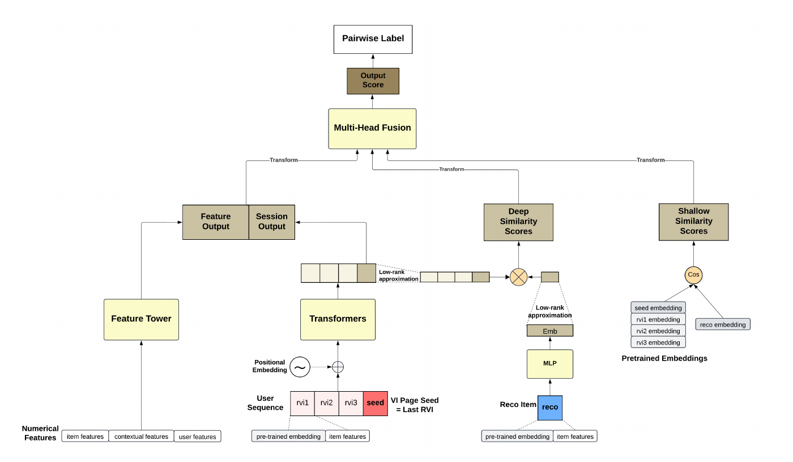

# eBay detail-page similar items: purchase rate +2.4%

> [中文版](ebay-contextual-ranker.md)

### Paper: Contextual Ranker in Production: Session-Aware Similar Item Ranking for Lower-Funnel E-Commerce (CIKM'26 Industry Day)
### Link: https://doi.org/10.1145/3799682.3839262
### Company: eBay
### Idea: seed-item anchoring, session intent, multi-signal relevance fusion
### Area: i2i

## Overview:
The "Similar Items" module below eBay's product detail page helps users decide between buying the item in front of them and switching to another one. The previous ranker was XGBoost: it only looked at how similar a candidate is to the current item, not at what the user is comparing in this session (brand, price band, condition).
This paper puts the recently viewed items and the current item into one sequence, passes it through one or more transformer layers, scores the candidate against every position in the sequence, and finally uses multi-head attention to decide per request which signal to trust more.

### Problem: the current item's dual role
The item the user is viewing (the seed item) is both the latest event in the session sequence and the anchor that similar-item recommendations must stay close to. Traditional I2I rankers hold on to the anchor but ignore the session; sequential recommenders read the session but treat the seed as just another step, diluting its role as the anchor.

### Model architecture

Read the figure bottom-up in four columns: feature tower, session encoding, deep relevance and shallow relevance; the last three all revolve around the candidate item (reco in the figure). The four columns feed into the multi-head fusion at the top.

### (1) Four parallel towers
* Feature tower (left column, Feature Tower)
Numerical features of the trigger, the target, the context and the user go through the feature tower, giving the Feature Output. The paper doesn't say how the feature tower is built; the most common approach is to normalize or bucketize the numerical features first, then pass them through a few MLP layers that output a vector.

* Session encoding (second column, User Sequence → Transformers)
The recently viewed items (rvi1, rvi2, rvi3) are ordered by time, with the trigger in the last position. The sequence has a fixed length (the paper doesn't give it): longer sessions are truncated to keep the most recent items, shorter ones are padded and the padding is masked, because deep and shallow relevance later produce one score per position that must be transformed into a fixed dimension, so the length has to be fixed. A cold-start request is a sequence with only the trigger and padding everywhere else. Each item is represented by a pretrained embedding plus item features (pre-trained embedding + item features), positional embeddings (Positional Embedding) are added, and the sequence goes through the transformer, giving an output vector at every position. The output at the seed's position is the Session Output, the "contextualized seed representation": it knows how the user got to this item.

* Deep relevance (third column, Reco Item → Deep Similarity Scores)
The candidate is also represented by its pretrained embedding plus item features and goes through an MLP to get Emb. Emb is dot-multiplied (⊗ in the figure) with the transformer output at each position, giving a set of scores, the Deep Similarity Scores, which reflect how well the candidate matches the user's current intent. Before the dot product, both the transformer outputs and the candidate's Emb go through a low-rank factorization (the two Low-rank approximation spots in the figure: a large projection matrix is split into the product of two small matrices) to cut online compute.

* Shallow relevance (right column, Pretrained Embeddings → Shallow Similarity Scores)
The candidate's pretrained embedding (reco embedding) is compared by cosine (Cos in the figure) with the pretrained embedding of each item in the sequence (trigger, rvi1, rvi2, rvi3 embedding), giving another set of scores, the Shallow Similarity Scores, which can be treated as content similarity. No session modeling is involved; this is a stable I2I prior.

### (2) Fusion network (top, Multi-Head Fusion)
The three signal groups are each transformed (Transform in the figure; the paper gives no details, presumably a linear projection) into vectors of the same dimension, giving 3 tokens: Feature Output and Session Output concatenated as one, deep relevance, and shallow relevance. The 3 tokens go through multi-head self-attention, which outputs 3 tokens as well; these are combined into one Output Score, a scalar (the paper doesn't say how, but it isn't hard: an MLP or pooling).

Why not simply concatenate and pass through an MLP? Because different requests should trust different signals. A user who lands on the detail page with no browsing history (cold start) can only be served by the features and shallow relevance; after viewing 5 pairs of sneakers from the same brand (comparing within one category), deep relevance best captures "this brand, this price range"; after viewing shoes, then bags, then watches (browsing across categories), the session is scattered and the model should fall back to shallow relevance anchored on the trigger. Concatenation plus an MLP could in principle learn this switching too, but the MLP has to find it on its own; MHSA makes the three signals compare against each other explicitly and computes how much each one counts directly. In the paper's ablation, removing multi-head fusion drops purchase NDCG@4 from 0.6772 to 0.6694, the largest drop of any component. These three kinds of requests are the ones the paper names; which signal each leans on is inferred from the design intent.

The attention scores use QK-Norm: ordinary attention scores are q·k / √d; QK-Norm first normalizes q and k to unit vectors, so the dot product becomes a cosine similarity, then multiplies by a learnable coefficient g instead of dividing by √d. This keeps any one signal from monopolizing the weights just because its values are large.

### Training
Training uses a pairwise loss (Pairwise Label in the figure): the candidates within one request are split by user behavior into three tiers, purchase > click > no click, and candidates from different tiers are compared pairwise, requiring the higher tier to score higher.

### A/B results
Against the online XGBoost: purchase rate +2.43% on mobile and +1.54% on desktop, with significant lifts in conversion rate and monetization too (numbers not given).

## Takeaways:
* In post-click recommendation, don't just concatenate session information into the input; the gain shows up only when the candidate's relevance to each step of the session is computed explicitly.
* Keep a shallow relevance path based on pretrained embeddings as an I2I prior, then fuse dynamically per request with attention, so cold-start requests are covered too.
* I2I for several scenarios is handled in this one model, and the model is designed to cope with that.

## My take

## Credibility: production

## Recommendation level: worth a look if you have time
