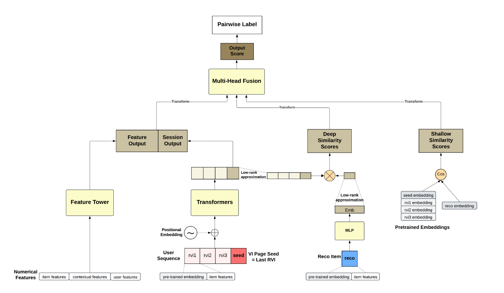

# eBay 详情页相似推荐，购买率+2.4%

关注我，每天为你精挑细选最优质、最新鲜的推荐算法paper，陪你一起保持进步、不断精进！

> [English version](ebay-contextual-ranker.full.en.md)

### 论文：Contextual Ranker in Production: Session-Aware Similar Item Ranking for Lower-Funnel E-Commerce（CIKM'26 Industry Day）
### 网址：https://doi.org/10.1145/3799682.3839262
### 公司：eBay
### 思想：种子商品锚定、会话意图、多路相关性融合
### 方向：i2i

## 解读：
eBay 商品详情页下方的「Similar Items」，帮用户在买眼前这件和换一件之间做比较。原来的排序模型是 XGBoost，只看候选商品和当前商品像不像，不看用户这次会话里在比什么（品牌、价格段、新旧成色）。
本文把最近浏览的商品和当前商品拼成一条序列，经过一层或者多层 transformer 层，再让候选商品和序列中每个位置分别算一遍相关性，最后用多头 attention 动态决定每个请求更信哪路信号。

### 问题：当前商品的双重角色
用户正在看的商品（种子商品）既是会话序列里最新的一个行为，又是相似推荐必须围绕的锚点。传统 I2I 排序抓住了锚点，但不看会话；序列推荐模型看了会话，但把种子商品当成普通的一步，锚点作用被稀释。

### 模型结构

图从下往上看，分四列：特征塔、会话编码、深相关性、浅相关性，后三列都围绕候选商品（图中 reco）。四列的输出汇到顶部的多头融合。

### （1）4个并列的塔
* 特征塔（左列 Feature Tower）。
trigger、target、上下文、用户的数值特征，经过特征塔，得到 Feature Output。特征塔怎么实现论文没写，最常见的做法是数值特征先做归一化或分桶，再过几层 MLP，输出一个向量。

* 会话编码（第二列 User Sequence → Transformers）。
最近浏览的商品（rvi1、rvi2、rvi3）按时间排好，trigger放在最后一位。序列是定长的（长度论文没给）：超过就截断、只留最近的，不够就补齐并用 mask 屏蔽，因为后面深、浅相关性是每个位置出一个分数，要变换成固定维度，长度必须固定。冷启动请求就是序列里只有 trigger、其余全是补齐位。每个商品用预训练向量加商品特征表示（pre-trained embedding + item features），加上位置编码（Positional Embedding），过 transformer，每个位置都得到一个输出向量。种子位置的输出就是 Session Output，即「带上下文的种子表示」：它知道用户是怎么走到这件商品的。

* 深相关性（第三列 Reco Item → Deep Similarity Scores）。
候选商品同样用预训练向量加商品特征表示，过 MLP 得到 Emb。Emb 和 transformer 每个位置的输出分别做点积（图中 ⊗），得到一组分数 Deep Similarity Scores，反映候选和用户当前意图的匹配程度。点积之前，transformer 的输出和候选的 Emb 都先过一次低秩分解（图中两处 Low-rank approximation：把大的投影矩阵拆成两个小矩阵相乘），用来降低线上计算量。

* 浅相关性（右列 Pretrained Embeddings → Shallow Similarity Scores）。
候选商品的预训练向量（reco embedding）和序列里每个商品的预训练向量（trigger、rvi1、rvi2、rvi3 embedding）分别算余弦（图中 Cos），得到另一组分数 Shallow Similarity Scores，这可以算内容相似度。不经过任何会话建模，是一个稳定的 I2I 先验。

### （2）融合网络（顶部 Multi-Head Fusion）
三组信号各自变换（图中 Transform，论文没给细节，推测是线性投影）成同维向量，得到 3 个 token：Feature Output 和 Session Output 拼成的一组、深相关性、浅相关性。3 个 token 做 multi-head self-attention，输出也是 3 个 token，将其融合（融合方法论文没说，也不难，无非mlp或者pooling）获得一个 Output Score（一个scalar）。

为什么不直接拼接后过 MLP？因为不同请求该信的信号不一样。比如用户直接进详情页、没有浏览历史（冷启动），只能靠特征和浅相关性；连看了 5 双同品牌球鞋（同类目反复比较），深相关性最能抓住「这个品牌、这个价位」；看了鞋又看包又看表（跨类目闲逛），会话很散，应该退回以 trigger 为锚的浅相关性。拼接后过 MLP 理论上也能学到这种切换，但要靠 MLP 自己摸索；MHSA 让三路信号显式地互相比较，直接算出各占多少。论文的消融里，去掉多头融合，购买 NDCG@4 从 0.6772 掉到 0.6694，是各模块里降得最多的。论文举的就是这三种请求，各自偏向哪路是按设计意图推的。

算注意力分数时用了 QK-Norm：普通 attention 的打分是 q·k / √d，QK-Norm 先把 q、k 各自归一化成单位向量，点积就成了余弦相似度，再乘一个可学习的系数 g，代替除以 √d，这样某一路信号不会因为数值大而垄断权重。

### 训练
用 pairwise 损失训练（图中 Pairwise Label）：同一个请求里的多个候选，按用户行为分成购买 > 点击 > 未点击三档，档位不同的两两对比，要求档位高的得分更高。

### A/B效果
对照是线上 XGBoost：购买率移动端 +2.43%、桌面端 +1.54%，转化率和变现也显著提升（未给数字）。

## 心得：
* 后推荐里会话信息别只是拼进输入，要让候选商品和会话的每一步显式算相关性，收益才出来。
* 留一路基于预训练向量的浅相关性做 I2I 先验，再用 attention 按请求动态融合，冷启动请求也能兜住。
* 多个场景的i2i，放到这一个模型里处理；模型为此也做了应对。

## 愚见

## 可信度：生产

## 推荐等级：有时间看看

**请帮忙点赞、转发，谢谢。欢迎干货投稿 \ 论文宣传\ 合作交流**

### 【铁粉】请入微信群，群内我会给出更深入的解读，还可以共同讨论技术方案、发招聘广告、内推和交友等。
* 铁粉标准：关注公众号一个月以上，且在公众号上累计15次互动（评论、爱心、转发）、或投稿1次，只欢迎技术同学。
* 入群方法：请您加个人微信lmxhappy，我拉您入群，请备注【公司】（只我个人看，不公开）。

## 推荐您继续阅读：
