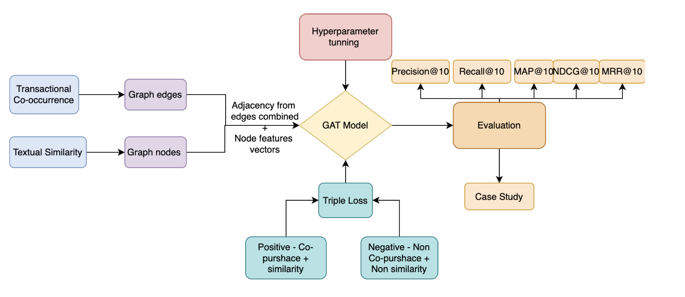

# Substitute and complementary recommendations for small retailers: TF-IDF plus GAT

> [中文版](egoi-crossmarket-gat.md)

### Paper: Cross-Market Evaluation of Complementary and Alternative Product Recommendations Using GATs and Textual Similarity (ICITS 2026, LNNS)
### Link: https://doi.org/10.1007/978-3-032-25652-2_3
### Company: E-goi (a Portuguese marketing automation company), University of Porto, Polytechnic of Porto
### Idea: text similarity, graph attention networks, LLM-completed metadata
### Area: i2i

## Overview:
E-goi provides marketing automation for small online stores, and this paper does both substitute and complementary recommendations for two of its clients: a health and wellness retailer (929 products, 5,830 transactions) and a technology e-commerce retailer (19,396 products, 14,742 transactions). "Cross-market" refers to these two sectors. The difficulty for small retailers is little data and incomplete product descriptions, so the methods are all lightweight. The paper has offline experiments only.

### (1) Completing product information
**LLM-written descriptions.** For products with missing descriptions, a prompt is built from the product name, category and brand, an internal LLM (which can search the web) writes a complete description, and it is put back into the dataset.

**NER field extraction.** The technology retailer's products have little more than a title. A spaCy named entity recognition model is trained to extract fields such as model, brand, color, memory and storage from titles. The training data is a public Kaggle dataset of 914 products.

### (2) Substitutes: TF-IDF plus cosine similarity
Each product's text attributes are turned into a TF-IDF vector, pairwise cosine similarities are computed, and the most similar products are the substitutes. For example, the substitutes for "iPhone 16 Pro Max 256GB Black" are the same model in Desert and White, plus a refurbished iPhone 12 Pro Max.

### (3) Complements: a GAT on the co-purchase graph

**Graph.** Products are nodes, with the products' text features as node features; two products bought in the same transaction are connected by an edge.

**Model.** A 2-layer GAT (graph attention network: when a node aggregates its neighbors, attention gives different neighbors different weights), with hidden layers of 256 and 512 dimensions and 5 attention heads.

**Training.** Triplet loss. Positives are product pairs that "were bought together and have high text similarity"; negatives are pairs that "were never bought together and have low text similarity". The authors' reasoning: products never bought together but textually similar might be complements not yet discovered, so they aren't used as negatives, to avoid misleading the model.

### Results (offline only)
**Substitutes** have no ground-truth labels, so the authors randomly picked 15 products per store and checked them by hand: precision@3 is about 97% for the health and wellness store and about 69% for the technology retailer.

**Complements** use an 80/20 split of transactions. The health and wellness store gets Precision@10 of 28% and Recall@10 of 67%; the technology retailer only 11% and 16%. The authors attribute this to the technology retailer's sparse product information and infrequent co-purchases.

## Takeaways:
* The quality of product metadata directly caps content-based recommendation: the information-rich health and wellness store gets four times the complementary recall of the technology retailer, which has only product names.
* With little data, small retailers can use an LLM to complete descriptions and NER to extract structured fields from titles, as cheap data augmentation.

## My take
* Requiring "high text similarity" for complementary positives conflicts with what complementarity means: a phone and a phone case are complements but their text isn't alike. In the paper's own example, the first and third "complements" for an iPhone 16 are an iPhone 16 Pro and a Xiaomi 15 Ultra, which are really substitutes.
* The evaluation is weak: substitutes were checked by hand on only 30 products; complements have no baseline at all, not even "rank by co-purchase count". The abstract (28% / 67%) and the figure in the body (38% / 61%) also disagree.
* No online experiment; the conclusion lists A/B testing as future work.

## Credibility: offline

## Recommendation level: worth a look if you have time
