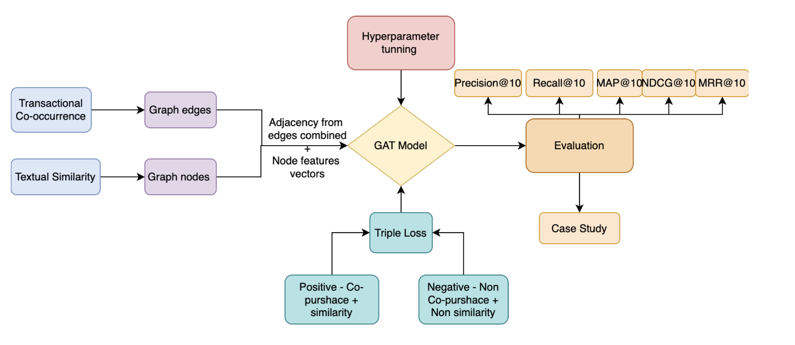

# 中小商家的替代品与互补品推荐：TF-IDF 加 GAT

关注我，每天为你精挑细选最优质、最新鲜的推荐算法paper，陪你一起保持进步、不断精进！

> [English version](egoi-crossmarket-gat.full.en.md)

### 论文：Cross-Market Evaluation of Complementary and Alternative Product Recommendations Using GATs and Textual Similarity（ICITS 2026，LNNS）
### 网址：https://doi.org/10.1007/978-3-032-25652-2_3
### 公司：E-goi（葡萄牙营销自动化公司），波尔图大学，波尔图理工学院
### 思想：文本相似度、图注意力网络、LLM 补全元数据
### 方向：i2i

## 解读：
E-goi 给中小网店做营销自动化，本文在它的两个客户上同时做替代品推荐和互补品推荐：一家健康保健零售店（929 个商品、5,830 笔交易），一家科技电商（19,396 个商品、14,742 笔交易）。「跨市场」指的就是这两个行业。中小商家的难点是数据少、商品描述残缺，所以方法都很轻。全文只有离线实验。

### （1）补全商品信息
**LLM 补描述。** 描述缺失的商品，用商品名、类目、品牌拼一段提示词，让内部 LLM（可以联网搜索）写一段完整描述，再填回数据集。

**NER 抽字段。** 科技电商的商品基本只有一个标题。用 spaCy 训练一个命名实体识别模型，从标题里抽出型号、品牌、颜色、内存、存储等字段。训练数据是 Kaggle 上的公开数据，914 个商品。

### （2）替代品：TF-IDF 加余弦相似度
把商品的文本属性算成 TF-IDF 向量，两两算余弦相似度，最像的几个就是替代品。比如「iPhone 16 Pro Max 256GB 黑色」的替代品是同款的沙漠色、白色，以及一台二手 iPhone 12 Pro Max。

### （3）互补品：共同购买图上的 GAT

**建图。** 商品是节点，节点特征是商品的文本特征；两个商品被同一笔交易买过，就连一条边。

**模型。** 2 层 GAT（图注意力网络：每个节点聚合邻居时，用注意力给不同邻居不同权重），隐藏层 256 和 512 维，5 个注意力头。

**训练。** 三元组损失。正样本是「被一起买过、且文本相似度高」的商品对；负样本是「没被一起买过、且文本相似度低」的商品对。作者的理由是：没被一起买过但文本相似的商品，可能是还没被发现的互补品，不当负样本，以免误导模型。

### 效果（只有离线）
**替代品** 没有真实标签，作者从每个店随机挑 15 个商品人工检查：健康保健店 precision@3 约 97%，科技电商约 69%。

**互补品** 按 8:2 切分交易数据。健康保健店 Precision@10 28%、Recall@10 67%，科技电商只有 11% 和 16%。作者归因于科技电商的商品信息太少、一起购买的情况也少。

## 心得：
* 商品元数据的质量直接决定内容类推荐的上限：信息丰富的健康保健店，互补品召回率是只有商品名的科技电商的四倍。
* 中小商家数据少，用 LLM 补描述、用 NER 从标题抽结构化字段，是低成本的数据增强办法。

## 愚见
* 互补品的正样本要求「文本相似度高」，和互补的定义冲突：手机和手机壳是互补品，文本并不像。论文自己的例子里，iPhone 16 的「互补品」排第一和第三的是 iPhone 16 Pro 和小米 15 Ultra，其实是替代品。
* 评估很弱：替代品只人工检查了 30 个商品；互补品没有任何基线，连「按共同购买次数排序」都没比。摘要（28% / 67%）和正文图里的数字（38% / 61%）也对不上。
* 没有线上实验，结论里把 A/B 测试列为未来工作。

## 可信度：离线

## 推荐等级：有时间看看

**请帮忙点赞、转发，谢谢。欢迎干货投稿 \ 论文宣传\ 合作交流**

### 【铁粉】请入微信群，群内我会给出更深入的解读，还可以共同讨论技术方案、发招聘广告、内推和交友等。
* 铁粉标准：关注公众号一个月以上，且在公众号上累计15次互动（评论、爱心、转发）、或投稿1次，只欢迎技术同学。
* 入群方法：请您加个人微信lmxhappy，我拉您入群，请备注【公司】（只我个人看，不公开）。

## 推荐您继续阅读：
