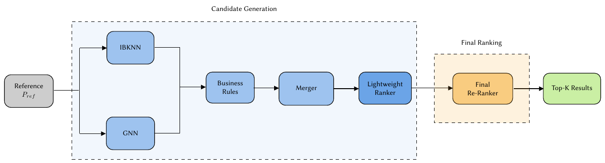

# Expedia similar vacation rentals: retrieval swaps Hotel2Vec for a heterogeneous-graph GNN that complements ItemCF, Recall@300 +14.8%

> [中文版](expedia-gnn-hybrid-cg.md)

### Paper: A Multi-Source Ensemble Approach to Candidate Generation for Alternative Vacation Rental Property Recommendations (RecTour 2026 workshop at RecSys)
### Link: https://arxiv.org/abs/2609.05748
### Institution: Expedia Group
### Ideas: multi-source retrieval, heterogeneous-graph link prediction, query/candidate dual embeddings, percentile-rank fusion
### Area: i2i retrieval (similar properties)

## Breakdown:
The paper adds a heterogeneous-graph GNN as a new retrieval source; merged with the existing ItemCF source, its candidates go to the existing LightGBM pre-ranker and final ranker. The aim is for ItemCF to cover the obvious, popular alternatives at the top and the GNN to fill in less obvious ones further down, with the two sources merged by taking the max of each candidate's within-source rank percentile.

The scenario is a vacation rental detail page: while a user views a property, a "similar properties" carousel sits below it. The platform has over 2 million active properties, each one different (from studios to ten-bedroom villas); recommendations must stay near the destination, availability changes daily, and new listings keep arriving. The original retrieval was IBKNN (overlap between the users who viewed two properties, i.e., ItemCF) plus Hotel2Vec (Word2Vec trained on click sessions as sentences, concatenated with attribute embeddings). IBKNN has nothing to offer for properties without interactions; Hotel2Vec learns only one-hop co-occurrence, and its A-to-B similarity equals B-to-A, so it can't learn "B is a good alternative to A, but not necessarily the reverse".

The full pipeline is two retrieval sources, business-rule filtering, merging, LightGBM pre-ranking, and final ranking (figure above). IBKNN, the business rules (filters on bookability, distance, rating, capacity, etc.), the pre-ranker and the final ranker all exist in the original system; the paper only adds the GNN retrieval source and changes how the two sources are merged.

### The new GNN retrieval source
**How the graph is built.** In substance there are three node types and two relations. The nodes are users, query-side properties (triggers) and candidate-side properties (targets); the relations are "a user viewed the query property" and "people who viewed query property A later booked candidate property B". Each property is split into a query-side and a candidate-side node, each learning its own embedding, so "B is a good alternative to A" and "A is a good alternative to B" can differ. The paper doesn't say whether edges are directed; according to Kumo's platform documentation each edge passes messages in both directions, and the asymmetry comes from splitting properties into two node types, not from edge direction. Viewing relations connect only to the query side, so a candidate-side property's embedding can come only from alternative relations and its own features. In the implementation, the graph is built by Kumo's graph learning platform directly from database tables, with each table row a node, so the two kinds of relation records (view records, alternative records) also become nodes, five types in all, and every relation costs an extra hop.

**Training objective.** Link prediction: given a query property, predict which candidate properties will become its alternatives in the next 7 days, with cross-entropy loss. An alternative is defined as a user viewing A and later booking B, with the two compatible in location and attributes.

**Message passing.** Two hops of neighbors are sampled for each query property. Hop 1 samples 48 alternative records and 64 view records; hop 2 samples 1 more per record, reaching the candidate property it was replaced by and the user who viewed it, respectively. Because relation records take up a hop, other properties viewed by the same user can't be reached within two hops; that takes four (property–view record–user–view record–property). Property nodes carry structural (bedrooms, capacity), location, policy (pets allowed, cancellation policy), quality (rating, review count) and 62 amenity features, so a new property without interactions can still get an embedding from these features. The paper doesn't say which GNN it uses, only the configuration: 128-dimensional node representations in each intermediate layer with a 64-dimensional final output, neighbor aggregation that combines sum, mean, min, max and standard deviation, GELU activation and LayerNorm. According to Kumo's platform documentation (not the paper), the platform's default GNN is a heterogeneous GNN with GraphSAGE-style neighbor sampling, a separate set of parameters per relation, and several aggregators used together, with the number of layers equal to the number of sampled hops; the paper's configuration matches it, so it is most likely this model with 2 layers.

**Output.** Two 64-dimensional embeddings per property (query and candidate). Candidate embeddings are indexed in FAISS; the query property's query embedding retrieves the top 1,000 by inner product.

### Merging the two sources
The existing system gave one source priority and let the other only fill remaining slots. The paper instead converts each source's scores, per query property, into rank percentiles (the top-ranked close to 1, the last close to 0), putting the two sources on the same scale; when a candidate is retrieved by both, the larger value is kept. The authors also tried min-max normalization; taking the max gave the most stable recall curves without weight tuning. 300 to 500 candidates are kept after merging and passed to the existing pre-ranker.

### Data and results
Training uses data from March to May 2025; testing uses "viewed A, later booked B" property pairs from June, which enter neither the graph nor the index. Offline only, no A/B.
* **GNN alone vs. Hotel2Vec.** Relative recall gains of 48% to 68% across cutoffs; Recall@300 goes from 26.6% to 41.4%.
* **Division of labor.** At the retrieval stage, IBKNN is stronger at the top (Recall@10 7.6% vs. 4.9%), while the GNN overtakes it by 500 (49.2% vs. 48.5%). The merged pool's Recall@300 is 44.3%, above either source (42.4%, 41.4%).
* **Full system vs. the original.** With both the retrieval source and the merge method changed, and the same existing pre-ranker applied, Recall@300 goes from 39.9% to 45.8% (+14.8% relative); Recall@10 is essentially unchanged (7.8% to 7.9%).
* **Final ranking.** With the final ranker's architecture unchanged but retrained on each candidate pool, booking NDCG@5 goes from 0.345 to 0.365.

## Takeaways
* When merging retrieval sources, convert each source's scores to within-source rank percentiles and take the max: no weight tuning, no worry about differing score scales.
* Splitting each item into a query side and a candidate side with separate embeddings lets the alternative relation be asymmetric.
* After a new retrieval source launches, the final ranker must be retrained on the new candidate pool to realize the gain, and evaluation should separate these two effects.

## Caveats
* No A/B. The final-ranking gain compares rankers retrained on their own candidate pools, so the pool change and the retraining are mixed together.
* The +14.8% includes two changes at once: swapping Hotel2Vec for the GNN, and replacing priority-and-fill merging with max of rank percentiles. The original system's Recall@300 after pre-ranking (39.9%) is even lower than IBKNN alone at retrieval (42.4%); the two numbers come from different stages, but this hints that part of the gain may come from the merge method.
* The GNN is supervised directly on "viewed A, booked B" pairs, the same definition as the test set, while Hotel2Vec is an unsupervised co-occurrence embedding. How much of the 48%–68% gap comes from graph structure versus the supervision signal can't be separated, and the paper doesn't compare against a supervised two-tower model or graph methods such as LightGCN.
* The three GNN ablations don't line up. The best configuration (48 label neighbors, 64 dimensions, full features) reaches 41.4% Recall@300, but 48 neighbors gives 40.5% in the neighbor ablation and full features gives 39.8% in the feature ablation; the base configuration of each ablation isn't made clear. All results come from a single one-month test window without confidence intervals.
* Cold start is the main motivation for adding the GNN, yet recall isn't reported separately for new or low-interaction properties.
* The paper doesn't state which of the platform's modes and architectures the GNN uses (it can only be inferred from the platform documentation), nor how negatives are sampled; training relies on a commercial graph learning platform, and neither data nor model is released, so reproducibility is limited.

The authors state nearly all of these points themselves in their limitations section.

## Credibility: offline

## Recommendation level: worth a look if you have time
