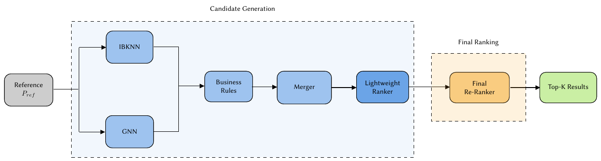

# Expedia 度假房源相似推荐：召回把 Hotel2Vec 换成异构图 GNN，和 ItemCF 互补，Recall@300 +14.8%

关注我，每天为你精挑细选最优质、最新鲜的推荐算法paper，陪你一起保持进步、不断精进！

> [English version](expedia-gnn-hybrid-cg.full.en.md)

### 论文：A Multi-Source Ensemble Approach to Candidate Generation for Alternative Vacation Rental Property Recommendations
### 网址：https://arxiv.org/abs/2609.05748
### 公司：Expedia Group
### 思想：多路召回、异构图链接预测、查询/候选双向量、百分位排名融合
### 方向：i2i 召回（相似房源）

## 解读：
本文提出了一个异构图 GNN作为新的一路召回，和已有的 ItemCF 召回合并后，交给已有的 LightGBM 粗排和精排。目的是ItemCF 管前排的热门替代，GNN 补后排的冷门替代，两路按各自的排名百分位取最大值合并。

场景是度假房源的详情页，用户在看一个房源时，下面有一栏「相似房源」。平台有 200 多万个在架房源，每个房源都不一样（单间到十卧别墅），只能在目的地附近推，可订状态天天变，新房源源源不断。原来的召回是 IBKNN（看过两个房源的用户重合度，即 ItemCF）加 Hotel2Vec（把点击 session 当句子训 Word2Vec，再拼上属性向量）。IBKNN 碰到没互动的房源就没辙；Hotel2Vec 只学一跳共现，而且 A 和 B 的相似度与 B 和 A 的一样，学不出「B 是 A 的好替代，反过来不一定」。

整条链路是两路召回、业务规则过滤、合并、LightGBM 粗排、精排（上图）。其中 IBKNN、业务规则（可订、距离、评分、可住人数等过滤）、粗排和精排都是原系统已有的，本文只新增了 GNN 这一路召回，并换了两路的合并方式。

### 新增的 GNN 召回
**建图。** 实质上是三类节点、两类关系。节点是用户、查询方房源（trigger）、候选方房源（target）；关系是「用户看过查询房源」和「看了查询房源 A 的人后来订了候选房源 B」。同一个房源拆成查询方和候选方两个节点，各学一套向量，「B 是 A 的好替代」和「A 是 B 的好替代」就可以不一样。论文没说边有没有方向；按 Kumo 平台文档，每条边在消息传递时是双向的，不对称靠把房源拆成两类节点，不靠边的方向。浏览关系只连查询方，候选方房源的向量只能从替代关系和自身特征来。具体实现上，图由 Kumo 图学习平台直接从数据库表建出来，每张表的一行是一个节点，所以两类关系记录（浏览记录、替代记录）本身也成了节点，共五类，每条关系要多走一跳。

**训练目标。** 链接预测。给定查询房源，预测未来 7 天里哪些候选房源会成为它的替代，交叉熵损失。替代的定义是用户看了 A、之后订了 B，并且两者在地理位置和属性上兼容。

**消息传递。** 每个查询房源采两跳邻居。第一跳采 48 条替代记录和 64 条浏览记录，第二跳每条记录再采 1 个，分别到达被替代成的候选房源和看过它的用户。因为关系记录占了一跳，两跳之内碰不到同一个用户看过的其他房源，那需要「房源–浏览记录–用户–浏览记录–房源」四跳。房源节点带结构（卧室数、可住人数）、位置、政策（能否带宠物、取消政策）、质量（评分、评论数）和 62 个设施特征，新房源没有互动也能靠这些特征得到向量。论文没说用的是哪种 GNN，只给了配置。中间每层的节点表示 128 维，最后输出 64 维，邻居聚合同时用求和、均值、最小、最大、标准差五种再合起来，GELU 激活加 LayerNorm。按 Kumo 平台文档（不是论文），平台默认的 GNN 是 GraphSAGE 式邻居采样、每种关系一套参数、同时用多种聚合方式的异构 GNN，层数等于采样跳数；论文的配置和它吻合，大概率就是这个，即 2 层。

**产出。** 每个房源两个 64 维向量（查询向量、候选向量）。候选向量建 FAISS 索引，用查询房源的查询向量做内积检索，取前 1000。

### 两路合并
原系统是一路优先、另一路只补空位。本文改成每一路内部按查询房源把分数换成排名百分位（排第一的接近 1，排最后的接近 0），两路的分数就到了同一个尺度；同一个候选两路都召回时取较大的那个。作者也试过 min-max 归一化，取最大值的 Recall 曲线最稳，也不用调权重。合并后保留 300 到 500 个，交给原有的粗排。

### 数据与效果
训练用 2025 年 3 到 5 月的数据，测试用 6 月「看了 A、后来订了 B」的房源对，测试对不进图、不进索引。只有离线实验，没有 A/B。
* **GNN 单路对比 Hotel2Vec。** Recall 各档相对提升 48% 到 68%，Recall@300 从 26.6% 到 41.4%。
* **两路分工。** 召回阶段单看，前排 IBKNN 更强（Recall@10 为 7.6% 对 4.9%），到 500 GNN 反超（49.2% 对 48.5%）。合并后 Recall@300 为 44.3%，高于任一路（42.4%、41.4%）。
* **整套对比原系统。** 召回源和合并方式都换掉后，同样经原有粗排排序，Recall@300 从 39.9% 到 45.8%（相对 +14.8%），Recall@10 基本不变（7.8% 到 7.9%）。
* **精排效果。** 精排结构不变，在各自候选池上重训，预订 NDCG@5 从 0.345 到 0.365。

## 心得：

## 愚见
* 论文没写明 GNN 用的是平台的哪种模式和结构（只能对照平台文档推断），负采样方式也没交代，训练依托商业图学习平台，数据和模型也未公开，复现性有限。

## 可信度：离线

## 推荐等级：有时间看看

**请帮忙点赞、转发，谢谢。欢迎干货投稿 \ 论文宣传\ 合作交流**

### 【铁粉】请入微信群，群内我会给出更深入的解读，还可以共同讨论技术方案、发招聘广告、内推和交友等。
* 铁粉标准：关注公众号一个月以上，且在公众号上累计15次互动（评论、爱心、转发）、或投稿1次，只欢迎技术同学。
* 入群方法：请您加个人微信lmxhappy，我拉您入群，请备注【公司】（只我个人看，不公开）。

## 推荐您继续阅读：
* [Vrbo 长尾房源召回，LLM 生成查询补 ItemCF 的空，免训练](../long-tail/vrbo-llm-candidate-gen.md)（同一栏「相似房源」的另一条召回）
