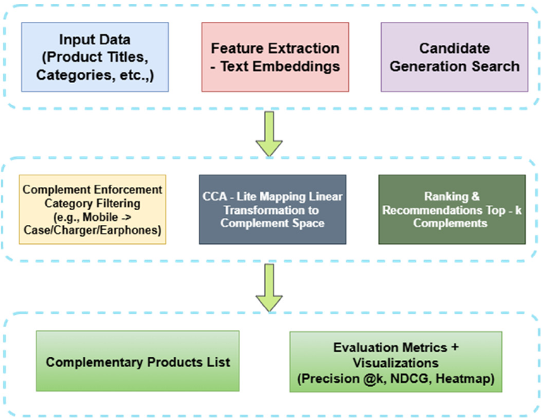

# Electronics accessory recommendation: TF-IDF retrieves candidates, category rules filter out substitutes, and CCA learns two linear projections to align main products with accessories

> [中文版](giet-cca-lite.md)

### Paper: A Lightweight CCA-Based Framework for Complementary Product Recommendation Using Textual Embeddings (ETASR 2026)
### Link: https://doi.org/10.48084/etasr.18014
### Institution: GIET University, Nadimpalli Satyanarayana Raju Institute of Technology (India)
### Ideas: TF-IDF, KNN candidates, category complement rules, canonical correlation analysis (CCA)
### Area: i2i (complementary item recommendation)

## Breakdown:
Complementary recommendation using only product titles and descriptions: after TF-IDF encoding, nearest neighbors are first retrieved by cosine, then hand-written category rules (laptop → charger, mouse, bag) filter out non-complementary categories, and finally CCA learns two linear projections that map main products and accessories into one space, where candidates are ranked by cosine.

The scenario is recommending accessories for an electronic product, e.g., a phone case, charger and earphones after buying a phone. The authors argue that ranking by text similarity mostly finds same-type products, i.e., substitutes, while accessories' text is often unlike the main product's ("phone" and "phone case" are described very differently), so a space that aligns across categories is needed.

### Method
Four steps in order.
* **TF-IDF encoding.** Titles and descriptions are TF-IDF encoded (term frequency–inverse document frequency: a word gets more weight the more often it appears in this product's text and the less often in other products'), giving each product a sparse vector with one dimension per word.
* **KNN candidates.** KNN (k-nearest neighbors) retrieves the 10 products most similar to the query by cosine.
* **Category rule filtering.** Each category's complementary categories are written by hand (e.g., phone → earphones, case, screen protector), and candidates whose category isn't on the list are dropped.
* **CCA mapping and ranking.** Three steps:
  * **Dimensionality reduction.** The TF-IDF vectors of all products (main products and accessories) are normalized, then reduced with PCA (principal component analysis). At inference, the query goes through the same PCA.
  * **Learning projections.** Using (main product, accessory) pairs as training samples, CCA (canonical correlation analysis) learns one linear projection for the main-product side and one for the accessory side, maximizing the correlation of paired items after projection. "Lite" means solving it with truncated eigendecomposition instead of full matrix inversion.
  * **Ranking.** The query is mapped with the main-product projection, compared by cosine with accessory-side projected vectors, and the top k are taken.

### Data and results
The data is the Kaggle dataset "Amazon Electronics Products 10k items - 2023", from which 9,500 electronic products in 8 categories were curated, each main product paired with 3 to 4 complementary products built from "product relationships and category-level associations". Offline only.
* **Versus baselines.** Precision@3 (share of correct complements among the top 3) is 0.82, vs. 0.75 for the strongest baseline (personalized PageRank: random walks over a product relation graph starting from the query, ranking by arrival probability) and 0.65 for TF-IDF plus KNN; NDCG@3 (a ranking metric that rewards correct items ranked higher) is 0.79 vs. 0.73; MRR (mean reciprocal rank of the first correct answer) 0.71 vs. 0.64. 2.9 ms per query.
* **Ablation.** Removing the CCA mapping and using raw TF-IDF drops Precision@3 to 0.68; removing the category filter drops it to 0.60.

## Takeaways
* Complements' text is often unlike the main product's, so nearest neighbors in a single text space are mostly substitutes; learning a separate projection for each side that pulls pairs together is a very lightweight fix.
* Category-level complement rules are simple and direct, and filter out most substitutes up front.

## Caveats
* The labels and the method rely on the same category associations. Complementary pairs are built "from product relationships and category-level associations", and the method filters by category rules, so the evaluation partly tests agreement with its own rules. The dataset has no behavioral data such as co-purchases, and the paper doesn't detail how the labels were made.
* The pipeline doesn't hang together. The paper itself says TF-IDF similarity mostly finds same-type substitutes, yet the second step takes exactly the 10 most similar by TF-IDF cosine and then filters by complementary category, which should leave very few candidates. Whether CCA re-ranks these 10 or searches all accessories isn't explained.
* Evaluation details are missing: how CCA's training and test data are split, how large the candidate pool is, and how many dimensions PCA and CCA reduce to. The "Logistic Re-ranker" baseline cites a re-ranking paper that needs user behavior sequences, and how it was implemented on text-only data isn't explained.
* Several details don't match. The text says 8 categories but Figure 2 shows only 5; the method section opens by saying deep learning models are used, but none are; the conclusion's 26% precision gain is computed against the weakest baseline, and against the strongest it's 9%.

## Credibility: offline

## Recommendation level: worth a look if you have time
