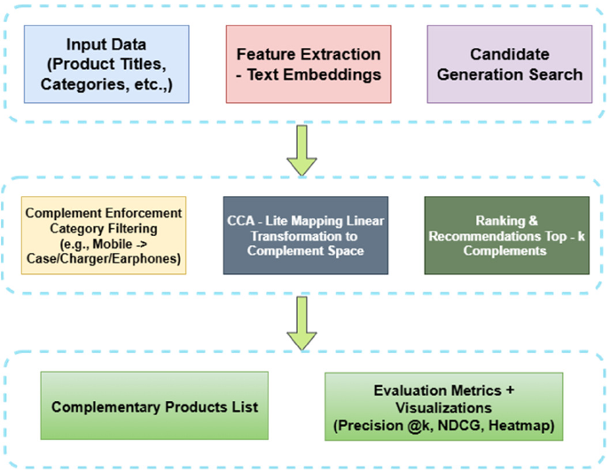

# 电子产品配件推荐：TF-IDF 取候选，类目规则筛掉替代品，CCA 学两套线性投影把主商品和配件对齐

关注我，每天为你精挑细选最优质、最新鲜的推荐算法paper，陪你一起保持进步、不断精进！

> [English version](giet-cca-lite.full.en.md)

### 论文：A Lightweight CCA-Based Framework for Complementary Product Recommendation Using Textual Embeddings
### 网址：https://doi.org/10.48084/etasr.18014
### 公司：GIET 大学、Nadimpalli Satyanarayana Raju 理工学院（印度）
### 思想：TF-IDF、KNN 候选、类目互补规则、典型相关分析（CCA）
### 方向：i2i（互补品推荐）

## 解读：
只用商品的标题和描述做互补推荐：TF-IDF 编码后先按余弦取近邻，再用人工写的类目规则（笔记本 → 充电器、鼠标、包）筛掉非互补类目，最后用 CCA 学两套线性投影，把主商品和配件映射到同一个空间里按余弦排序。

场景是给一件电子产品推配件，比如买了手机推手机壳、充电器、耳机。作者认为，按文本相似度找出来的多是同类商品，也就是替代品，而配件和主商品的文字往往不像（「手机」和「手机壳」描述差很远），所以要换一个能跨类目对齐的空间。

### 方法
按顺序分四步。
* **TF-IDF 编码。** 标题和描述做 TF-IDF（词频–逆文档频率：一个词在这件商品的文字里出现越多、在其他商品里出现越少，权重越高），每件商品得到一个稀疏向量，每一维对应一个词。
* **KNN 取候选。** 用 KNN（k 近邻）按余弦相似度取和查询商品最像的 10 件。
* **类目规则过滤。** 人工写好每个类目的互补类目（如手机 → 耳机、手机壳、贴膜），候选的类目不在名单里就删掉。
* **CCA 映射与排序。** 分三步：
  * **降维。** 所有商品（主商品和配件）的 TF-IDF 向量先归一化，再用 PCA（主成分分析）降维。推理时查询商品也用同一个 PCA 降维。
  * **学投影。** 拿（主商品，配件）配对当训练样本做 CCA（典型相关分析），给主商品一侧和配件一侧各学一个线性投影，使配对的两边投影后相关性最大。「Lite」指求解时用截断的特征值分解，代替完整的矩阵求逆。
  * **排序。** 把查询商品用主商品一侧的投影映射过去，和配件一侧投影后的向量算余弦，取前 k 个。

### 数据与效果
数据是 Kaggle 上的「Amazon Electronics Products 10k items - 2023」，从中整理出 9,500 件电子产品、8 个类目，每件主商品配 3 到 4 件互补商品，按「商品关系和类目级关联」构造。只有离线实验。
* **对比基线。** Precision@3（前 3 个推荐里正确互补品的占比）为 0.82，最强基线（个性化 PageRank：从查询商品出发在商品关系图上随机游走，按到达概率排序）0.75，TF-IDF 加 KNN 为 0.65；NDCG@3（考虑排名位置的排序指标，排得越靠前得分越高）为 0.79 对 0.73；MRR（第一个正确答案排名倒数的平均值）0.71 对 0.64。每个查询 2.9 毫秒。
* **消融。** 去掉 CCA 映射、直接用 TF-IDF，Precision@3 降到 0.68；去掉类目过滤降到 0.60。

## 心得：

## 愚见

## 可信度：离线

## 推荐等级：有时间看看

**请帮忙点赞、转发，谢谢。欢迎干货投稿 \ 论文宣传\ 合作交流**

### 【铁粉】请入微信群，群内我会给出更深入的解读，还可以共同讨论技术方案、发招聘广告、内推和交友等。
* 铁粉标准：关注公众号一个月以上，且在公众号上累计15次互动（评论、爱心、转发）、或投稿1次，只欢迎技术同学。
* 入群方法：请您加个人微信lmxhappy，我拉您入群，请备注【公司】（只我个人看，不公开）。

## 推荐您继续阅读：
