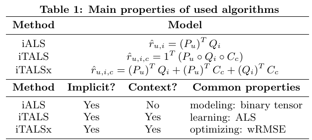

# Context-aware i2i from 2013: learn item vectors with time-band-aware tensor factorization, and let the similarity itself change with the time band

> [中文版](gravity-ca-i2i-factorization.md)

### Paper: Context-aware item-to-item recommendation within the factorization framework (CaRR 2013)
### Link: https://doi.org/10.1145/2442670.2442675
### Institution: Gravity R&D, Budapest University of Technology and Economics
### Ideas: implicit-feedback tensor factorization (iTALS, iTALSx), item-vector similarity, context-dependent similarity
### Area: i2i (similar items)

## Breakdown:
Item vectors learned by factorization models are used to compute similarities for i2i, and the paper brings in context (the time band in which an event happens) at two levels: the first uses context only when training the factorization model, leaving the similarity itself unchanged; the second makes the similarity change with the current time band, so the same item gets different similar items in different time bands.

The scenario is non-personalized i2i: while a user views an item, a list of "items similar to this" is shown, depending only on the item, not on who is viewing. Factorization models are accurate and scalable for personalized recommendation, and the authors want to carry them over to i2i, finding similar items by the similarity between item vectors. All data are implicit feedback (views, purchases, listens), with no ratings. Context means a property of the event itself, here the time band: the hour of the day or the day of the week. The paper appeared at the CaRR 2013 workshop; the first author, Hidasi, later proposed GRU4Rec, but this is earlier work unrelated to GRU4Rec.

### Method
Two steps: first train factorization models on "user × item × time band" interaction data to get a vector for each item and each time band; then define item-to-item similarity with these vectors.

#### (1) Training context-aware factorization models
All three models are existing methods from the authors' group (table above). They share the same setup: the interaction data is treated as a 0/1 matrix or tensor (1 if there was an interaction, 0 otherwise), trained with weighted squared error (1s weigh more) and solved with alternating least squares (ALS).
* **iALS.** The context-free baseline: the inner product of user and item vectors approximates whether this user interacted with this item.
* **iTALS.** Adds a time-band dimension: the user, item and time-band vectors are multiplied element-wise and summed. The time-band vector acts as a per-dimension weight, so the user–item relation is reweighted differently in different time bands.
* **iTALSx.** Pairwise inner products of the three vectors, added up: user·item + user·time band + item·time band. The time band's effect on users and on items is modeled separately.

**How time bands are defined.** The online grocery data is split by day of week; the other datasets by 4-hour windows of the day. The authors also tried time bands clustered automatically from the data.

Note that all these models are trained to predict user–item interactions, with no item-to-item supervision at all; the authors assume a well-trained factorization model gives similar items similar vectors.

#### (2) How similarity is computed at inference: two levels
The previous step learns a vector for each item and for each time band. This step uses them to compute "how similar items A and B are"; the difference is whether the time band takes part in that computation. This step is the scoring used at inference and involves no training; it just plugs the vectors learned in the previous step into formulas. Training happens only in the previous step, and its objective is predicting user–item interactions, not item-to-item similarity.

* **Level 1: the time band doesn't take part.** The similarity is just the cosine of the two item vectors. The time band was used only in training in the previous step, to help the model learn item vectors more accurately. As a result, the same program gets the same similar programs in the morning and in the evening.
* **Level 2: the time band takes part.** The similarity also depends on the current time band, so the same program can get different similar programs in different time bands. As an example (my own), after watching a news show in the morning, recommendations lean toward other morning programs; after watching the same show in the evening, they lean toward evening news and dramas. There are two formulas, one for each model's scoring structure, obtained by replacing the user vector in the model's scoring formula with the second item's vector:
  * **iTALS version: the time band reweights each dimension.** The two item vectors are multiplied element-wise, each dimension is further multiplied by the matching dimension of the time-band vector, and the result is summed (then normalized). Think of each dimension of an item vector as a latent feature; the time-band vector decides which features matter in the current time band, and items alike on the features that matter get a high similarity. When the time-band vector is poorly learned, every dimension's weight is skewed and the results are very unstable.
  * **iTALSx version: time-band bonuses and penalties on top of level 1.** Similarity = the cosine of the two item vectors (i.e., level 1) + the cosine of item A and the current time band + the cosine of item B and the current time band. The last two terms measure whether the current time band favors each item, adding a bonus if so and a penalty if not. Because the level-1 term is always there, a poorly learned time band can't make things too bad, so it's more stable. A variant that normalizes the time-band vector is called iTALSxN.

**Cosine or inner product.** Both were tried. The inner product favors items with longer vectors, and popular items usually have longer vectors, so the inner product is more accurate but concentrates recommendations on popular items.

**Producing the list.** Given the item the user is viewing and the current time band, compute its similarity to all items with the formulas above and take the top 20. Level 1 doesn't depend on the time band, so each item's similar-item list can be computed once offline; level 2 does, but there are only a few time bands (7 days of the week, or 6 bands of the day), so one copy can be computed offline per time band and looked up online by the current band.

### Data and results
Four implicit-feedback datasets: online grocery (25K users, 17K items, 6.2M events), two IPTV sets (TV1 with 773 programs, TV2 with 3,398), and LastFM 1K (artists as items). Training and test are split by time. Offline only.

**Evaluation.** There are no "similar item" labels, so the authors use consecutive behavior as a proxy: for each event in the test set, find the same user's previous event within 24 hours, generate an i2i list from that previous event's item, and check whether the current item is in the top 20. Metrics are Recall@20, MAP@20 and coverage (the share of all items that were recommended at some point during the test period).
* **Level 1.** Stable but small gains; coverage mostly rises (on grocery with cosine, from 88.8% to about 94%). With the inner product, grocery improves clearly: the iTALS version's Recall@20 rises from 0.071 to 0.132.
* **Level 2, iTALS version.** Extremely sensitive to the quality of the time bands. On TV1 with automatically clustered time bands, Recall@20 is 7 to 9 times the baseline (0.527 vs. 0.059 with cosine); on TV2 with manual time bands, Recall@20 falls from 0.217 to 0.018.
* **Level 2, iTALSx version.** About the same as the baseline on most datasets, with small swings; a clear gain on TV1 (inner-product Recall@20 of 0.084 vs. 0.055 for the baseline).

The authors conclude that no method wins across the board: level 1 is safe to use, the iTALSx version of level 2 is fairly safe too, and the iTALS version of level 2 brings both large gains and large risks, depending on how well the time bands are chosen.

## Takeaways
* Item vectors learned by factorization models can be used directly for i2i, with no item-to-item labels needed.
* Context can be used just to learn item vectors more accurately, or can enter the similarity itself so the recommendation list changes with the time band; the latter pays off more but is very sensitive to context quality.
* Inner product vs. cosine is a trade-off between accuracy and coverage: the inner product favors popular items.

## Caveats
* The evaluation takes "the next action within 24 hours" as the ground truth for similar items, which measures sequential behavior rather than necessarily similarity. Level-2 similarity happens to use time-band information, which fits naturally with labels defined by temporal order and may overstate its benefit.
* In Table 4, TV2's context-free baseline Recall@20 is 0.0657, while in Table 3 it's 0.2167. The baseline doesn't use context, so changing the time-band definition shouldn't change its result; 0.0657 is exactly TV2's baseline MAP@20, so it looks like a copy error.
* Section 3.2 writes item vectors as P_i and P_j, but in Table 1 P is the user matrix and Q the item matrix, so the notation is inconsistent.
* The most striking result, a 7 to 9 times gain on TV1, relies on automatically clustered time bands, a method cited only to the authors' internal technical report and not explained. All results come from a single time split with no significance testing, the methods trade wins, and the paper offers no way to judge in advance whether a time-band definition is good (the authors list this as future work in the conclusion).

## Credibility: offline

## Recommendation level: worth a look if you have time
