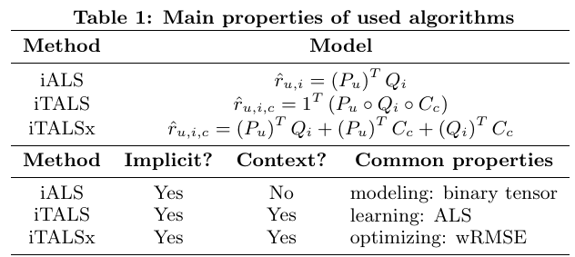

# 2013 年的上下文 i2i：用带时段的张量分解学商品向量，相似度本身也可以随时段变化

关注我，每天为你精挑细选最优质、最新鲜的推荐算法paper，陪你一起保持进步、不断精进！

> [English version](gravity-ca-i2i-factorization.full.en.md)

### 论文：Context-aware item-to-item recommendation within the factorization framework
### 网址：https://doi.org/10.1145/2442670.2442675
### 公司：Gravity R&D、布达佩斯技术与经济大学
### 思想：隐式反馈张量分解（iTALS、iTALSx）、商品向量相似度、随上下文变化的相似度
### 方向：i2i（相似商品）

## 解读：
用分解模型学到的商品向量算相似度做 i2i，本文把上下文（事件发生的时段）加进来，给出两级做法：第一级只在训练分解模型时用上下文，相似度本身不变；第二级让相似度也随当前时段变化，同一件商品在不同时段推荐不同的相似商品。

场景是非个性化的 i2i：用户在看某件商品，下面列出「和它相似的商品」，列表只取决于这件商品，和是谁在看无关。分解模型在个性化推荐上又准又能扩展，作者想把它搬到 i2i 上，用商品向量之间的相似度来找相似商品。数据都是隐式反馈（浏览、购买、收听），没有评分。上下文指的是事件本身的属性，这里用的是时段：一天里的几点、一周里的星期几。

### 方法
分两步：先在「用户 × 商品 × 时段」的交互数据上训练分解模型，得到每件商品、每个时段的向量；再用这些向量定义商品之间的相似度。

#### （1）训练带上下文的分解模型
三个模型都是作者组里已有的方法（上表），共同点是把交互数据当成 0/1 的矩阵或张量（有过交互记 1，否则记 0），用加权平方误差训练（1 的权重更高），用交替最小二乘（ALS）求解。
* **iALS。** 不带上下文的基线：用户向量和商品向量的内积，近似这个用户和这件商品有没有交互。
* **iTALS。** 多一个时段维度：用户、商品、时段三个向量逐维相乘再求和。时段向量相当于给每一维加权，时段不同，用户和商品的关系就被重新加权。
* **iTALSx。** 三个向量两两内积再相加：用户·商品 + 用户·时段 + 商品·时段。时段对用户、对商品的影响分开建模。

**时段怎么定义。** 生鲜电商的数据按星期几分，其余数据集按一天里每 4 小时一段分。作者还试了按数据自动聚类出时段。

注意，这些模型训练的目标都是预测用户和商品的交互，没有任何商品对商品的监督；作者假设学得好的分解模型会给相似的商品学出相似的向量。

#### （2）推理时怎么算相似度：两级
上一步给每件商品学出一个向量，也给每个时段学出一个向量。这一步用它们算「商品 A 和商品 B 有多像」，区别在于时段要不要参与这个计算。这一步就是推理时的打分方式，不需要训练，只是拿上一步学好的向量套公式；训练只在上一步，而且训练目标是预测用户和商品的交互，不是商品之间的相似度。

* **第一级：时段不参与。** 相似度就是两件商品向量的余弦。时段只在上一步训练时用过，帮模型把商品向量学准。结果是同一部节目，早上和晚上推荐的相似节目都一样。
* **第二级：时段参与。** 相似度还要看当前是哪个时段，同一部节目在不同时段推荐的相似节目可以不同。举个例子（例子是我编的），早上看了一档新闻，推荐偏向其他早间节目；晚上看了同一档新闻，推荐偏向晚间新闻和电视剧。具体有两种算法，分别对应两个模型的打分方式，写法是把模型打分公式里的用户向量换成第二件商品的向量：
  * **iTALS 版：时段给每一维重新加权。** 两件商品的向量逐维相乘，每一维再乘上时段向量对应的那一维，最后求和（再归一化）。可以把商品向量的每一维想成一种隐含特征，时段向量决定当前时段看重哪些特征，被看重的特征上相像的商品，相似度就高。时段向量学得不好时，每一维的权重都会被带偏，结果很不稳定。
  * **iTALSx 版：在第一级的基础上按时段加分减分。** 相似度 = 两件商品向量的余弦（就是第一级）+ 商品 A 和当前时段的余弦 + 商品 B 和当前时段的余弦。后两项衡量当前时段是否偏爱这件商品，偏爱就加分，不偏爱就减分。第一级那一项一直都在，时段学得不好也不至于太差，所以更稳定。另有一个把时段向量归一化的变体 iTALSxN。

**余弦还是内积。** 两种都试了。内积偏向向量长度大的商品，而热门商品的向量通常更长，所以内积准确率更高，但推荐更集中在热门商品上。

**出推荐列表。** 给定用户正在看的商品和当前时段，按上面的公式算它和所有商品的相似度，取前 20 个。第一级和时段无关，每件商品的相似列表可以离线一次算好；第二级和时段有关，但时段只有几个（一周 7 天，或一天 6 段），可以每个时段各离线算一份，线上按当前时段查表。

### 数据与效果
四个隐式反馈数据集：生鲜电商（2.5 万用户、1.7 万商品、620 万事件）、两个 IPTV（TV1 有 773 个节目，TV2 有 3,398 个）、LastFM 1K（以歌手为商品）。按时间切分训练和测试。只有离线实验。

**评测方式。** 没有现成的「相似商品」标注，作者用前后行为来代替：测试集里每个事件，找同一个用户 24 小时内的上一个事件，拿上一个事件的商品生成 i2i 列表，看当前这件商品在不在前 20 个里。指标是 Recall@20、MAP@20，以及覆盖率（测试期内被推荐过的商品占全部商品的比例）。
* **第一级。** 稳定但提升小，覆盖率多数提高（生鲜电商用余弦时从 88.8% 提到 94% 左右）。用内积时生鲜电商提升明显，iTALS 版 Recall@20 从 0.071 提到 0.132。
* **第二级 iTALS 版。** 对时段的质量极其敏感。TV1 用自动聚类的时段，Recall@20 是基线的 7 到 9 倍（余弦 0.527 对 0.059）；TV2 用人工时段，Recall@20 从 0.217 跌到 0.018。
* **第二级 iTALSx 版。** 多数数据集上和基线差不多，起伏小；TV1 上提升明显（内积 Recall@20 为 0.084，基线 0.055）。

作者的结论是没有一种方法全面胜出：第一级可以放心用，第二级 iTALSx 版也比较安全，第二级 iTALS 版收益和风险都很大，取决于时段选得好不好。

## 心得：

## 愚见

## 可信度：离线

## 推荐等级：有时间看看

**请帮忙点赞、转发，谢谢。欢迎干货投稿 \ 论文宣传\ 合作交流**

### 【铁粉】请入微信群，群内我会给出更深入的解读，还可以共同讨论技术方案、发招聘广告、内推和交友等。
* 铁粉标准：关注公众号一个月以上，且在公众号上累计15次互动（评论、爱心、转发）、或投稿1次，只欢迎技术同学。
* 入群方法：请您加个人微信lmxhappy，我拉您入群，请备注【公司】（只我个人看，不公开）。

## 推荐您继续阅读：
