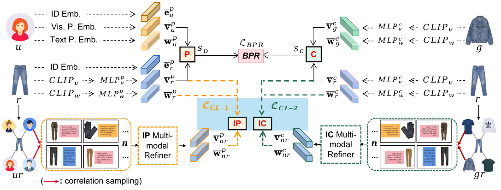

# Personalized outfit completion: match a bottom to a given top by the user's taste, build an "indirect representation" of each candidate bottom from similar users and similar items, and align it contrastively

> [中文版](hkust-apcl.md)

### Paper: Adaptive Preference Modeling via Explicit Indirect Relational Learning for Personalized Fashion Matching
### Link: https://arxiv.org/abs/2609.21475
### Institution: The Hong Kong University of Science and Technology
### Ideas: preference score + compatibility score, BPR, similar-user sampling, multimodal aggregation, contrastive alignment of direct and indirect representations
### Area: i2i (personalized fashion matching, with users)

## Breakdown:
APCL keeps GP-BPR's scoring: the sum of two scores. The first is the compatibility score: the frozen CLIP image features of the given item and the candidate pass through the same MLP and one cosine is taken, the text features pass through another shared MLP and a second cosine is taken, and the two cosines are added with weights. The second is the user preference score: each user has three learned vectors, for ID, image and text, each compared by cosine with the candidate's representation of the same type, plus biases. The two scores are summed and trained with BPR.

To help candidates with few interactions, during training only it builds two indirect representations for each candidate: one from items chosen by similar users, the other from items that have been matched with the same garments as the candidate. Both are first selected and aggregated with attention, then pulled by InfoNCE toward the candidate's direct preference representation and direct compatibility representation, respectively. At inference, neither indirect representation is used.

The scenario is personalized outfit completion: given a user u and a top g, recommend a bottom r that both goes with the top and suits this user's taste (and vice versa, matching a top to a bottom), the same setup as GP-BPR. The difficulty is sparsity: fashion items turn over fast and have short lifecycles, and most candidate bottoms have only 0 to 2 interactions.

### Model architecture
The four modules form pairs: for each of the two aspects, preference and compatibility, there is one direct module and one indirect module (P with IP, C with IC). The upper half of the figure is the two direct modules; the final score = preference score + compatibility score, trained with BPR. The lower half is the two indirect modules, each building an indirect representation of the candidate bottom that a contrastive loss pulls toward the representation in the matching direct module during training (IP toward P, IC toward C); they don't enter the score.

**Item features.** Each garment's image goes into a pretrained CLIP image encoder and its text description into the CLIP text encoder, each giving a feature vector. CLIP isn't trained; the features are extracted in advance and stored (the paper doesn't say which CLIP version). What the modules below actually train are the MLPs on top of the CLIP features.

#### Preference score (P)
Measures whether the user likes this bottom, following the VBPR line of work. Each user has three learnable vectors looked up by user ID (an ID vector, a visual preference vector and a textual preference vector), trained with BPR rather than computed from images of garments the user interacted with. Each is compared by cosine with one representation of the bottom:
* **ID preference score.** Cosine of the user ID vector and the bottom ID vector.
* **Visual preference score.** Cosine of the user's visual preference vector and the bottom's visual vector, which comes from the CLIP image feature passed through an MLP plus BatchNorm.
* **Textual preference score.** Cosine of the user's textual preference vector and the bottom's text vector, computed the same way.

Preference score = ID preference score + user bias + item bias + global bias + π × visual preference score + (1 − π) × textual preference score. Overall it amounts to a user–bottom two-tower model.

#### Compatibility score (C)
Measures whether the top and bottom go together. The CLIP image features of top and bottom each pass separately through the same MLP (shared parameters, plus BatchNorm) into the compatibility space, giving an image cosine; text features likewise give a text cosine. Compatibility score = π × image cosine + (1 − π) × text cosine, where π is a hyperparameter (the paper doesn't give its value). These MLPs are not shared with the preference score: the same CLIP features go through a different set of MLPs for the preference score, turning them into representations suited to judging user taste. Overall it is a top–bottom Siamese network.

#### Indirect preference (IP)
Builds a representation of candidate bottom r from similar users.
* **Finding similar users.** User similarity = number of items two users both interacted with, divided by the square root of the product of their interaction counts; each user keeps its top K similar users.
* **Selecting items.** From the bottoms these similar users chose, cross-attention picks n items related to r: with r as the query, each bottom gets an attention score, and n items are picked by score. The paper doesn't say which representations are used, how scores are turned into a pick of n, or what n is.
* **Aggregating.** The CLIP features of the n bottoms each pass through an MLP, giving n visual vectors and n text vectors, and each set of n is then compressed into one.
  * **Visual path.** The n items are treated as a sequence of length n (like n words in a sentence), and a 1D convolution slides over neighboring items, mixing the features of a few adjacent items (each kernel is d × k, covering all d dimensions of k adjacent items, so it mixes both neighboring items and different dimensions), followed by ReLU, followed by attention pooling: each item gets a weight and the vectors are summed with those weights.
  * **Text path.** Self-attention runs among the n items (a two-head Transformer with residuals and LayerNorm), then the mean and max over the n outputs are taken.

  This gives r's indirect visual vector and indirect text vector.

#### Indirect compatibility (IC)
Builds a representation of candidate bottom r from "bottoms with similar matching relations", corresponding to r's compatibility vectors in C. IP looks for information on the user side (what similar users chose); IC looks on the matching side (what bottoms that go with the same tops as r look like). The paper covers this part with a single sentence, "the same as IP"; pieced together from Figure 3, it works like this:
* **Finding related bottoms.** Starting from r, first find the tops it has been matched with (gr, bottom right of Figure 3), then see which other bottoms those tops have been matched with. Bottoms that go with the same tops are considered to have similar matching relations.
* **Selecting and aggregating.** The steps mirror IP: with r as the query, cross-attention picks n items; their CLIP features pass through an MLP, then the visual path does a 1D convolution plus attention pooling and the text path does self-attention plus mean and max pooling, giving r's indirect visual and textual compatibility vectors. Figure 3 draws this as a separate aggregation module from IP's; the paper doesn't say whether parameters are shared.

A contrastive loss pulls these toward r's compatibility vectors in C.

**Loss.** BPR requires positive (u, g, r+) to score above negative (u, g, r−). Two InfoNCE losses are added: pull r's visual and text vectors in P toward IP's indirect vectors, and those in C toward IC's, with BPR's r− as the negative. A temperature between 1 and 5 works best, and equal weights for BPR and the contrastive losses work best.

**Inference.** The score uses only the preference and compatibility scores; the indirect modules don't take part. The compatibility score is the cosine of top and bottom vectors, the preference score is a user–bottom cosine plus biases, and the vectors can all be precomputed.

### Data and results
Two public datasets: IQON3000 (3,236 users, ~140,000 garments) and Polyvore-519 (519 users, ~33,000 garments), keeping only outfits with exactly one top and one bottom. Offline only.
* **Matching a bottom to a top.** On IQON3000, AUC rises from 0.884 for the strongest reproducible baseline, CP-TransMatch, to 0.974, and HR@10 from 0.879 to 0.951; on Polyvore, AUC goes from 0.900 to 0.983.
* **Matching a top to a bottom.** Larger gains: on IQON3000, HR@10 goes from 0.625 to 0.859 (+37.4%), and NDCG@10 is up 71.4% relative.
* **Ablation.** Removing either the preference or the compatibility score drops performance a lot; matching bottoms to tops on IQON3000, removing the preference score drops AUC from 0.974 to 0.665.

## Takeaways
* Personalized matching can be split into "does the user like it" and "do the two go together", with the two scores simply added rather than traded off.
* Representations of sparse items can borrow data from similar users and similar items, used only as an alignment target during training, at no extra inference cost.
* The two views in contrastive learning can be split by relation source (direct interactions vs. indirect relations), not necessarily by modality.

## Caveats
* Per Algorithm 1, the indirect modules act only through the contrastive losses and don't enter the score. By that logic, once the contrastive losses are removed the indirect modules can't affect predictions, so "without indirect modules" and "without contrastive losses" should be equivalent; yet the ablation table gives different results (matching bottoms to tops on Polyvore, AUC 0.927 vs. 0.943), and Figure 6 even lists a separate "indirect modules, no contrastive loss" variant. The paper doesn't explain how the indirect modules affect predictions in that case.
* The text and Figure 3 say IC samples items with similar matching relations, but in Algorithm 1 IC and IP use the same set of items from similar users. IC's sampling is described only as "the same as IP", which leaves it unclear.
* The paper doesn't say how many candidates each query is ranked against for HR@10 and NDCG@10. A 71% relative NDCG@10 gain for matching tops to bottoms needs evaluation details to back it up. Some baselines (HMGL-OCM, etc.) are taken directly from their original papers rather than reproduced.
* The values of K and n aren't given. The contrastive loss uses only one negative, and a temperature of 1 to 5 is far above the usual 0.05 to 0.2, so the alignment constraint is weak.
* Only the simplified one-top-one-bottom setting is studied. Offline experiments only.

## Credibility: offline

## Recommendation level: worth a look if you have time
