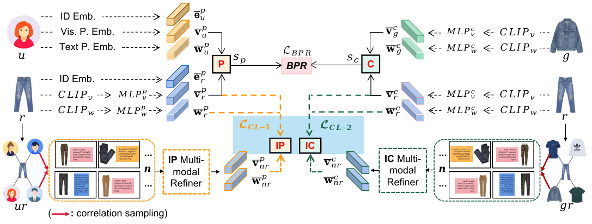

# 个性化穿搭补全：给定上衣按用户口味配下装，用相似用户、相似商品给候选下装造一份「间接表示」，对比学习对齐

关注我，每天为你精挑细选最优质、最新鲜的推荐算法paper，陪你一起保持进步、不断精进！

> [English version](hkust-apcl.full.en.md)

### 论文：Adaptive Preference Modeling via Explicit Indirect Relational Learning for Personalized Fashion Matching
### 网址：https://arxiv.org/abs/2609.21475
### 公司：香港科技大学
### 思想：偏好分 + 搭配分、BPR、相似用户采样、多模态聚合、直接与间接表示的对比学习
### 方向：i2i（个性化搭配，带用户）

## 解读：
APCL 沿用 GP-BPR 的打分方式，由两个分数相加而成。第一个是搭配分：给定物品和候选的冻结 CLIP 图像特征经同一个 MLP 投影后算一个余弦，文本特征经另一个共享 MLP 投影后再算一个余弦，两个余弦加权相加。第二个是用户偏好分：用户有三个学出来的向量，分别对应 ID、图像和文本，每个向量和候选同类型的表示算一个余弦，再加上偏置。两个分数相加后用 BPR 训练。

为了帮助互动很少的候选，它只在训练时为每个候选构造两份间接表示：一份来自相似用户选过的物品，另一份来自和候选搭配过同一批服装的物品。两份都先用注意力挑选、聚合，再通过 InfoNCE 分别拉近到候选的直接偏好表示和直接搭配表示上。推理时，这两份间接表示都不使用。

场景是个性化穿搭补全：给定用户 u 和一件上衣 g，推荐一条下装 r，既要和上衣搭，又要合这个用户的口味（反过来给下装配上衣也一样），设定和 GP-BPR 相同。难点是稀疏：服装上新快、生命周期短，大部分候选下装只有 0 到 2 次互动。

### 模型结构
四个模块是两两配对的关系：偏好、搭配两个方面，各有一个直接模块和一个间接模块（P 配 IP，C 配 IC）。上图上半部分是两个直接模块，最终分数 = 偏好分 + 搭配分，用 BPR 训练。下半部分是两个间接模块，各自给候选下装造一份间接表示，训练时用对比损失拉近到对应直接模块里的表示（IP 拉 P，IC 拉 C），不进分数。

**商品特征。** 每件衣服的图片送进预训练的 CLIP 图像编码器，文字描述送进 CLIP 文本编码器，各得到一个特征向量。CLIP 不参与训练，特征事先抽好存起来（论文没写用哪个版本的 CLIP）。下面各模块真正训练的是接在 CLIP 特征后面的 MLP。

#### 偏好分（P）
衡量用户喜不喜欢这条下装，沿用 VBPR 类做法。用户有三个按 ID 查表的可学习向量（ID 向量、视觉偏好向量、文本偏好向量），靠 BPR 训练出来，不是从他点过的衣服图片算出来的。三个向量各和下装的一种表示算余弦：
* **ID 偏好分。** 用户 ID 向量和下装 ID 向量的余弦。
* **视觉偏好分。** 用户视觉偏好向量和下装视觉向量的余弦，下装视觉向量由 CLIP 图像特征过 MLP 加 BatchNorm 得到。
* **文本偏好分。** 用户文本偏好向量和下装文本向量的余弦，做法同上。

偏好分 = ID 偏好分 + 用户偏置 + 商品偏置 + 全局偏置 + π × 视觉偏好分 + (1 − π) × 文本偏好分。整体相当于一个用户–下装的双塔。

#### 搭配分（C）
衡量上衣和下装搭不搭。上衣和下装的 CLIP 图像特征分别过同一个 MLP（参数共享，加 BatchNorm），各自投影到搭配空间后算一个图像余弦；文本特征同理，算一个文本余弦。搭配分 = π × 图像余弦 + (1 − π) × 文本余弦，π 是超参数（论文没给取值）。这里的 MLP 和偏好分的不共用，同一份 CLIP 特征进偏好分时走另一组 MLP，被改造成适合判断用户喜好的表示。整体就是一个上衣–下装的孪生网络（Siamese）。

#### 间接偏好（IP）
给候选下装 r 造一份来自相似用户的表示。
* **找相似用户。** 两个用户共同互动过的商品数，除以两人各自互动数之积的平方根，得到用户相似度，每个用户取前 K 个相似用户。
* **选商品。** 从这些相似用户选过的下装里，用交叉注意力挑出 n 件和 r 相关的：以 r 为查询，和每件下装算一个注意力分数，按分数挑出 n 件。论文没写用的是哪种表示，也没写怎么从分数变成挑 n 件、n 取多少。
* **聚合。** n 件下装的 CLIP 特征先各自过 MLP，得到 n 个视觉向量和 n 个文本向量，再各自把 n 个压成 1 个。
  * **视觉这路。** 把 n 件商品当成一个长度为 n 的序列（就像一句话里的 n 个词），用一维卷积在相邻几件商品之间滑动，把相邻几件的特征混合起来（每个卷积核的形状是 d × k，盖住相邻 k 件商品的全部 d 个维度，所以既混合相邻商品，也混合不同维度），再过 ReLU，再做注意力池化：每件商品算一个权重，加权求和。
  * **文本这路。** n 件商品之间做自注意力（两头的 Transformer，带残差和 LayerNorm），再对 n 个结果取均值和最大值。

  得到 r 的间接视觉向量和间接文本向量。

#### 间接搭配（IC）
给候选下装 r 造一份来自「搭配关系相近的下装」的表示，对应 C 里 r 的搭配向量。IP 从用户这一侧找信息（相似用户选过什么），IC 从搭配这一侧找信息（和 r 搭同样上衣的下装长什么样）。论文这部分只有一句「做法和 IP 相同」，按图 3 拼起来是这样：
* **找相近下装。** 从 r 出发，先找到和它搭配过的上衣（图 3 右下的 gr），再看这些上衣还搭配过哪些别的下装。能搭同一批上衣的下装，被认为搭配关系相近。
* **选商品、聚合。** 步骤和 IP 一样：以 r 为查询，用交叉注意力挑出 n 件；n 件的 CLIP 特征过 MLP 后，视觉这路做一维卷积加注意力池化，文本这路做自注意力加均值、最大值池化，得到 r 的间接视觉搭配向量和间接文本搭配向量。图 3 把它画成和 IP 分开的另一个聚合模块，论文没写参数是否共享。

对比损失把它们拉近到 C 里 r 的搭配向量。

**损失。** BPR 要求正样本 (u, g, r+) 的分数高于负样本 (u, g, r−)。另加两个 InfoNCE：把 P 里 r 的视觉、文本向量和 IP 的间接向量拉近，把 C 里的和 IC 的拉近，负样本就是 BPR 的那个 r−。温度在 1 到 5 之间最好，BPR 和对比损失等权时最好。

**推理。** 分数只用偏好分和搭配分，间接模块不参与。搭配分是上衣、下装两个向量的余弦，偏好分是用户和下装的余弦加偏置，向量都可以预先算好。

### 数据与效果
两个公开数据集，IQON3000（3,236 个用户、约 14 万件衣服）和 Polyvore-519（519 个用户、约 3.3 万件），只保留恰好一件上衣加一件下装的搭配。只有离线实验。
* **给上衣配下装。** IQON3000 上 AUC 从能复现的最强基线 CP-TransMatch 的 0.884 提到 0.974，HR@10 从 0.879 提到 0.951；Polyvore 上 AUC 从 0.900 到 0.983。
* **给下装配上衣。** 提升更大，IQON3000 上 HR@10 从 0.625 到 0.859（+37.4%），NDCG@10 相对 +71.4%。
* **消融。** 去掉偏好分或搭配分都掉得很多，IQON3000 给上衣配下装时，去掉偏好分 AUC 从 0.974 掉到 0.665。

## 心得：

## 愚见

## 可信度：离线

## 推荐等级：有时间看看

**请帮忙点赞、转发，谢谢。欢迎干货投稿 \ 论文宣传\ 合作交流**

### 【铁粉】请入微信群，群内我会给出更深入的解读，还可以共同讨论技术方案、发招聘广告、内推和交友等。
* 铁粉标准：关注公众号一个月以上，且在公众号上累计15次互动（评论、爱心、转发）、或投稿1次，只欢迎技术同学。
* 入群方法：请您加个人微信lmxhappy，我拉您入群，请备注【公司】（只我个人看，不公开）。

## 推荐您继续阅读：
