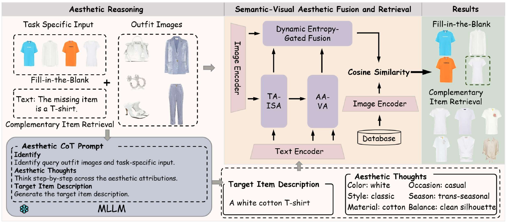

# Outfit completion without training: GPT-4o first reasons out what the missing piece looks like along six dimensions such as color, style and material, then FashionCLIP retrieves it

> [中文版](hust-tattoo.md)

### Paper: TATTOO: Training-free AesTheTic-aware Outfit recOmmendation (AAAI 2026)
### Link: https://arxiv.org/abs/2509.23242
### Institution: Huazhong University of Science and Technology, Carnegie Mellon University
### Ideas: training-free, multimodal LLM reasoning, aesthetic chain of thought, FashionCLIP retrieval, entropy-weighted fusion
### Area: i2i (outfit completion)

## Breakdown:
For outfit completion, the paper trains no model at all and works in two steps. First, it calls the GPT-4o API directly and has it look at the items already in the outfit and reason through six aesthetic dimensions one by one (color, style, occasion, season, material, balance), giving, for the missing piece, a keyword and a one-sentence reason on each (e.g., "color: white", with the reason explaining why white goes with the existing items), then write down what the missing piece should look like based on that. Then an off-the-shelf FashionCLIP (an open-source CLIP further trained on fashion product image–text pairs) fuses this description, the reasoning conclusions for the six dimensions and the images of the existing items into one query vector, which retrieves images from the catalog by cosine similarity.

The scenario is outfit completion: given the items already in an outfit (e.g., a top, trousers, a bag), find the missing one in the catalog. There are two test formats: fill-in-the-blank (FITB) picks one of a few given candidates; complementary item retrieval (CIR) is told only the missing category (e.g., "a T-shirt is missing") and searches the whole catalog. Earlier methods all train an embedding space on large labeled datasets, need retraining when seasons and trends change, and their vectors can't explain why an item is recommended.

The authors first ran a small experiment: adding two words, color and material, to Polyvore's item descriptions raised a retrained model's fill-in-the-blank accuracy from 67.4% to 71.2%. From this they conclude that fine-grained aesthetic attributes help, and have the LLM reason about these attributes.

### Method
Two stages: the first has the LLM reason out what the missing piece looks like, the second fuses the reasoning with the images into a query vector for retrieval.

#### (1) Aesthetic reasoning
The images of the existing items and the task input (candidate images for fill-in-the-blank, the missing category for complementary retrieval) go to GPT-4o (temperature 0). There is a single request; the prompt asks it to write out its reasoning in the following three steps, in order, within one response:
* **Identify.** Recognize what each item is, what role it plays in the outfit, and how the items relate.
* **Aesthetic thoughts.** Reason through the six dimensions (color, style, occasion, season, material, balance) one by one, giving the missing piece a keyword on each that describes what it should be like on that dimension (e.g., "color: white"), plus a one-sentence reason explaining why that attribute goes with the existing items.
* **Target description.** Combine the first two steps into a description of the missing piece (e.g., "a white cotton T-shirt").

#### (2) Fusing into a query vector and retrieving
Everything is encoded with a frozen FashionCLIP, each image and each piece of text getting one vector, all in the same image–text space: the existing items' images go through the image encoder to give their image vectors; the target description written by GPT-4o goes through the text encoder to give the target-description vector; the six dimension conclusions also go through the text encoder. These are then combined into one query vector in the three steps below.
* **Image vector of the existing items.** Each existing item's image vector is compared with the target-description vector; after softmax (temperature 0.01) these similarities become weights for a weighted sum. Items more related to the missing piece get more weight.
* **Aesthetic vector.** The six dimension conclusions from the "aesthetic thoughts" step in (1) (e.g., "color: white", "material: cotton", each with a one-sentence reason) are each encoded into a vector, weighted by softmax over their average similarity to the target-description vector and to the image vector above, and summed.
* **Entropy-based fusion.** These two vectors plus the target-description vector make three. Each is compared with every item in the candidate set to get a distribution, and its entropy is computed: the more concentrated the distribution, the better the vector pins down a few candidates, and the larger its weight (weight = exp(−entropy), then normalized). The weighted sum of the three is the query vector.
* **Retrieval.** The query vector is compared by cosine with each catalog item's FashionCLIP image vector, and the highest is taken.

**Inference cost.** Candidate items need their image vectors computed only once offline, but every query calls GPT-4o once; the paper reports neither latency nor cost.

### Results
All evaluation is offline; there's no comparison of online performance.
* **Aesthetic test (Aesthetic-100).** A set of fill-in-the-blank questions in two parts, popular aesthetics and expert aesthetics. Accuracy on popular aesthetics is 4 points above the strongest baseline (OutfitTransformer with FashionCLIP encoders), 79% vs. 75%, and 3 points higher on expert aesthetics, 75% vs. 72%.
* **Polyvore fill-in-the-blank.** On the split with no item overlap, accuracy is 65.7% vs. 59.5% for the strongest baseline; on the split that allows item overlap, 66.0%, slightly below the strongest baseline's 67.1%.
* **Polyvore complementary retrieval.** Worse than trained methods: on the overlapping split, R@10 is 5.4% vs. 9.6% for the strongest baseline. The authors attribute this to each query having only one labeled answer, with other items that would match just as well counted as wrong.
* **Swapping the LLM.** Open-source LLaMA-4 and Qwen-VL-Max come close to GPT-4o on popular aesthetics but are 9 to 16 points lower on expert aesthetics.

## Takeaways
* What the LLM reasons the missing piece looks like can serve directly as a retrieval query, so completion recommendations need no training and come with ready-made reasons.
* Multiple query signals can be weighted by how concentrated their distributions over the candidates are, with no learned parameters.
* Adding structured attributes such as color and material to item descriptions helps even on catalogs with poor text quality.

## Caveats
* Aesthetic-100 is very small (the name says about 100 questions), so a 4-point lead amounts to a few more correct answers, and the paper does no significance testing.
* In the ablation, the full GPT-4o model scores 58.80% on the soft popular-aesthetics metric, lower than the version without the identify step (59.02%) and the version without aesthetic thoughts and the fusion module (59.54%). The paper's claim that "removing identify or the fusion module alone causes a drop" doesn't hold on this metric.
* The aesthetic vector's weighting works against its stated purpose. The authors say this step is meant to fill in attributes the description missed, but the weights follow each attribute's similarity to the description, so attributes more like the description get more weight, which actually reinforces what the description already says.
* Complementary retrieval is clearly worse than trained methods. The authors blame the single labeled answer per question, but all methods are evaluated under the same labels, and the paper supports this only with visual examples, not numbers. "Never having seen Polyvore" also can't be verified, since GPT-4o's training data may include these public web images.
* The most direct training-free baseline is missing: no LLM call, just FashionCLIP retrieving with the existing items' images and the missing category's text. Without it, there's no telling how much of the gain comes from LLM reasoning. Every query calls GPT-4o once, latency and cost aren't reported, and the best results depend on a closed-source model (the authors acknowledge the latter in their limitations).

## Credibility: offline

## Recommendation level: worth a look if you have time
