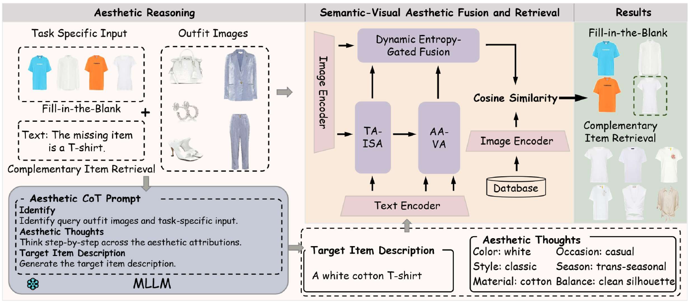

# 穿搭补全不用训练：GPT-4o 先按颜色、风格、材质等六个维度推理出缺的那件长什么样，再用 FashionCLIP 检索

关注我，每天为你精挑细选最优质、最新鲜的推荐算法paper，陪你一起保持进步、不断精进！

> [English version](hust-tattoo.full.en.md)

### 论文：TATTOO: Training-free AesTheTic-aware Outfit recOmmendation
### 网址：https://arxiv.org/abs/2509.23242
### 公司：华中科技大学、卡内基梅隆大学
### 思想：免训练、多模态大模型推理、审美思维链、FashionCLIP 检索、按熵加权融合
### 方向：i2i（穿搭补全）

## 解读：
对于穿搭补全，本文不训练任何模型，分两步。先直接调用 GPT-4o 的 API，让它看着已有的几件单品，在颜色、风格、场合、季节、材质、平衡六个审美维度上逐一推理，为缺的那件在每个维度给出一个关键词和一句理由（如「颜色：白色」，理由说明为什么白色和已有单品搭），再据此写出缺的那件应该长什么样。再用现成的 FashionCLIP（在时尚商品图文对上继续训练过的开源 CLIP）把这段描述、六个维度的推理结论和已有单品的图片融合成一个查询向量，按余弦相似度去库里找图。

场景是穿搭补全：给定一套搭配里已有的几件单品（如上衣、裤子、包），从库里找出缺的那一件。有两种考法：填空题（FITB）是从给定的几个候选里选一个；互补检索（CIR）是只告诉你缺的是什么类目（比如「缺一件 T 恤」），从整个库里找。以往的方法都要在大规模标注数据上训练一个嵌入空间，换季、换潮流就得重训，而且向量说不清为什么推荐这件。

作者先做了个小实验：在 Polyvore 的商品描述里补上颜色和材质两个词，重训的模型填空准确率从 67.4% 提到 71.2%。由此认为细粒度的审美属性有用，于是让大模型来推理这些属性。

### 方法
分两个阶段。第一阶段让大模型推理出缺的那件长什么样，第二阶段把推理结果和图片融合成查询向量去检索。

#### （1）审美推理
把已有单品的图片和任务输入（填空题给候选图片，互补检索给缺的类目）交给 GPT-4o（温度设为 0）。只发一次请求，提示词要求它在同一个回答里按下面三步依次写出推理过程：
* **识别。** 认出每件单品是什么、在搭配里扮演什么角色、彼此什么关系。
* **审美思考。** 在颜色、风格、场合、季节、材质、平衡六个维度上逐一推理，为缺的那件每个维度给一个关键词，描述它在这个维度上应该是什么样（比如「颜色：白色」），再给一句理由，说明为什么这个属性和已有单品搭。
* **目标描述。** 综合前两步，写出缺的那件的描述（比如「一件白色纯棉 T 恤」）。

#### （2）融合成查询向量，检索
用冻结的 FashionCLIP 编码，每张图、每段文字各得到一个向量，都在同一个图文空间里：已有单品的图片过图像编码器，得到各自的图片向量；GPT-4o 写的目标描述过文本编码器，得到目标描述向量；六个维度的结论也过文本编码器。再按下面三步合成一个查询向量。
* **已有单品的图片向量。** 每件单品的图片向量和目标描述向量算相似度，softmax 后作为权重（温度 0.01），加权求和。和缺的那件越相关的单品，权重越大。
* **审美向量。** 第（1）步「审美思考」给出的六个维度结论（如「颜色：白色」「材质：纯棉」，各带一句理由）各编码成一个向量，按它和目标描述向量、和上一步图片向量的平均相似度做 softmax 加权，加权求和。
* **按熵融合。** 上面两个向量加上目标描述向量，共三个。每个向量和候选集里所有商品算相似度，得到一个分布，算它的熵（scalar）：分布越集中，说明这个向量越能锁定少数候选，权重越大（权重为 exp(−熵)，再归一化）。三个向量加权求和，得到查询向量。
* **检索。** 查询向量和库里每件商品的 FashionCLIP 图片向量算余弦，取最高的。

**推理成本。** 候选商品只需要离线算一次图片向量，但每个查询都要调一次 GPT-4o，论文没报时延和费用。

### 效果
全部是离线评测，没有对比线上效果。
* **审美测试（Aesthetic-100）。** 一组填空题，分大众审美和专家审美两部分。大众审美的准确率比最强基线（换成 FashionCLIP 的 OutfitTransformer）高 4 个点（79% 对 75%），专家审美高 3 个点（75% 对 72%）。
* **Polyvore 填空。** 单品不重叠的划分上准确率 65.7%，最强基线 59.5%；允许单品重叠的划分上 66.0%，略低于最强基线的 67.1%。
* **Polyvore 互补检索。** 不如训练过的方法，单品重叠划分上 R@10 为 5.4%，最强基线 9.6%。作者认为原因是每个查询只标了一个正确答案，而其他同样能搭的商品都被算作错。
* **换大模型。** 开源的 LLaMA-4 和 Qwen-VL-Max 在大众审美上接近 GPT-4o，专家审美低 9 到 16 个点。

## 心得：

## 愚见

## 可信度：离线

## 推荐等级：有时间看看

**请帮忙点赞、转发，谢谢。欢迎干货投稿 \ 论文宣传\ 合作交流**

### 【铁粉】请入微信群，群内我会给出更深入的解读，还可以共同讨论技术方案、发招聘广告、内推和交友等。
* 铁粉标准：关注公众号一个月以上，且在公众号上累计15次互动（评论、爱心、转发）、或投稿1次，只欢迎技术同学。
* 入群方法：请您加个人微信lmxhappy，我拉您入群，请备注【公司】（只我个人看，不公开）。

## 推荐您继续阅读：
