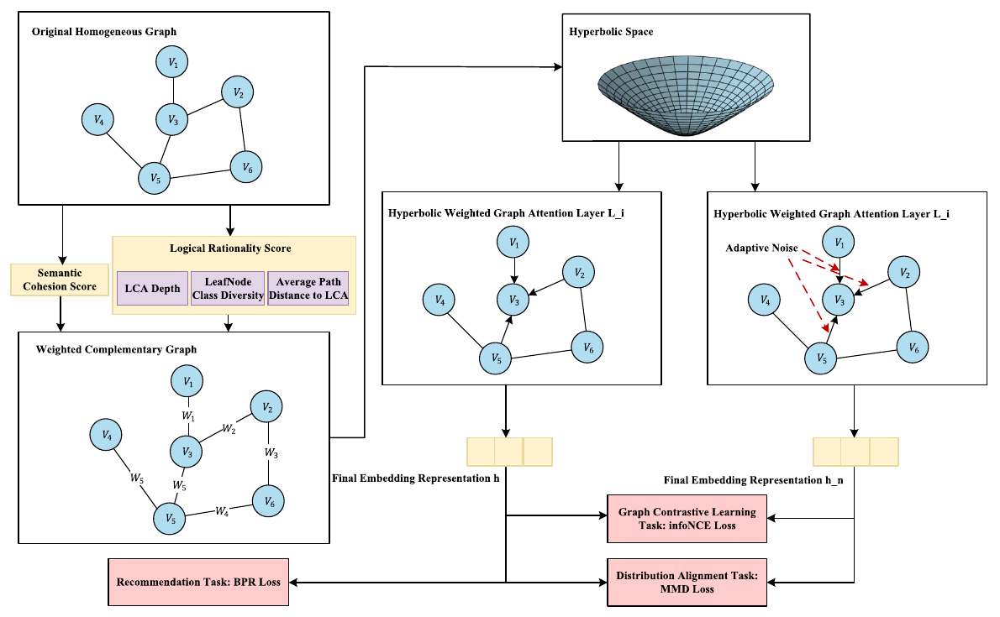

# Complementary item recommendation: weight co-purchase edges with text semantics and the category tree, then run a weighted GAT and contrastive learning in hyperbolic space

> [中文版](imu-hw-gatcr.md)

### Paper: Hyperbolic geometry meets contrastive learning: A novel approach for complementary item recommendation (ESWA 2026)
### Link: https://doi.org/10.1016/j.eswa.2026.133452
### Institution: Inner Mongolia University
### Ideas: weighted complementary graph, hyperbolic graph neural network, graph contrastive learning, MMD distribution alignment
### Area: i2i (complementary item recommendation)

## Breakdown:
**Co-purchase edges are first given weights from semantics and category; a weighted GAT then learns item vectors, and at inference items are scored by inner product.**

The task: given an item, recommend items that complement it (a camera with a lens or a memory card). The common approach treats co-purchase (also_buy) as complementarity, which has two problems. First, co-purchases mix in substitutes and unrelated items (two brands of milk bought together). Second, co-purchase is only "yes or no" and can't tell strong from weak (camera + lens is far stronger than camera + lens cloth). On top of that, Amazon data is very sparse, and popular items have many connections in the graph, so training is easily dominated by them.

The model is called HW-GATCR (Hyperbolic Weighted Graph Contrastive Attentional Network for Complementary Recommendation). It first uses item text and the category tree to compute a weight between 0 and 1 for each co-purchase edge, then runs a graph attention network (GAT) on the weighted graph, with each layer's linear transform done in hyperbolic space, plus a contrastive-learning branch with added noise. At inference, items are scored by the inner product of their vectors.

### Model architecture
Four steps. (1) corresponds to the left column of the figure, turning the original co-purchase graph into a weighted complementary graph; (2) corresponds to the middle column (hyperbolic space and weighted GAT); (3) corresponds to the noisy branch on the right and the three losses at the bottom; (4) is inference, which uses only the final vector h output by the middle branch.

### (1) Weight co-purchase edges and build the weighted complementary graph
Every edge in the graph is a co-purchase edge, taken from the also_buy field of the Amazon item metadata (the "customers who bought this also bought" list on the product page, i.e., item pairs Amazon has already compiled, not raw shopping baskets), and the graph is undirected. The paper defines the weighted complementary graph as a subset of the original co-purchase edges but gives no filtering threshold, so in practice this step mainly assigns a weight to each edge.

Item titles and descriptions go through a pretrained BERT and then a ReLU (to keep values non-negative), giving each item's initial vector, which is also the input to the GAT later. Each co-purchase edge's weight is made of two kinds of scores.
* **Semantic score.** Cosine similarity between the two items' initial vectors.
* **Category score.** Made of three parts on the category tree. One is the depth of the two items' lowest common ancestor category, with deeper scoring higher; two is whether their leaf categories differ, scoring 1 if different and 0.5 if the same (to push substitutes down); three is the average distance from each leaf category to the common ancestor, taken as 1/(1 + average distance). Each part is min-max normalized, then the three are averaged.
* **Edge weight.** After normalizing each score, they are combined as edge weight = α × semantic score + (1−α) × category score, giving the weighted complementary graph.

### (2) Hyperbolic weighted GAT
Each GAT layer does the following; 1 to 3 layers are stacked, with K heads concatenated per layer.
* **Map to hyperbolic space.** The input vector is placed in hyperbolic space (hyperboloid model) via the exponential map.
* **Linear transform.** A matrix multiplication is done in hyperbolic space.
* **Map back.** The result is mapped back to Euclidean space via the logarithmic map.
* **Weighted attention.** The usual GAT attention score plus "learnable coefficient × edge weight" as a bias (one coefficient per head), followed by a softmax over neighbors. Attention thus looks both at the two nodes' vectors and at the complementarity strength computed in (1).
* **Aggregate.** Neighbors are summed with the attention weights, passed through ELU, with a residual added, then LayerNorm.

**Why hyperbolic space.** The authors argue complementary relations are hierarchical (coffee equipment covers coffee machines, beans, filter paper, cups). Capacity in hyperbolic space grows faster the farther out you go, which suits tree-like structures: broad categories sit near the center while many long-tail items and fine-grained pairings spread outward.

### (3) Training
The focus of training is noisy contrastive learning and distribution alignment, used as auxiliary losses trained together with the BPR loss for recommendation. The GAT runs twice on the same weighted graph: once without noise (the clean view, used for recommendation) and once with noise added to the vectors before each layer (the noisy view). The noise is added as noise vector = direction × magnitude, added to the item vector. The direction is a uniform random vector multiplied element-wise by the sign of each dimension of the item vector, then L2-normalized (so no dimension flips sign after adding noise); the magnitude = base magnitude × (1 + γ × normalized degree), so popular high-degree nodes get more noise.
* **InfoNCE.** An item's noisy vector and clean vector form a positive pair; the clean vectors of other items in the batch are negatives.
* **MMD.** A Gaussian kernel measures the gap between the distributions of clean and noisy vectors in the batch (MMD²), which is minimized. The authors argue hyperbolic representations are sensitive to perturbation and that noise around popular nodes gets amplified, so aligning the two distributions makes training more stable.

**Total loss.** The main loss is BPR (a complementary pair's inner-product score should be higher than a non-complementary pair's). Total loss = BPR + λ × InfoNCE + λ1 × MMD, with λ in 0.08–0.10 and λ1 in 0.02–0.08. The noisy view and the last two losses are used only during training.

**Why more noise on popular nodes.** Popular nodes have many neighbors and dominate message passing, so the model can take the shortcut of leaning on popular items. Larger perturbations weaken that dominance; long-tail nodes, which have little signal to begin with, get only small perturbations.
### (4) Inference
Only the clean view is run; the inner product of two items' final vectors is the complementarity score.

### Data and results
Four Amazon subsets (Appliances with 804 items; Toys, Grocery and Home with 25K to 76K items), graphs built from also_buy, data split 6:2:2 at random. Offline experiments only. Against the strongest baseline, SR-Rec, HR@5 is 12.6%–22.0% higher and NDCG 9.4%–35.9% higher. In the ablation on Toys, Grocery and Home, removing any single module costs less than 2%; only on the smallest dataset, Appliances, is the gap large, with the full model's HR@5 8.5% higher than the version without the hyperbolic module.

## Takeaways:
* The category tree helps separate substitutes from complements: different leaf categories with a fairly deep common ancestor are more likely complements.
* Adding prior relation strength as a bias to the GAT attention score is a simple way to feed edge weights into a graph network.
* Scaling contrastive-learning noise up with node degree is a way to weaken popular nodes' dominance in message passing.

## Caveats
* Most of the gap over the baselines doesn't come from the paper's four modules. In Table 7, the base backbone without any of the four modules already reaches HR@5 0.9710 on Toys, 17% above SR-Rec's 0.8312, and adding all four modules adds only 0.6% more; Grocery and Home look the same. The paper doesn't say what the base backbone is.
* The evaluation protocol is unclear. Edges are split at random, but the paper doesn't say whether test edges took part in graph construction and GNN propagation, or how many negatives each positive is ranked against. HR@10 reaches 0.99 on Toys and Home, which suggests a small candidate pool.
* The semantic score is a BERT cosine, so more similar items score higher; a deeper common ancestor also scores higher. Yet the authors themselves say substitutes tend to share a fine-grained category and be highly similar, so these two terms give substitutes high scores, working against the goal of filtering out substitute relations; only the leaf-category term pushes substitutes down.
* Hyperbolic space is used only for each layer's linear transform and is mapped straight back to Euclidean space; attention, aggregation and final scoring all happen in Euclidean space. How much of the authors' argument, that hyperbolic space accommodates hierarchy, carries over to this usage is unclear; removing the hyperbolic module costs less than 0.2% on all three larger datasets.
* The long-tail analysis (Table 6) reports only the proposed model with no baseline, which isn't enough to show popularity bias was reduced; and the long-tail group's HR is actually higher than the head group's (Appliances HR@5 0.80 vs 0.59), which the paper doesn't explain.
* A few details are inconsistent: Toys HR@5 is 0.9711 in Table 3 and 0.9771 in Table 5; Eq. 15 adds the edge weight after the LeakyReLU, while Algorithm 1 adds it before.

## Credibility: offline

## Recommendation level: worth a look if you have time
