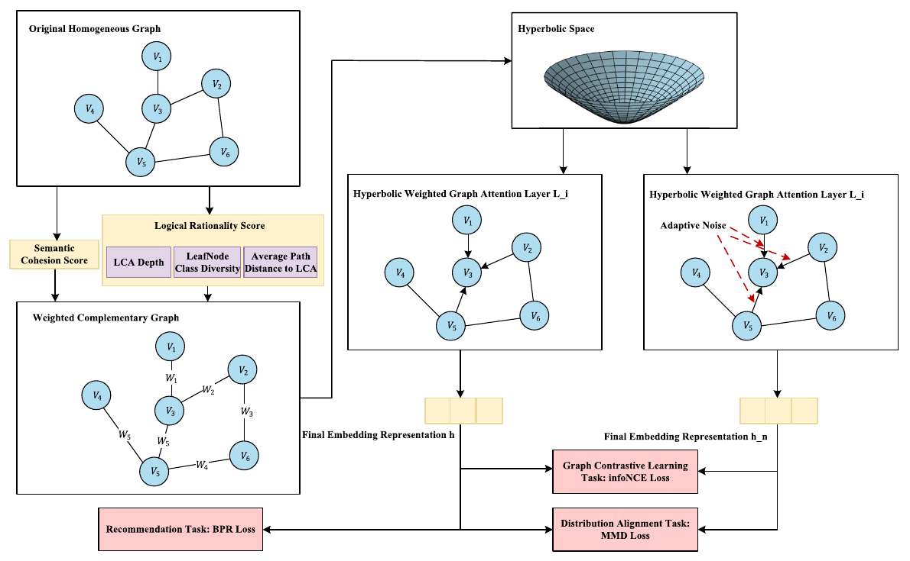

# 互补品推荐：先按文本语义和类目树给共购边定权重，再在双曲空间里做加权 GAT 和对比学习

关注我，每天为你精挑细选最优质、最新鲜的推荐算法paper，陪你一起保持进步、不断精进！

> [English version](imu-hw-gatcr.full.en.md)

### 论文：Hyperbolic geometry meets contrastive learning: A novel approach for complementary item recommendation（ESWA 2026）
### 网址：https://doi.org/10.1016/j.eswa.2026.133452
### 公司：内蒙古大学
### 思想：加权互补图、双曲图神经网络、图对比学习、MMD 分布对齐
### 方向：i2i（互补品推荐）

## 解读：
**共购边先按语义和类目算出边权，再用加权 GAT 学商品向量，推理时用内积打分。**

针对互补推荐，本文提出 HW-GATCR（Hyperbolic Weighted Graph Contrastive Attentional Network for Complementary Recommendation）。先用商品文本和类目树给每条共购边算一个 0 到 1 的边权，再在加权图上跑图注意力网络（GAT），每层的线性变换放在双曲空间里做，并加一路加噪的对比学习，推理时用两个商品向量的内积打分。

常见做法是把共购（also_buy）当互补，问题有两个。一是共购里混着替代品和无关商品（一次买了两个牌子的牛奶）；二是共购只有「有或没有」，分不出强弱（相机配镜头比相机配擦镜布强得多）。另外 Amazon 数据很稀疏，热门商品在图上连接多，训练容易被它们主导。

### 模型结构
分四步。（1）对应图左列，从原始共购图得到加权互补图；（2）对应中间一列（双曲空间和加权 GAT）；（3）对应右列加噪的那一路和底部的三个损失；（4）是推理，只用中间那一路输出的最终向量 h。

### （1）给共购边算权重，建加权互补图
图上的边全是共购边，来自 Amazon 商品元数据里的 also_buy 字段（商品页上「买了这个的顾客也买了」的列表，是 Amazon 整理好的商品对，不是原始购物篮），建成无向图。论文把加权互补图定义为原始共购边的子集，但没给过滤阈值，这一步实际做的主要是给每条边定权重。

商品标题和描述过预训练 BERT，再过 ReLU（保证非负），得到每个商品的初始向量，这个向量也是后面 GAT 的输入。每条共购边的边权由两类分组成。
* **语义分。** 两个商品初始向量的余弦相似度。
* **类目分。** 由类目树上的三项组成。一是两者最近公共祖先类目的深度，越深分越高；二是叶子类目是否不同，不同记 1、相同记 0.5（用来压低替代品）；三是两者叶子类目到公共祖先的平均距离，取 1/(1+平均距离)。三项各自 min-max 归一化后取平均。
* **边权。** 两类分各自归一化后加权求和，边权 = α × 语义分 + (1−α) × 类目分，得到加权互补图。

### （2）双曲加权 GAT
每层 GAT 的步骤如下，堆 1 到 3 层，每层 K 个头拼接。
* **映射到双曲空间。** 输入向量通过指数映射放到双曲空间（双曲面模型）。
* **线性变换。** 在双曲空间里做矩阵乘法。
* **映射回来。** 通过对数映射回到欧氏空间。
* **加权注意力。** 普通 GAT 的注意力分数，加上「可学习系数 × 边权」作为偏置（每个头一个系数），再对邻居做 softmax。这样注意力既看两个节点的向量，也看（1）算出的互补强度。
* **聚合。** 按注意力加权求和邻居，过 ELU，加残差，过 LayerNorm。

**为什么用双曲空间。** 作者认为互补关系有层级（咖啡设备下有咖啡机、咖啡豆、滤纸、杯子）。双曲空间越往外容量增长越快，适合放树状结构，大类靠近中心，大量长尾商品和细分搭配往外铺开。

### （3）训练
训练的重点是加噪对比学习与分布对齐，两者作为辅助损失，和推荐用的 BPR 一起训练。同一张加权图跑两遍 GAT。一遍不加噪（干净视图，用于推荐），一遍在每层输入前给向量加噪（加噪视图）。加噪方法是噪声向量 = 方向 × 幅度，加到商品向量上。方向是均匀分布随机向量逐维乘以商品向量各维的正负号，再 L2 归一化（加噪后各维不变号）；幅度 = 基础幅度 × (1 + γ × 归一化度数)，度数越高的热门节点噪声越大。
* **InfoNCE。** 同一个商品的加噪向量和干净向量互为正样本，batch 内其他商品的干净向量是负样本。
* **MMD。** 用高斯核计算 batch 内干净向量和加噪向量两组分布的差异（MMD²），把它压小。作者认为双曲表示对扰动敏感，热门节点附近的噪声还会被放大，对齐两组向量的分布能让训练更稳。

**总损失。** 主损失是 BPR（互补对的内积分要高于非互补对），总损失 = BPR + λ × InfoNCE + λ1 × MMD，λ 取 0.08–0.10，λ1 取 0.02–0.08。加噪视图和后两个损失只在训练时用。

**为什么热门节点加更大的噪声。** 热门节点邻居多，在消息传递里占主导，模型容易走「靠热门商品」的捷径。给它们更大的扰动削弱这种主导，长尾节点信号本来就少，只加小扰动。

### （4）推理
只跑干净视图，两个商品最终向量的内积就是互补分。

### 数据与效果
Amazon 四个子集（Appliances 804 个商品，Toys、Grocery、Home 2.5 万到 7.6 万个商品），用 also_buy 建图，数据按 6:2:2 随机切分。只有离线实验。对比最强基线 SR-Rec，HR@5 高 12.6%–22.0%，NDCG 高 9.4%–35.9%。消融里，在 Toys、Grocery、Home 上去掉任何一个模块，指标降幅都在 2% 以内；只有最小的 Appliances 差距大，完整模型的 HR@5 比去掉双曲模块的版本高 8.5%。

## 心得：

## 愚见

## 可信度：离线

## 推荐等级：有时间看看

**请帮忙点赞、转发，谢谢。欢迎干货投稿 \ 论文宣传\ 合作交流**

### 【铁粉】请入微信群，群内我会给出更深入的解读，还可以共同讨论技术方案、发招聘广告、内推和交友等。
* 铁粉标准：关注公众号一个月以上，且在公众号上累计15次互动（评论、爱心、转发）、或投稿1次，只欢迎技术同学。
* 入群方法：请您加个人微信lmxhappy，我拉您入群，请备注【公司】（只我个人看，不公开）。

## 推荐您继续阅读：
