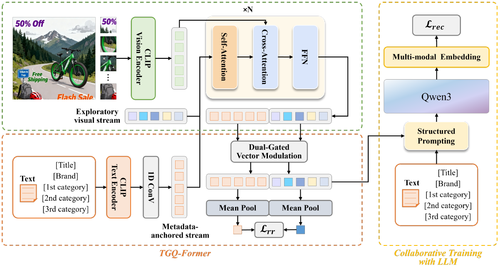

# JD multimodal i2i: product titles and categories guide the model where to look in the main image, steering clear of promo stickers

> [中文版](jd-tgq-former.md)

### Paper: Text-Guided Visual Representation Learning for Robust Multimodal E-Commerce Recommendation
### Link: https://arxiv.org/abs/2605.17366
### Institution: Tsinghua University, JD.com
### Ideas: text-guided Q-Former queries, two streams of visual tokens, channel-wise gating, redundancy-reduction regularizer, LLM-produced item embeddings
### Area: i2i retrieval (multimodal item embeddings)

## Breakdown:
Most of TGQ-Former's queries are generated from the product's title, brand and categories, so they attend to the product itself rather than the promo stickers on poster-style product images; a few free queries capture appearance details the text doesn't mention.

The scenario is JD's i2i retrieval: given an item, find related items in the full catalog, by learning a multimodal embedding per item and retrieving by cosine similarity.

**The problem is the main image.** Many merchant-uploaded main images are poster-style, with promo stickers like "50% off", "free shipping" and "flash sale" plus decorative backgrounds layered over the product.

**Why the existing approach falls short.** The common framework freezes a vision encoder and connects it to an LLM through a lightweight connector, and this paper keeps that framework (the strongest baseline in the experiments, NoteLLM-2, is this kind of framework). The connector is usually BLIP-2's Q-Former, which uses a set of learnable query vectors to cross-attend over image tokens and summarize them into a few visual tokens. These queries are randomly initialized with no semantic prior, so attention is easily drawn to eye-catching stickers, and the learned embedding follows the promotion rather than the product. The authors also tried simply cropping the image borders, which barely helped.

The paper proposes TGQ-Former: some queries are generated from the product's title, brand and categories, while a few random queries are kept to capture appearance details the text doesn't mention, and the two streams are each reweighted by how reliable they are. Offline experiments only.

### Model architecture
The data flow has three steps: the image and metadata first pass through the connector to become two streams of visual tokens, channel-wise gates then adjust the weight of each stream, and finally they go into the LLM together with the metadata text to produce the item embedding.

#### (1) Connector: pulling information from the main image with two sets of queries
This step compresses a main image into a few visual tokens for the gates and the LLM that follow. The Q-Former's idea is to prepare several "queries"; each query picks the information relevant to it from the image's regions and summarizes it into one visual token, so there are as many output visual tokens as queries. What the paper changes is where the queries come from.
* **Encoding.** A frozen Chinese-CLIP (ViT-B/16) cuts the main image into patches and encodes them into a sequence of visual tokens, plus a global image vector (kept for the gates in (2)); a frozen CLIP text encoder encodes the metadata (title, brand, three-level categories) into a sequence of text tokens.
* **Building two sets of queries.**
  * **Text-guided queries (about 10, inferred from text length; the paper doesn't give the number directly).** The text tokens go through a 1D convolution (kernel and stride both 5) that compresses every 5 into 1, then a linear projection into queries. These queries know what the product is and look for regions consistent with the title and categories.
  * **Random queries (3).** Randomly initialized learnable queries, unconstrained by text, that capture appearance details and presentation information the text doesn't mention (e.g., accessories displayed alongside).
* **Pulling information.** The two sets are concatenated and fed into a 6-layer Q-Former; each layer first does self-attention among the queries, then cross-attention from the queries to the visual tokens.

**Output.** Each query yields one output visual token, giving two groups of visual tokens (the text-guided group and the random group), aligned to the LLM's dimension and passed to (2) for gating.

#### (2) Channel-wise gating for each stream
Each stream of visual tokens is multiplied by a gate vector (1 + β), with each dimension of β in (−1, 1), so each channel can be pushed down to near 0 or up to near 2. β comes from a two-layer MLP followed by 2σ(x) − 1.
* **Text-guided stream.** The gate's inputs are the global image vector, the title vector, the cosine similarity between image and title, and the mean of each stream's tokens. The design intent is to amplify this stream when image and text agree and suppress it when they don't, but the gate is learned and the paper adds no constraint to guarantee this.
* **Random stream.** The gate's inputs are the global image vector and this stream's token mean; the design intent is to suppress it when the image itself is unreliable.

#### (3) Into the LLM for the embedding
The metadata is written into the prompt "Product image: , Product metadata: {brand, category, title}. Produce a single embedding for retrieval.", with the  position replaced by the gated visual tokens from both streams, and fed into Qwen3-Embedding-0.6B (LoRA only). The last token's hidden state is linearly projected into a 256-dimensional item embedding.

**Loss.** The main loss is InfoNCE: positive pairs are pulled together, other items in the batch serve as negatives, temperature 0.07. A redundancy-reduction regularizer is added: within a batch, the two streams' mean token vectors after gating are standardized per dimension, the correlation between the two streams on the same dimension is computed, and its square is penalized, reducing duplicate information between the two streams. It's a soft constraint that only covers correlation within the same dimension. The two terms are summed with equal weight.

**Inference.** Query and candidate items go through the same model, and retrieval is by cosine similarity. The paper doesn't describe online deployment; from the structure, each item's embedding would be precomputed offline and indexed. Compute is about 35 GFLOPs per item.

### Data
The data comes from one year of add-to-cart logs on JD's checkout-page "add-on" channel. Swing retrieves 100 similar items for each trigger item to form the training and test item pairs: about 3.5 million training pairs and about 67,000 test pairs, with no trigger items shared between the two. At evaluation, each query retrieves from all ~134,000 test items.

### Results
Offline only, measured by H@K (whether at least one positive is in the top K).
* **Versus other connectors.** With Qwen3-Embedding-0.6B, H@100 rises from the strongest baseline NoteLLM-2's 65.19 to 69.13 (+6.04% relative). With Qwen3-1.7B and Baichuan2-7B, the gain is only 0.3 to 0.4 points (63.20 vs. 62.92, 64.57 vs. 64.19).
* **Versus end-to-end multimodal LLMs.** H@100 is 3.45 points above Qwen3-VL-4B (69.13 vs. 65.68), at about 1/17 of its compute (1/8 to 1/20 across the multimodal LLMs compared).
* **Ablation.** Replacing all random queries with text-guided ones raises H@100 from 65.19 to 67.45, the biggest single step; mixing both streams gives 68.11, adding the gates 68.90, adding the redundancy regularizer 69.13.

## Takeaways
* When main images are noisy, using structured text metadata to guide visual token extraction works better than preprocessing such as cropping.
* Beyond the text-guided queries, keep a few random queries to fill in appearance information the text can't describe.
* For item embeddings, a purpose-trained embedding model (Qwen3-Embedding-0.6B) may work better than a larger generative LLM.

## Caveats
* The abstract claims an "average" H@100 gain of 6.04%, but this number comes from only one backbone, Qwen3-Embedding-0.6B. The other two backbones gain about 0.5% relative, and the average across all three is about 2.4%.
* Positive pairs come from Swing's top 100 similar items, and so does the test set, so H@K measures agreement with Swing rather than user behavior itself. The paper also doesn't say whether the Swing pairs were further filtered by actual add-to-cart events.
* For the comparison with end-to-end multimodal LLMs, the paper doesn't say whether those models were fine-tuned with the same data and contrastive loss. If their embeddings were taken directly, the comparison isn't like-for-like.
* Three random seeds were used, but the tables give single numbers without standard deviations. With larger backbones the gain is under 0.5 points, and gaps that small need variance to judge.
* A robustness test on public Amazon data with synthetic stickers shows only a 0.8-point H@50 gain under the heaviest noise (68.33 vs. 67.55). No online A/B.

## Credibility: offline

## Recommendation level: worth a look if you have time
