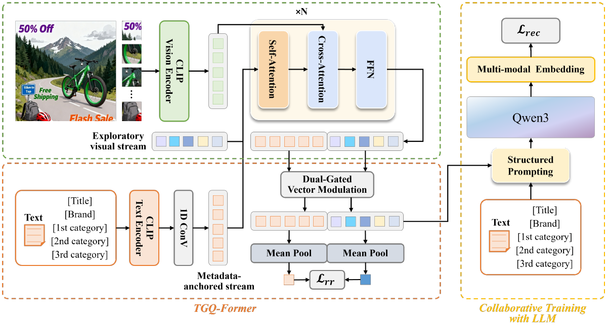

# 京东多模态 i2i：用商品标题、类目引导模型看主图，避开促销贴纸

关注我，每天为你精挑细选最优质、最新鲜的推荐算法paper，陪你一起保持进步、不断精进！

> [English version](jd-tgq-former.full.en.md)

### 论文：Text-Guided Visual Representation Learning for Robust Multimodal E-Commerce Recommendation
### 网址：https://arxiv.org/abs/2605.17366
### 公司：清华大学、京东
### 思想：文本引导的 Q-Former 查询、双路视觉 token、按通道门控、去冗余正则、LLM 出商品向量
### 方向：i2i 召回（多模态商品向量）

## 解读：
TGQ-Former 的大部分查询由商品的标题、品牌和类目生成，让它们关注商品本身，而不是海报式商品图上的促销贴纸；另有少数自由查询，用来捕捉文字里没有写到的外观细节。

场景是京东的 i2i 召回，给一个商品，从全库里找相关商品，做法是给每个商品学一个多模态向量，按余弦相似度检索。

**问题出在主图上。** 商家上传的主图很多是海报式的，商品上叠着「5 折」「包邮」「限时抢购」这类促销贴纸和装饰背景。

**现有做法为什么不行。** 常见的框架是冻结一个视觉编码器，用一个轻量的连接器接到 LLM 上，本文也沿用这套框架（实验里最强的基线 NoteLLM-2 就是这类框架）。连接器一般是 BLIP-2 的 Q-Former，用一组可学习的查询向量对图像 token 做交叉注意力，汇总成几个视觉 token。这些查询是随机初始化的，没有任何语义先验，注意力容易被醒目的贴纸吸走，学到的向量跟着促销活动走，而不是跟着商品本身走。作者也试过简单裁掉图片边缘，几乎没用。

### 模型结构
数据流分三步。图像和元数据先经连接器变成两路视觉 token，再按通道门控调整两路的权重，最后和元数据文本一起送进 LLM，取出商品向量。

#### （1）连接器：用两组查询从主图里取信息
这一步把一张主图压成几个视觉 token，交给后面的门控和 LLM。Q-Former 的思路是准备几个「查询」，每个查询去图像的各个区域里挑和自己相关的信息，汇总成一个视觉 token，有几个查询就输出几个视觉 token。本文改的是查询从哪来。
* **编码。** 冻结的 Chinese-CLIP（ViT-B/16）把主图切成小块，编码成一串视觉 token，外加一个全局图像向量（留给（2）的门控用）；冻结的 CLIP 文本编码器把元数据（标题、品牌、三级类目）编码成一串文本 token。
* **造两组查询。**
  * **文本引导的查询（约 10 个，按文本长度推算，论文没直接给）。** 文本 token 过一维卷积（核长和步长都是 5），每 5 个压成 1 个，再线性投影成查询。这组查询知道商品是什么，会去找和标题、类目对得上的区域。
  * **随机查询（3 个）。** 随机初始化的可学习查询，不受文字约束，去捕捉文字没写到的外观细节和陈列信息（如配套展示的配件）。
* **取信息。** 两组查询拼在一起进 6 层的 Q-Former，每层先在查询之间做自注意力，再让查询对视觉 token 做交叉注意力。

**产出。** 每个查询对应一个输出视觉 token，所以得到两组视觉 token（文本引导的一组、随机的一组），维度对齐到 LLM，交给（2）做门控。

#### （2）两路各自按通道门控
两路视觉 token 各乘一个门控向量 (1 + β)，β 每一维在 (−1, 1) 之间，所以每个通道可以被压低到接近 0 或放大到接近 2。β 由一个两层 MLP 算出，再过 2σ(x) − 1。
* **文本引导这一路。** 门控的输入包括全局图像向量、标题向量、图像和标题的余弦相似度，以及两路 token 各自的均值。设计意图是图文对得上时放大这一路，对不上时压低，但门控是学出来的，论文没有额外约束保证这一点。
* **随机这一路。** 门控的输入是全局图像向量和这一路 token 的均值，设计意图是图片本身不可靠时压低。

#### （3）送进 LLM 出向量
把元数据写成提示词「Product image: , Product metadata: {brand, category, title}. Produce a single embedding for retrieval.」， 的位置替换成门控后的两路视觉 token，送进 Qwen3-Embedding-0.6B（只训 LoRA）。取最后一个 token 的隐状态，线性投影成 256 维的商品向量。

**损失。** 主损失是 InfoNCE，正样本对拉近，同 batch 其他商品当负样本，温度 0.07。另加一个去冗余正则：一个 batch 内，把门控后两路 token 的均值向量按维度标准化，算两路之间同一维的相关系数，惩罚它的平方，减少两路编码重复的信息。这是软约束，只管同一维之间的相关。两项等权相加。

**推理。** 查询商品和候选商品走同一个模型，按余弦相似度检索。论文没写线上部署，按结构应是每个商品离线算好向量建索引。

### 数据
数据来自京东结算页「凑单加购」频道一年的加购日志。用 Swing 给每个 trigger 商品召回 100 个相似商品，构成训练和测试的商品对，训练集约 350 万对，测试集约 6.7 万对，两边的 trigger 商品不重叠。评测时每个查询在全部约 13.4 万个测试商品里检索。

### 效果
只有离线实验，指标是 H@K（前 K 个结果里有没有命中至少一个正样本）。
* **对比其他连接器。** 用 Qwen3-Embedding-0.6B 时，H@100 从最强基线 NoteLLM-2 的 65.19 提到 69.13（相对 +6.04%）。换成 Qwen3-1.7B 和 Baichuan2-7B，提升只有 0.3 到 0.4 个点（63.20 对 62.92，64.57 对 64.19）。
* **对比端到端多模态大模型。** H@100 比 Qwen3-VL-4B 高 3.45 个点（69.13 对 65.68），计算量约为它的 1/17（对比的几个多模态大模型在 1/8 到 1/20 之间）。
* **消融。** 把随机查询全换成文本引导的查询，H@100 从 65.19 涨到 67.45，是最大的一步；两路混合到 68.11，加门控到 68.90，加去冗余正则到 69.13。

## 心得：

## 愚见

## 可信度：离线

## 推荐等级：有时间看看

**请帮忙点赞、转发，谢谢。欢迎干货投稿 \ 论文宣传\ 合作交流**

### 【铁粉】请入微信群，群内我会给出更深入的解读，还可以共同讨论技术方案、发招聘广告、内推和交友等。
* 铁粉标准：关注公众号一个月以上，且在公众号上累计15次互动（评论、爱心、转发）、或投稿1次，只欢迎技术同学。
* 入群方法：请您加个人微信lmxhappy，我拉您入群，请备注【公司】（只我个人看，不公开）。

## 推荐您继续阅读：
