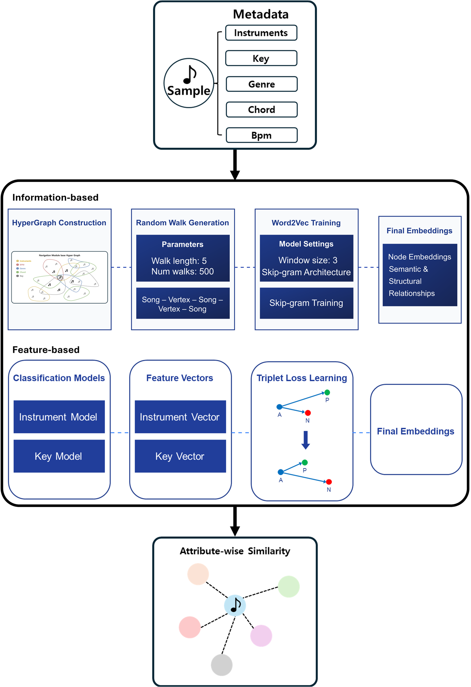

# Similar-sample recommendation for music production: metadata via hypergraph random walks + Word2Vec, audio via a Siamese network, one list per attribute

> [中文版](keti-hybrid-music.md)

### Paper: Hybrid Music Similarity with Hypergraph and Siamese Network (Big Data and Cognitive Computing 10(3):96, 2026)
### Link: https://doi.org/10.3390/bdcc10030096
### Company: Korea Electronics Technology Institute (KETI), Sangmyung University
### Idea: hypergraphs, random walks + Word2Vec, Siamese networks, triplet loss, cold start
### Area: i2i (a music sample → similar samples per attribute)

## Overview:
The setting is music production. Composers and producers browse sample libraries for material. A sample is a piece of audio ready to use in production (a drum loop, a brass phrase, a chord pattern), and it is the item in this paper. They already have one sample and want other samples with the same instrument, the same key, the same genre, and so on. The trigger is that sample. Samples have almost no user interactions, so collaborative filtering does not apply, and looking only at metadata or only at audio each misses half the picture.

The paper (published in BDCC 2026) computes similarity with two independently trained modules. The metadata module builds a hypergraph of samples and their attribute values, runs random walks and learns vectors with Word2Vec, and handles genre, chord and BPM. The audio module trains Siamese networks on top of frozen instrument and key classifiers, and handles instrument and key. At recommendation time there is no single combined ranking: there is one "most similar samples" list per attribute (same instrument, same key, same genre, and so on), and the user picks which one to look at; the two modules' similarities are not weighted into one total score either. Offline experiments only.

### Model side

#### Metadata module
This is the Information-based row in the figure.

* **Building the hypergraph.** There are two kinds of nodes: samples, and attribute values (e.g., "BPM 120", "Jazz", "key F"). Each sample and its 5 attribute values (instrument, key, genre, chord, BPM) form one hyperedge, shaped like a star.
* **Random walks.** 500 walks start from each node, each of length 5, shaped like "sample – attribute value – sample – attribute value – sample" (the hypergraph is star-shaped, so samples and attribute values can only alternate; walks starting from an attribute value look like "attribute value – sample – attribute value – sample – attribute value"). Two samples appearing on the same path means they share some attribute value.
* **Word2Vec.** The walk paths are treated as sentences, and skip-gram (window 3) learns a 128-dimensional vector for every sample and every attribute value. Samples that share more attribute values end up closer. Only one Word2Vec is trained, so each sample has a single vector (mixing information from all 5 attributes), shared by genre, chord and BPM.
* **Retrieval.** The nearest samples are found by cosine similarity.

#### Audio module
This is the Feature-based row in the figure. Instrument and key each get their own copy, with the same structure.

* **Feature extraction.** Instrument uses a pretrained CNN + Transformer classifier (10 classes, mel-spectrogram input); key uses a pretrained CNN + BiGRU classifier (12 classes, CQT input). Both classifiers are frozen, and the penultimate layer's output is taken as the feature.
* **Siamese + triplet loss.** A Siamese network is trained on the features and outputs 128-dimensional vectors (its architecture is not given). Samples of the same class (same instrument or same key) are positives for each other, samples of different classes are negatives, with margin 1.0.
* **Retrieval.** Each class's center (the mean of the vectors in the class) is computed; a new sample first finds the nearest class center, then is ranked against samples within that class by cosine similarity.

**How they are used at recommendation time.** The two modules retrieve separately: the instrument and key lists come from the audio module, and the genre, chord and BPM lists from the metadata module; they are shown together in one star-shaped view in a single interface (bottom of the figure). The trigger sits in the center, representative similar samples per attribute are linked to it (the paper does not say how many; the example in Fig. 3 shows 1 per attribute), shorter links mean higher similarity, and attributes are told apart by color. Genre, chord and BPM share one vector and hence one neighbor list, yet the example gives a different sample for each of them; how those are picked is not stated.

### Data side
**Dataset.** Self-collected and not public, with 254K samples (16 kHz). Attributes: 7 instrument classes, 12 genres, 2 chord types (major, minor), 12 keys plus "no key", and BPM as an integer from 0 to 172 (0 means no tempo information).

**Evaluation protocol.** These attributes are both the training labels and the evaluation ground truth. The Siamese networks are trained with an 80/20 split, but in retrieval evaluation every sample is used as a query against the full dataset (the authors state explicitly that training and retrieval use the same sample pool, so this measures embedding consistency, not generalization to new samples).

### Results (offline only)
The proposed method's Precision@10 is 0.970 for instrument, 0.939 for key, and above 0.999 for genre, chord and BPM. Per the paper's own Table 1, simple baselines are higher on 4 of the 5 attributes (one-hot metadata gets 1.000 on genre and chord; OpenL3 audio embeddings get 0.986 on instrument); the proposed method is clearly better only on key (OpenL3 gets 0.314).

## Takeaways:
* When items have no interactions, building an "item – attribute value" bipartite graph or hypergraph and running random walks + Word2Vec yields a vector space clustered by attribute co-occurrence, at very low implementation cost.
* Giving similarity per dimension rather than as one total score is a sensible product design for creative settings where users pick for themselves.
* Freezing the pretrained classifiers and training the Siamese network only on their features is more stable than fine-tuning the extractors as well (after fine-tuning, instrument Precision@10 drops from 0.970 to 0.765).

## My take
* Evaluation is done on the same sample pool used for training, and the ground truth is the training labels themselves (the Siamese positives and negatives are defined by the instrument and key classes), so the high Precision mostly reflects that the labels have been learned, not that the method works on new samples. The authors acknowledge this in the abstract and the conclusion.
* Per Table 1, exact one-hot matching already gets 1.000 on genre and chord, so the metadata module (0.9998) brings no measurable gain; the authors explain that it can learn co-occurrence between attributes, but no experiment tests this.
* Genre, chord and BPM share one Word2Vec space, and in evaluation the three use the same set of neighbors (as the paper states; their Cosine@k values in Table 3 are identical), so the retrieval results for these three attributes are not actually different; yet the example in Fig. 3 shows a different sample for each of the three, and how those were picked is not explained.
* Each BPM integer is a separate token, so "BPM 120" and "BPM 121" have no numerical connection and can only be pulled together through co-occurrence.
* The large lead over OpenL3 on key comes mainly from a dedicated key classifier, which is not a like-for-like comparison with a general-purpose audio embedding; a control using the key classifier's features without the Siamese network is missing.

## Credibility: offline

## Recommendation level: worth a look if you have time
