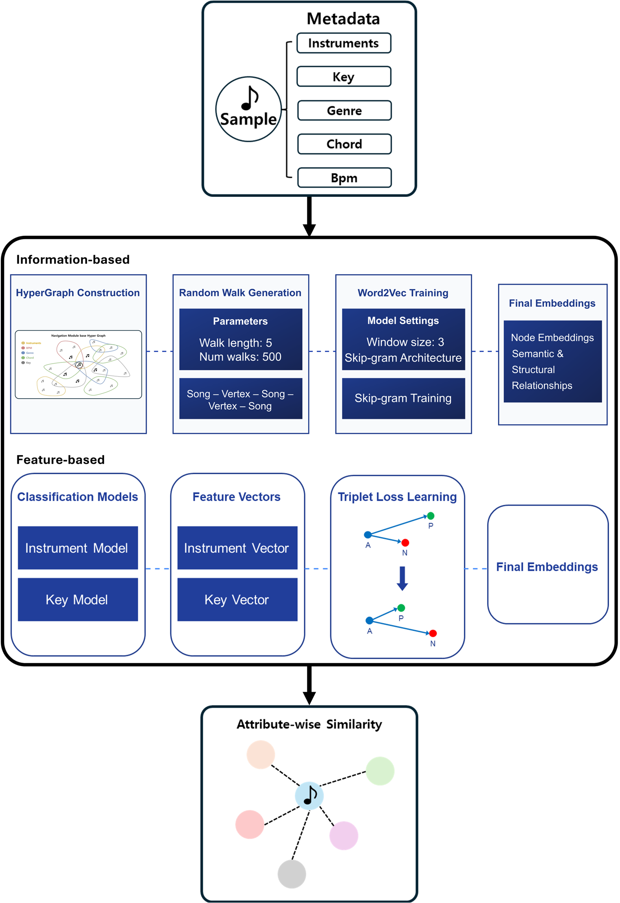

# 音乐采样相似推荐：元数据走超图随机游走 + Word2Vec，音频走 Siamese，按属性各出一份列表

关注我，每天为你精挑细选最优质、最新鲜的推荐算法paper，陪你一起保持进步、不断精进！

> [English version](keti-hybrid-music.full.en.md)

### 论文：Hybrid Music Similarity with Hypergraph and Siamese Network
### 网址：https://doi.org/10.3390/bdcc10030096
### 公司：韩国电子技术研究院（KETI）、祥明大学
### 思想：
### 方向：i2i\超图、随机游走 + Word2Vec、Siamese 网络、triplet loss、冷启动

## 解读：
本文的场景是音乐制作。编曲和制作人在采样库里找素材。采样（sample）是一段可直接用于编曲的音频素材（一段鼓点、一段铜管、一段和弦），就是本文的 item。手上已经有一个采样，想找「同乐器」「同调」「同曲风」的其他采样。trigger 是这个采样。采样几乎没有用户交互，协同过滤用不上；只看元数据或只看音频，又各缺一半。

本文用两个独立训练的模块分别算相似。元数据模块把采样和它的属性值建成超图，随机游走后用 Word2Vec 学向量，负责曲风、和弦、BPM；音频模块在冻结的乐器、调性分类器上训 Siamese 网络，负责乐器和调性。推荐时不出一个综合排序，而是按属性各出一份「最像的采样」列表（同乐器的、同调的、同曲风的……），由用户自己挑看哪一份；两个模块的相似度也不加权合成一个总分。

### 模型侧

#### 元数据模块
对应图中 Information-based 一行。

* **建超图。** 节点有两类，一类是采样，一类是属性值（如「BPM 120」「Jazz」「F 调」）。每个采样和它的 5 个属性值（乐器、调性、曲风、和弦、BPM）连成一条超边，呈星形。
* **随机游走。** 从每个节点出发走 500 条，每条长 5，形如「采样 – 属性值 – 采样 – 属性值 – 采样」（超图是星形的，采样和属性值只能交替出现；从属性值出发的路径则是「属性值 – 采样 – 属性值 – 采样 – 属性值」）。两个采样出现在同一条路径里，说明它们共享某个属性值。
* **Word2Vec。** 把游走路径当句子，用 skip-gram（窗口 3）学出每个采样、每个属性值的 128 维向量。共享属性值越多的采样，向量越近。只训一个 Word2Vec，每个采样只有一个向量（混合了全部 5 个属性的信息），曲风、和弦、BPM 三个属性共用。
* **检索。** 用余弦相似度找最近的采样。

#### 音频模块
对应图中 Feature-based 一行。乐器和调性各训一套，结构相同。

* **抽特征。** 乐器用一个预训练的 CNN + Transformer 分类器（10 类，输入梅尔谱），调性用一个预训练的 CNN + BiGRU 分类器（12 类，输入 CQT 谱）。两个分类器都冻结，取倒数第二层输出当特征。
* **Siamese + triplet loss。** 在特征上训一个 Siamese 网络，输出 128 维向量（网络结构论文没给）。同类（同乐器或同调）的采样互为正样本，不同类的当负样本，margin 1.0。
* **检索。** 先算每个类的中心（类内向量的平均），新采样先找最近的类中心，再在这个类里按余弦相似度排序。

**推荐时怎么用。** 两个模块各自检索，乐器、调性的列表来自音频模块，曲风、和弦、BPM 的列表来自元数据模块，放在同一个界面的一张星形图里（图中最下方）。trigger 在中心，每个属性挑代表性的相似采样连过来（论文没说几个，图 3 的示例是每个属性 1 个），连线越短越相似，不同属性用不同颜色区分。曲风、和弦、BPM 共用一个向量、只有一份近邻，示例里却各给了一个不同的采样，怎么挑的论文没说。

### 数据侧
**数据集。** 自建、不公开，共 25.4 万个采样（16 kHz）。属性有乐器 7 类、曲风 12 类、和弦 2 类（大调、小调）、调性 12 类加「无调性」、BPM 为 0–172 的整数（0 表示无节拍信息）。

**评测方式。** 这些属性既是训练标签，也是评测真值。Siamese 训练时按 8:2 切分，但检索评测时所有采样都当 query，在全量数据上检索（作者明确说训练和检索是同一个样本池，衡量的是嵌入的一致性，不是对新采样的泛化）。

### 效果（仅离线）
本文方法的 Precision@10 是乐器 0.970、调性 0.939、曲风 / 和弦 / BPM 都在 0.999 以上。按论文自己的表 1，简单基线在 5 个属性里有 4 个更高（one-hot 元数据在曲风、和弦上为 1.000，OpenL3 音频嵌入在乐器上为 0.986），本文只在调性上明显更好（OpenL3 为 0.314）。

## 心得：

## 愚见

## 可信度：离线

## 推荐等级：有时间看看

**请帮忙点赞、转发，谢谢。欢迎干货投稿 \ 论文宣传\ 合作交流**

### 【铁粉】请入微信群，群内我会给出更深入的解读，还可以共同讨论技术方案、发招聘广告、内推和交友等。
* 铁粉标准：关注公众号一个月以上，且在公众号上累计15次互动（评论、爱心、转发）、或投稿1次，只欢迎技术同学。
* 入群方法：请您加个人微信lmxhappy，我拉您入群，请备注【公司】（只我个人看，不公开）。

## 推荐您继续阅读：
