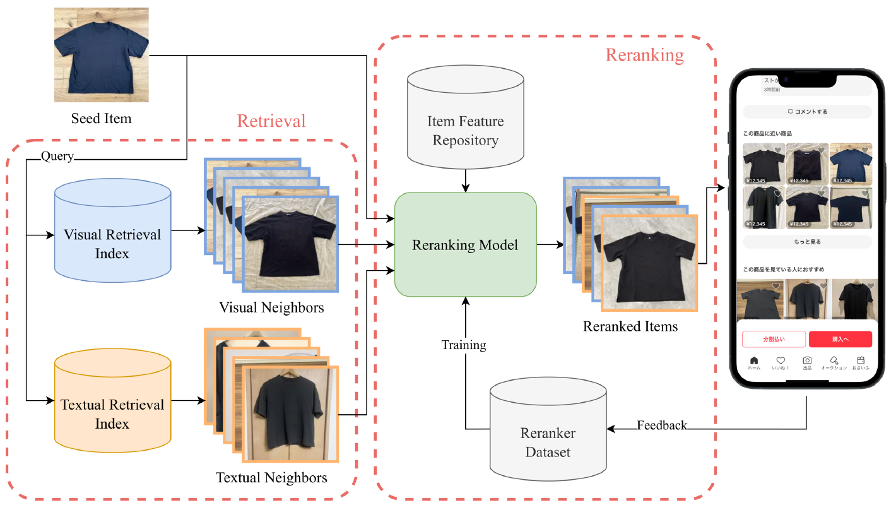

# Mercari, detail-page similar-item recommendation, purchases +20.4%, then +12.7% more from a ranking model

> [中文版](mercari-hybrid-i2i.md)

### Paper: Hybrid Retrieval and Multimodal Reranking for Item-to-Item Recommendation in a C2C Marketplace (RecSys'26)
### Link: https://doi.org/10.1145/3773078.3831894
### Company: Mercari
### Idea: adding a text retrieval channel, lightweight MLP ranking model
### Area: i2i (the similar-item module on an item detail page)

## Overview:
Mercari is Japan's largest second-hand (C2C) marketplace. Its item detail page has a "similar items" module, whose previous version had a single image retrieval channel: take the SigLIP image vector of the item being viewed (the seed item), run an ANN search, and rank by similarity. This paper does two things: it adds a second retrieval channel, an ANN lookup over Japanese title embeddings, and it adds an MLP ranking model on top (the paper calls it a reranker). The two steps shipped separately and lifted purchases from the module by +20.4% and then a further +12.7%.

### Two problems with image-only retrieval
**Looking alike doesn't mean being the same thing.** Second-hand listings can have near-identical photos and very different titles: standard vs. limited edition, size, model number, brand, condition. Buyer intent on the detail page often hinges on exactly these text attributes, which the image encoder never sees.

**Items with poor photos get no recommendations.** Photos are taken by sellers: bad lighting, occlusion, a shot of just the box. Such items find no close enough neighbors in image-embedding space, and since the module only renders when a fixed minimum number of neighbors clear the similarity threshold, the whole module simply doesn't show up.

There was also a separate keyword-based similar-item module on the same page that often surfaced the same items as the image module; merging them into one module uses screen space better.

### Architecture

### (1) Retrieval: a new title-embedding channel
The paper trains no model for this channel: it encodes item titles with a Japanese sentence-embedding model that Mercari's search team already had (fine-tuned from Ruri) and reuses it as-is. The search team trained it for search, with contrastive learning on millions of "search query → title of the item eventually purchased" pairs, so that a query sits close to the titles of items bought from it.

They don't use SigLIP's own text tower because it was trained for image-text alignment, not text-to-text similarity, and Mercari titles are almost all Japanese.

They also didn't merge image and text into one joint vector, because the image and text vectors are both shared with other recommendation surfaces and search, and merging them would couple all of those together.

### (2) Ranking: one MLP
It scores each (seed item, candidate item) pair. Inputs are both items' SigLIP image vectors and Ruri text vectors, plus categorical features like category and brand and numeric features like price and freshness, all concatenated and fed through an MLP trained with sigmoid cross-entropy; the label is whether the user engaged with the candidate (click-like).

**One model for several surfaces.** The detail page has other i2i modules too (e.g. "people who viewed this also recommend"). A categorical feature identifies which surface the request came from, training data is pooled across surfaces, and one set of weights serves all i2i modules.

**Samples.** The last week of session logs; sessions with no interaction with the module are dropped entirely. Data is regenerated and the model retrained weekly. About 80M item pairs in total, 22M of them from the similar-item module, with 22.2% positives.

**Position bias.** They tried PAL (position as a training feature, removed at prediction time) and IPW (weight samples by inverse exposure probability), and went with the simplest option: train and evaluate offline only on items within the first screen of the module, visible without scrolling. Users very likely saw these items, so an offline gain is more likely to carry over online.

**Offline ablation.** Removing the structured features hurts the most; removing the text vector hurts only slightly. The authors' explanation: the offline label is clicks, and clicks are driven mostly by the thumbnail, while text attributes like size, brand and condition matter more for whether someone buys.

On serving, the ranking model runs on a 4-core CPU at about 15ms p99.

### A/B results
Both experiments ran two weeks; all metrics are counted on the similar-item module only.

**Hybrid retrieval**: control is image-only retrieval; neither arm has a ranking model, and both use the same filters and boosting rules (same category, freshness, etc.). Purchases +20.4%, buyer conversion rate +17.8%. Broken down: module impression rate +34.1%, per-impression tap rate −8.2% (the newly shown cases are harder by construction), total taps +29.8%. The gain comes mainly from coverage: detail pages that used to show no module now show one.

**Ranking model**: both arms use hybrid retrieval; treatment adds the ranking model. Purchases +12.7%, buyer conversion rate +12.0%, tap rate +1.7%.

**At the whole-detail-page level the order flips**: hybrid retrieval lifts detail-page purchases by only +2.1% (it changes one module), while the ranking model lifts them by +7.2% (it also applies to the other i2i modules on the same page). Conversion on the home feed and search dipped slightly, so part of the purchases moved over from there; the marketplace-level net effect was positive and both versions shipped.

## Takeaways:
* In long-tail settings with uneven photo quality, retrieval coverage comes first: an item retrieval can't surface is one the ranking model can't save. The biggest gain here came from "the module can finally render".
* Text retrieval reuses the search team's "query → purchased title" embeddings without retraining; reusing embeddings across teams is a cheap source of gains.
* When reading a single module's lift, also look at the whole page and the marketplace: part of the module's gain is moved over from the home feed and search.

## Caveats
* The ranking model has no explicit seed-candidate cross features (the two similarity scores, same brand, price ratio, etc.); the MLP has to learn them from concatenated vectors. In practice these would very likely be added.
* The paper doesn't say how many candidates each path retrieves or how the display threshold is set.
* The ranking model is trained on click-like labels while the core metric is purchases; the authors themselves say the text vector's value should show up on purchases, yet they didn't try purchase labels or multi-task.

## Credibility: production

## Recommendation: practically useful
