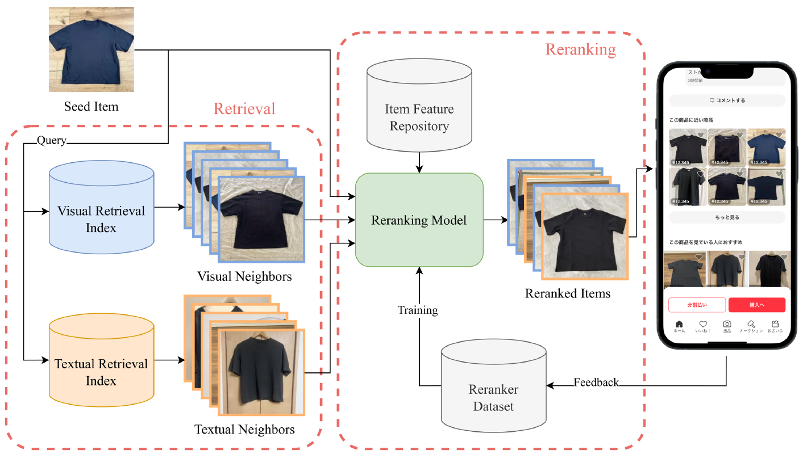

# Mercari，详情页相似推荐，购买+20.4%，排序模型再+12.7%

关注我，每天为你精挑细选最优质、最新鲜的推荐算法paper，陪你一起保持进步、不断精进！

> [English version](mercari-hybrid-i2i.full.en.md)

### 论文：Hybrid Retrieval and Multimodal Reranking for Item-to-Item Recommendation in a C2C Marketplace
### 网址：https://doi.org/10.1145/3773078.3831894
### 公司：Mercari（日本最大的二手交易平台）
### 思想：
### 方向：i2i、召回、ranking

## 解读：
详情页上有一个「和这件商品相似的商品」模块，去年的版本只有一路图片召回：拿当前商品（种子商品）的 SigLIP 图片向量做 ANN 检索，按相似度直接排。本文做了两件事：召回加一路日文标题向量的 ANN；再在后面加一个 MLP 排序。

### 只用图片召回的两个问题
**看着像，不一定是同一个东西。** 二手商品图片很像，标题可能差很多：普通版和限定版、尺码、型号、品牌、成色。买家在详情页的意图常常就落在这些文字属性上，图片编码器看不到。

**图拍得差的商品出不了推荐。** 二手商品的图是卖家随手拍的：光线差、有遮挡、只拍了包装盒。这类商品在图片向量空间里找不到足够近的邻居；而这个模块要求过相似度阈值的邻居凑够固定条数才展示，凑不够整个模块就不出。

另外详情页上原本还并列着一个基于关键词的相似推荐模块，和图片模块经常推出同样的商品，合成一个模块更省屏幕。

### 模型结构

### （1）召回：新增一路标题向量召回
这一路本文没有训练模型：对商品标题编码，直接拿 Mercari 搜索团队已有的日文句向量模型来用（基于 Ruri 微调）。那是搜索团队为搜索训的：在数百万「搜索词-最终被购买商品的标题」对上做对比学习，让搜索词和最终被买的商品标题靠得近。

不用 SigLIP 自带的文本塔，是因为它是为图文对齐训练的，不擅长「文本和文本比相似」；而且 Mercari 的标题基本是日文。

也没有把图片、文本合成一个联合向量，因为图片、文本两套向量还被其他推荐位和搜索共用，合成一个会把各方绑在一起。

### （2）排序：一个 MLP
对每个（种子商品，候选商品）对打一个分。输入是两者各自的 SigLIP 图片向量、Ruri 文本向量，加上类目、品牌这类离散特征和价格、新鲜度这类数值特征，全部拼接后过 MLP，用 sigmoid 交叉熵训练，标签是用户有没有和候选商品产生互动（点击一类）。

**一个模型服务多个推荐位。** 详情页上还有其他 i2i 模块（比如「看过这件的人还推荐」），加一个「来自哪个推荐位」的离散特征，训练数据混在一起，同一套权重服务所有 i2i 模块。

**样本。** 取最近一周的 session 日志，用户没和推荐模块有过任何互动的 session 整个丢掉；每周重新生成数据、重新训练。总共约 8000 万个商品对，其中相似推荐模块 2200 万，正样本占 22.2%。

**位置偏差。** 试过 PAL（训练时把位置当特征、预测时去掉）和 IPW（按曝光概率的倒数给样本加权），最后选了最简单的：训练和离线评估都只用模块里一屏之内、不往下滑就能看到的商品。这些商品用户大概率真的看到过，离线涨了，线上也更可能涨。

**离线消融。** 去掉结构化特征掉得最多，去掉文本向量只掉一点。作者的解释是离线标签是点击，点击主要看缩略图；尺码、品牌、成色这些文字信息更影响买不买。

服务上，排序模型在 4 核 CPU 上 p99 约 15ms。

### A/B效果
两次实验各两周，指标都只统计相似推荐模块。

**混合召回**：对照是纯图片召回，两组都没有排序模型、用同样的过滤和加权规则（同类目、新鲜度等）。购买 +20.4%，买家转化率 +17.8%。拆开看，模块展示率 +34.1%，单次曝光点击率 −8.2%（新增的展示本来就是难例），总点击 +29.8%。收益主要来自覆盖：以前不出模块的详情页现在出了。

**排序模型**：两组都用混合召回，实验组多加排序模型。购买 +12.7%，买家转化率 +12.0%，点击率 +1.7%。

**放到整个详情页看**，顺序反过来：混合召回只让详情页购买 +2.1%（只改了一个模块），排序模型 +7.2%（它同时作用在同页其他 i2i 模块上）。首页和搜索的转化略有下降，部分购买是从那边挪过来的；大盘整体为正，两版都上线了。

## 心得：
* 长尾、图片质量参差的场景，召回覆盖是第一位的：召回捞不到的商品，排序模型救不回来。本文最大一笔收益来自「模块终于能展示了」。
* 文本召回直接复用搜索团队「搜索词-购买标题」训出来的向量，不新训，跨团队复用向量是低成本的收益来源。
* 看单模块涨幅要同时看整页和大盘：模块涨的一部分是从首页、搜索挪过来的。

## 愚见
* 排序模型没有种子商品和候选商品之间的显式交叉特征（两路相似度、是否同品牌、价格比等），MLP 只能从拼接的向量里自己学，实际中大概率会加。
* 两路各召回多少、展示阈值怎么定，论文没讲。
* 排序模型用点击类标签训练，但核心指标是购买；作者自己也说文本向量的价值应体现在购买上，却没有试购买标签或多目标。

## 可信度：生产

## 推荐等级：有实践价值

**请帮忙点赞、转发，谢谢。欢迎干货投稿 \ 论文宣传\ 合作交流**

### 【铁粉】请入微信群，群内我会给出更深入的解读，还可以共同讨论技术方案、发招聘广告、内推和交友等。
* 铁粉标准：关注公众号一个月以上，且在公众号上累计15次互动（评论、爱心、转发）、或投稿1次，只欢迎技术同学。
* 入群方法：请您加个人微信lmxhappy，我拉您入群，请备注【公司】（只我个人看，不公开）。

## 推荐您继续阅读：
