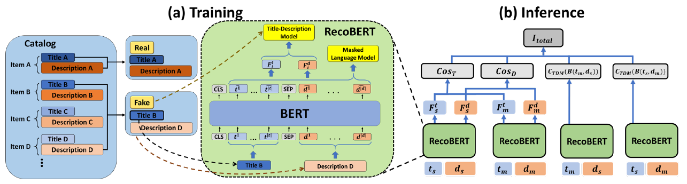

# Cold-start i2i without user data: train BERT on the catalog with a self-supervised "does this title match this description" task, then recommend by text similarity

> [中文版](microsoft-recobert.md)

### Paper: RecoBERT: A Catalog Language Model for Text-Based Recommendations (arXiv 2020)
### Link: https://arxiv.org/abs/2009.13292
### Institution: Microsoft, Tel Aviv University, et al.
### Ideas: catalog-specialized BERT, title-description matching, masked language model, cross-paired title/description scoring, cold catalogs
### Area: i2i (cold start, text similarity)

## Breakdown:
A new store has no user behavior at all, so "similar items" on the product page can only rely on item text, and there are no labels saying which two items are similar. The paper continues training BERT on the catalog with a self-supervised task: deciding whether a title and a description come from the same item. At recommendation time, given an item, its title and description are compared with those of each candidate in pairs, and four similarity scores are summed for ranking.

Each item has a title and a description. For wine, the title is "winery + year + wine name + grape variety", and the description is a sommelier's review (aromas, palate, tannins and so on).

### Method
First train BERT on the catalog, then use it to score item pairs.

#### (1) Training: does the title match the description
* **Input.** An item's title and description are concatenated into one sequence and fed to BERT-Large; the title tokens' outputs are averaged into a title vector and the description tokens' outputs into a description vector.
* **Title-description matching.** Half the samples use the item's own title and description (positives); the other half swap in another item's description (negatives). The cosine of the two vectors is mapped to 0–1 as the probability that they match, trained with cross-entropy.
* **Masked language model.** At the same time, 15% of tokens are randomly masked for the model to recover, adapting BERT to the catalog's jargon; for example, in wine the opposite of "dry" is "sweet", not "wet".

The two losses are simply added. Training needs neither similarity labels nor user behavior.

#### (2) Inference: summing four similarities
Given query item s and candidate item m, four scores are computed:
* **Description vs. description, title vs. title.** s and m each go through the model once, and the cosines of their two description vectors and of their two title vectors are taken.
* **Cross pairing.** m's title and s's description are concatenated and passed through the model, then scored with the matching head from training; s's title with m's description is scored the same way. The idea is "does this item's title fit that item's description".

Each score is standardized across all candidates, and the four are summed with equal weights for ranking. The first two scores can use precomputed vectors; the last two need a BERT pass for every item pair.

### Data and results
* **Wine.** 120K wine reviews from Kaggle; the authors had a sommelier label about 10 similar wines for each of about 100 wines, 1,095 labels in all, now public. Ranking among all 120K wines using descriptions only, HR@10 is 10.4%, vs. 4.5% for a baseline that only continues BERT pre-training on the catalog. Ranking only among the 1,095 labeled wines with all four scores, HR@10 is 65.4%, and 60.6% without the two cross-pairing scores.
* **Fashion.** 4,000 items; a fashion expert scored the top 5 recommendations for 100 query items from 0 to 5, averaging 3.94 vs. 3.75 for the best baseline.
* **Compute.** Training on the wine catalog took 1.5M steps, about 5 days on one V100; inference runs at about 340 items per second, and the whole 4,000-item fashion catalog takes about 7 hours.

The paper notes that Microsoft has productized a similar capability (with the TNLR language model) but gives no online numbers.

## Takeaways
* With no user behavior or similarity labels, the catalog's own title-description pairs can form a self-supervised task that adapts a language model to the domain.
* Cross-pairing titles and descriptions at inference adds information beyond comparing two text vectors, at the cost of a model pass for every item pair.

## Caveats
* MRR and HR in Table 1 don't agree: on the 1,095 wines, HR@5 is 38.6% and HR@10 65.4%, so a standard reciprocal-rank MRR is at most about 46%, yet the table shows 91.7%. This MRR probably isn't the usual definition, and the paper doesn't explain it.
* The evaluation over all 120K wines uses only the description or title cosine; the full four-score method is evaluated only on the small 1,095-wine set (where HR@1000 is near 100%), because cross pairing needs a BERT pass per item pair and can't be run over the full catalog.
* Fashion relies on a single expert's scores, with average differences of 0.2 to 0.7 between models and no significance testing.

## Credibility: offline

## Recommendation level: worth a look if you have time
