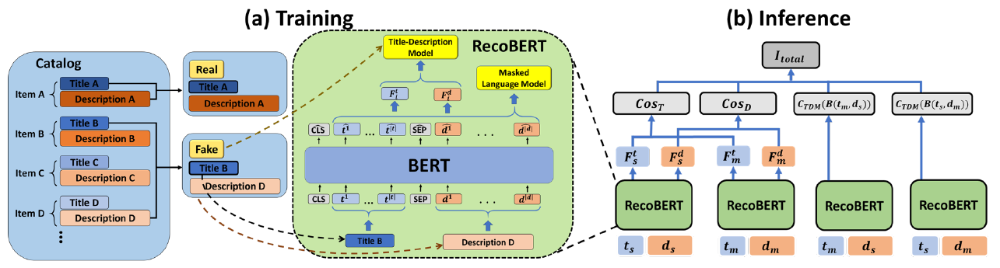

# 没有用户数据的冷启动 i2i：在商品目录上用「标题配不配描述」自监督训练 BERT，再按文本相似度推荐

关注我，每天为你精挑细选最优质、最新鲜的推荐算法paper，陪你一起保持进步、不断精进！

> [English version](microsoft-recobert.full.en.md)

### 论文：RecoBERT: A Catalog Language Model for Text-Based Recommendations
### 网址：https://arxiv.org/abs/2009.13292
### 公司：微软、特拉维夫大学等
### 思想：
### 方向：i2i（冷启动、文本相似）

## 解读：
新开的店没有任何用户行为，详情页的相似推荐只能靠商品文本，也没有「哪两件商品相似」的标注。本文在商品目录上继续训练 BERT，自监督任务是判断一段标题和一段描述是不是来自同一件商品；推荐时给定一件商品，把它和候选商品的标题、描述两两比较，四个相似度加起来排序。

每件商品有一个标题和一段描述。以葡萄酒为例，标题是「酒庄 + 年份 + 酒名 + 葡萄品种」，描述是品酒师写的一段评语（香气、口感、单宁等）。

### 方法
先在目录上训练 BERT，再用它给商品对打分。

#### （1）训练：标题配不配描述
* **输入。** 把一件商品的标题和描述拼成一条序列送进 BERT-Large，标题部分的输出取平均得到标题向量，描述部分的输出取平均得到描述向量。
* **标题-描述匹配。** 一半样本用商品自己的标题和描述（正样本），另一半把描述换成别的商品的（负样本）。两个向量的余弦映射到 0 到 1 当作「配得上」的概率，用交叉熵训练。
* **掩码语言模型。** 同时随机遮住 15% 的词让模型还原，让 BERT 适应这个目录的行话，比如葡萄酒里「干」的反义词是「甜」，不是「湿」。

两项损失直接相加。整个训练不需要相似标注，也不需要用户行为。

#### （2）推理：四个相似度相加
给定查询商品 s 和候选商品 m，算四个分数：
* **描述对描述、标题对标题。** s 和 m 各自过一遍模型，算两个描述向量的余弦、两个标题向量的余弦。
* **交叉配对。** 把 m 的标题和 s 的描述拼起来过一遍模型，用训练时的匹配打分；s 的标题配 m 的描述同样算一次。意思是「这件商品的标题，配不配得上那件商品的描述」。

四个分数各自在所有候选上标准化，等权相加后排序。前两个分数可以预先算好向量，后两个每对商品都要过一遍 BERT。

### 数据与效果
* **葡萄酒。** Kaggle 上 12 万条葡萄酒评论，作者请品酒师给约 100 瓶酒各标了约 10 瓶相似的，共 1,095 条，已公开。只用描述在 12 万瓶里排序，HR@10 为 10.4%，只在目录上继续做 BERT 预训练的基线是 4.5%。只在 1,095 瓶标注酒里排序、用上四个分数时，HR@10 为 65.4%，去掉两个交叉配对分数是 60.6%。
* **服装。** 4,000 件商品，时尚专家给 100 件查询商品的前 5 个推荐打 0 到 5 分，平均 3.94，最好的基线 3.75。
* **算力。** 葡萄酒目录训练 150 万步，单张 V100 约 5 天；推理每秒约 340 件，4,000 件的服装目录全部算完约 7 小时。

论文提到微软已上线了类似能力（换成 TNLR 语言模型），但没有给线上数据。

## 心得：

## 愚见

## 可信度：离线

## 推荐等级：有时间看看

**请帮忙点赞、转发，谢谢。欢迎干货投稿 \ 论文宣传\ 合作交流**

### 【铁粉】请入微信群，群内我会给出更深入的解读，还可以共同讨论技术方案、发招聘广告、内推和交友等。
* 铁粉标准：关注公众号一个月以上，且在公众号上累计15次互动（评论、爱心、转发）、或投稿1次，只欢迎技术同学。
* 入群方法：请您加个人微信lmxhappy，我拉您入群，请备注【公司】（只我个人看，不公开）。

## 推荐您继续阅读：
