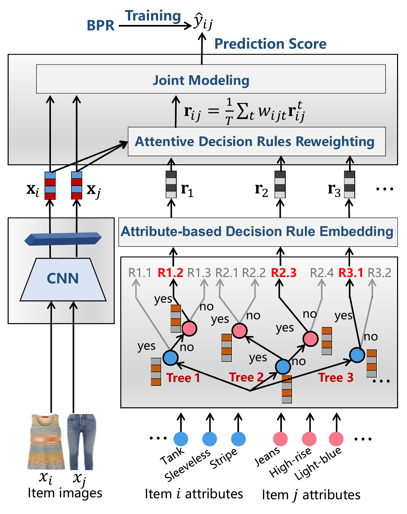

# Outfit matching: a GBDT extracts cross-item rules from the attributes of two items, each rule is encoded from its attribute crosses and scored together with image vectors; attention weights and per-cross scores explain "why they match"

> [中文版](nus-aic.md)

### Paper: Interpretable Fashion Matching with Rich Attributes (SIGIR 2019)
### Link: https://doi.org/10.1145/3331184.3331242
### Institution: National University of Singapore, University of Science and Technology of China, Hefei University of Technology
### Ideas: GBDT decision paths as rules, attribute-cross rule embedding, attentive rule reweighting, visual-rule joint scoring, BPR, interpretable complementary matching
### Area: i2i (complementary recommendation, outfit matching, explainable recommendation)

## Breakdown:
When a user is looking at a piece of clothing (e.g., a top), recommend matching items from complementary categories (bottoms, shoes) and say why they match. The paper first trains a GBDT whose input is the attributes of the two items concatenated; each tree's root-to-leaf path is a cross-item rule (e.g., "top material = wool AND bottom material = wool AND top category = blazer"). Each rule is encoded into a vector from the crosses of adjacent attributes on it, an attention network weights the rules, and three scores computed together with the two items' image vectors are summed.

Existing outfit matching relies mainly on images and pulls matching items together in a vector space; it is a black box that can't say why two items match. Items come with rich attributes (category, color, material, pattern, neckline, style) that are largely unused, and hand-written matching rules depend on domain knowledge and have limited coverage.

### Method
First train a GBDT and freeze it, using it to extract rules for each item pair ((1)); then encode each rule into a vector ((2)); finally weight the rules using the image vectors and sum three terms into a score ((3)). (2) and (3) are trained together with BPR.

#### (1) GBDT rule extraction
* **Input.** The two items' attributes are each one-hot encoded and concatenated as "the top's attributes, the bottom's attributes". The same value on the two items is a different feature (top material = wool and bottom material = wool are two columns).
* **T rules per pair.** Trained with XGBoost (10 trees, max depth 6 by default). An item pair lands in one leaf of each tree, and the root-to-leaf path is recorded as a rule, i.e., a sequence of "attribute + yes/no". Attributes of both items can alternate along a path, so a rule is a cross-item, high-order attribute cross.
* **Paths only, no scores.** The leaf predictions are not used in scoring; the authors argue that trees generalize poorly to unseen attribute combinations (such inputs tend to go "no" all the way down). The trees are frozen after training and not updated afterwards. The paper doesn't say what samples or labels the trees are trained on.

#### (2) Encoding a rule into a vector
The goal is for rules containing similar attributes to get similar vectors, instead of one independent ID vector per leaf.
* **Attribute + decision.** Each attribute has a 64-dim vector, and "yes" and "no" each have one shared vector; the attribute vector plus its decision vector represents "top material = wool, decision yes". Only (number of attributes + 2) vectors are needed. The paper doesn't make clear whether the same value on the two items shares one attribute vector.
* **Attribute crosses.** For windows of 2, 3, … adjacent attributes on the path, take the element-wise product; each window gives one cross vector. For example, a path with 3 attributes has two second-order crosses, (1,2) and (2,3), and one third-order cross, (1,2,3). Only contiguous windows on the path are used, not arbitrary combinations.
* **Averaging.** The average of all cross vectors is the rule's vector.

**Why not one ID vector per rule.** That way rules share no parameters, and the parameter count grows linearly with the number of leaves. When the number of trees goes from 10 to 100, the ID version's hit@5 on men's drops from 39.25 to 37.88, while the attribute-based version stays flat (39.51, 39.45).

#### (3) Attention weighting and three-term scoring
* **Image vectors.** A pretrained ResNet-50 extracts pool5 features, and one linear layer compresses them to 64 dims. Both items share this image encoder.
* **Rule weighting.** For rule t, multiply (query item's image vector + rule vector) element-wise with the candidate's image vector, concatenate the result with the rule vector itself, and pass it through one ReLU hidden layer to get a score; a softmax over the T rules gives the weights, and the weighted average is the pair's rule vector. The query item and the candidate play asymmetric roles in this input, matching directed pairings such as "top to bottom".
* **Scoring.** Three terms are summed, each the inner product of a learnable weight vector with a 64-dim vector. The first is image matching (element-wise product of the two image vectors), the second is rule matching (the rule vector itself), and the third is image-rule interaction (the sum of the two image vectors multiplied element-wise with the rule vector). All three depend on the pair as input: this is a learned scoring network, not a fixed vector similarity.

**Loss.** BPR, requiring positive pairs to score higher than negative pairs. Positives are two items that appear in the same outfit. Each positive gets 3 negatives, sampled at random from items in a category different from the query item's, which never appeared in the same outfit as the query item.

**How explanations are given.** Two levels. At the rule level, take the rules with the largest attention weights. At the attribute-cross level, use the fact that the second term is linear (a rule vector is the average of its cross vectors): each cross's contribution to the score is "rule weight × inner product of the second term's weight vector with that cross vector", and the largest one is picked. For example, for a navy coat with low-rise gray jeans, the top contributor in the first rule is "bottom low-rise & top style sophisticated"; for a white sleeveless cutout dress with white heels, it is "dress white & shoes white". Explanations come only from the second term; the image term and the interaction term are not part of the explanation.

**Why add the third term.** It lets image and rules interact in the same space, effectively using attribute rules to correct image matching. On women's, using only the third term (MRR 33.12) is on par with using all three (33.18).

### Inference
* **Pairwise scoring.** Each candidate must be concatenated with the query item's attributes and run through the GBDT to get T paths, then through attention and the three terms; candidate vectors can't be precomputed for vector retrieval.
* **Evaluation setup.** Each positive test pair gets 500 negatives (sampled from all categories other than the query item's), and the 501 candidates are ranked. The paper doesn't discuss retrieval over the full catalog.

### Data and results
The authors crawled 30,790 outfits from the Lookastic outfit website and treat two items in the same outfit as a positive pair. Men's has 5,069 items and 125k pairs; women's has 10,016 items and 159k pairs. Attributes come from the site's annotations, supplemented with Visenze's automatic tagging API: 65 colors, 38 materials, 40 patterns, 253 fine-grained categories, 11 styles and 114 category-specific attributes. Random 70%/20%/10% split, repeated 5 times and averaged. All baselines use the same image features and BPR loss (except the Siamese network). Offline experiments only.
* **Overall.** MRR is 30.74 on men's and 33.19 on women's, versus 29.10 and 31.63 for the strongest baseline TEM (which also uses GBDT paths but one ID vector per rule), relative gains of 5.6% and 4.9%. The image-only BPR-DAE gets 23.35 and 23.69.
* **Three-term ablation (MRR, men's/women's).** Rule term only 18.90/23.40, interaction term only 29.22/33.12, image term + rule term 30.38/32.73, all three 30.74/33.18.
* **Attention.** Replacing it with average pooling drops hit@5 from 39.51 to 37.70 on men's and from 43.83 to 42.69 on women's; max pooling gives 38.01 and 42.98.

## Takeaways
* GBDT root-to-leaf paths over the concatenated attributes of two items give cross-item attribute rules for free, with no hand-written matching rules.
* Encoding a rule as the average of its attribute crosses lets rules share parameters, which keeps the model stable as the number of trees grows, where per-leaf ID vectors overfit.
* Because the rule term is linear in the cross vectors, each attribute cross's contribution to the score can be read off directly.

## Caveats
* The explanations cover only the rule term, which on its own is the weakest component (MRR 18.90/23.40 versus 30.74/33.18 for the full model), while the interaction term alone nearly matches the full model on women's; the explanations therefore account for a minor share of the score.
* At the default 10 trees, attribute-based and ID-based rule vectors differ by only 0.26 hit@5 on men's (39.51 vs 39.25), while TEM gets 37.88, so at the default setting most of the gain over TEM comes from the joint scoring terms; the attribute-based encoding mainly matters when the number of trees is large.
* Test negatives are drawn from every category except the query's, so many of them are not in the positive's category, and category compatibility alone can rank part of them; the split unit (pairs or outfits) is not stated.
* No code is released, and several details are unspecified (the GBDT's training samples and labels, the maximum cross order, whether the two items share attribute vectors); there are also small numeric slips (BPR-DAE's hit@10 of 30.90 on men's is below its hit@5 of 30.97; women's MRR is 33.19 in Table 1 and 33.18 in Table 3).

## Credibility: offline

## Recommendation level: worth a look if you have time
