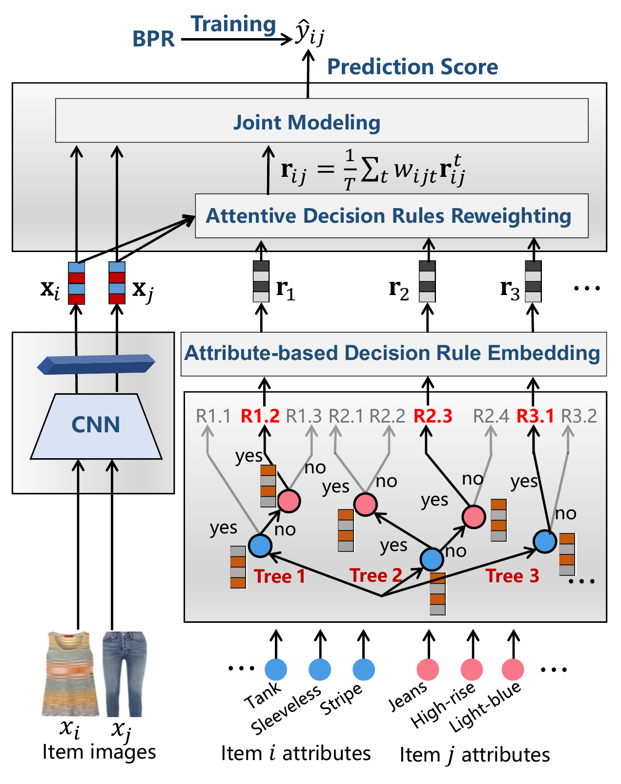

# 穿搭搭配：GBDT 从两件单品的属性里抽出跨单品规则，规则按属性交叉编码成向量，和图像向量一起打分；注意力权重和每个属性交叉的分数给出「为什么搭」

关注我，每天为你精挑细选最优质、最新鲜的推荐算法paper，陪你一起保持进步、不断精进！

> [English version](nus-aic.full.en.md)

### 论文：Interpretable Fashion Matching with Rich Attributes
### 网址：https://doi.org/10.1145/3331184.3331242
### 公司：新加坡国立大学、中国科学技术大学、合肥工业大学
### 思想：
### 方向：i2i（互补推荐、穿搭搭配、可解释推荐）

## 解读：
用户在看一件衣服（比如一件上衣）时，从互补品类（下装、鞋）里给它配单品，并说出为什么搭。本文先训练一个 GBDT，输入是两件单品的属性拼在一起，每棵树从根走到叶子的路径就是一条跨单品的规则（如「上衣材质=羊毛 且 下装材质=羊毛 且 上衣品类=西装外套」）。每条规则按其中相邻属性的交叉编码成向量，注意力网络给各条规则加权，再和两件单品的图像向量一起算三项分数相加。另外，本文还给推荐做了解释。

已有的穿搭匹配主要用图像，在向量空间里拉近搭配的两件，是黑盒，说不出为什么搭。单品本身带着丰富的属性（品类、颜色、材质、图案、领型、风格），却基本没被用上；手工写搭配规则又依赖领域知识，覆盖不全。

### 方法
一对单品的分数由三项相加，图像匹配、规则匹配、两者交互。每项是一个 64 维向量，和各自可学的权重向量做内积后再相加。规则匹配用到这对单品的 T 个规则向量（每棵树一个），由 GBDT 抽出的规则编码而来。GBDT 先训练并固定，其余部分一起用 BPR 训练。

三项：
* **图像匹配。** trigger商品和target商品，都经过预训练的 ResNet-50 抽 pool5 特征，过一层线性层压到 64 维。两件单品共用这一套图像编码。图像匹配就是两件图像向量逐元素乘积。
* **规则匹配。** 用一个门控网络给出的权重，对 T 条规则向量（每棵树一个，怎么来见下一节）做加权平均，得到这对单品的规则向量匹配。
    * **注意力网络（门控网络）。** 对某条规则，把（主单品图像向量 + 规则向量）与候选单品图像向量逐元素相乘，再和规则向量本身拼接，过一层 ReLU 隐层，再和一个权重向量做内积，得到一个标量分数；T 条规则的分数做 softmax，得到各条的权重。
* **图像和规则的交互。** 两件图像向量之和与同一个规则向量逐元素相乘。

**损失。** BPR，要求正样本对的分数高于负样本对。正样本是同一套穿搭里出现过的两件单品。每个正样本配 3 个负样本，从和主单品不同品类的单品里随机抽，且从没和主单品出现在同一套里。

**解释怎么给。** 分两级。规则级取门控权重最大的几条规则。属性交叉级利用规则匹配项是线性的（规则向量是各交叉向量的平均），每个交叉对分数的贡献就是「规则权重 × 规则匹配项的权重向量与该交叉向量的内积」，取最大的那个。例如藏青大衣配低腰灰牛仔裤，第一条规则里贡献最大的是「下装低腰 & 上衣风格成熟」；白色无袖镂空连衣裙配白色高跟鞋，贡献最大的是「连衣裙白色 & 鞋白色」。解释只来自规则匹配项，图像匹配项和交互项不参与解释。

**为什么门控网络的输入不对称。** 主单品和候选单品在输入里的位置不同，对应「上衣配下装」这类有方向的匹配。

**为什么加交互项。** 让图像和规则在同一空间里交互，相当于用属性规则修正图像匹配。女装上只用交互项（MRR 33.12）就和三项都用（33.18）相当。

#### T 个规则向量从哪来
每棵树给这对单品一条规则，再把每条规则编码成一个向量，分两步。

##### （1）GBDT 抽规则
* **输入。** 两件单品的属性各自 one-hot，按「上衣的属性、下装的属性」拼起来。
* **一对单品得到 T 条规则。** 用 XGBoost 训练（默认 10 棵树、最大深度 6）。一对单品在每棵树里落到一个叶子，从根到这个叶子的路径记为一条规则，即一串「属性 + 是/否」。每棵树给一条，所以 T 就是树的棵数，默认每对 10 条。路径上可以交替出现两件单品的属性，所以一条规则就是一个跨单品的高阶属性交叉。同一种属性却可以出现多次（如先问「上衣材质=羊毛」走否、再问「上衣材质=棉」走是，或上衣、下装的材质各问一次）。只用路径，叶子上的预测分不用；树训练完就固定，后面不再更新。论文没写树用什么样本、什么标签训练。

##### （2）每棵树编码成一个向量
为这一对item，每棵树编码成一个 64 维向量。
* **属性 + 判断。** 每个属性一个 64 维向量，「是」「否」各一个共享向量，属性向量直接加上对应判断的向量，表示「上衣材质=羊毛，判断为是」。总共只需（属性数 + 2）个向量。论文没说清两件单品上的同一取值是否共用一个属性向量。这样一条规则就变成一串向量，路径上每个节点一个，最多 6 个。
* **属性交叉。** 路径上相邻的 2 个、3 个……属性取逐元素乘积，每个窗口得到一个交叉向量。只取路径上连续的窗口，不取任意组合。以最深的 6 个节点为例，二阶 5 个（1,2）（2,3）（3,4）（4,5）（5,6），三阶 4 个（1,2,3）（2,3,4）（3,4,5）（4,5,6），四阶 3 个（1,2,3,4）（2,3,4,5）（3,4,5,6），五阶 2 个（1,2,3,4,5）（2,3,4,5,6），六阶 1 个（1,2,3,4,5,6），共 15 个交叉向量。论文没说交叉阶数有没有上限，案例分析里只展示了二阶。
* **平均。** 所有交叉向量取平均，就是这条规则的向量。一对单品于是得到 T 个 64 维规则向量，交给上面的规则匹配，先经门控网络加权。

**为什么不用叶子的分数。** 作者认为树对没见过的属性组合泛化差，这类输入往往一路走「否」。

**为什么用属性拼出规则向量。** 更直接的做法是把每个叶子当成一个 ID，各学一个独立向量，不看规则里有哪些属性。那样规则之间不共享参数，参数量随叶子数线性增长。树数从 10 加到 100 时，ID 版本 hit@5 在男装上从 39.25 掉到 37.88，按属性编码的版本基本不变（39.51、39.45）。

### 推理
* **逐对打分。** 每个候选都要和主单品拼属性过 GBDT 拿到 T 条路径，再算门控权重和三项分数，候选向量无法提前算好做向量检索。
* **评测方式。** 每个测试正样本配 500 个负样本（从主单品以外的所有品类里抽），对这 501 个候选排序。论文没讨论全库召回。

### 数据与效果
自己从 Lookastic 穿搭网站爬了 30,790 套穿搭，把同一套里的两件当正样本对。男装 5,069 件单品、12.5 万对，女装 10,016 件、15.9 万对。属性来自网站标注，再用 Visenze 的自动打标 API 补充，共 65 种颜色、38 种材质、40 种图案、253 个细品类、11 种风格和 114 个品类专属属性。按 70%/20%/10% 随机划分，重复 5 次取平均。所有基线用同样的图像特征和 BPR 损失（Siamese 网络除外）。只有离线实验。
* **整体。** MRR 男装 30.74、女装 33.19，最强基线 TEM（同样用 GBDT 路径，但每条规则一个 ID 向量）为 29.10、31.63，相对提升 5.6%、4.9%。只用图像的 BPR-DAE 为 23.35、23.69。
* **三项消融（MRR，男装/女装）。** 只用规则项 18.90/23.40，只用交互项 29.22/33.12，图像项 + 规则项 30.38/32.73，三项全用 30.74/33.18。
* **门控网络。** 换成平均池化，hit@5 男装从 39.51 降到 37.70，女装从 43.83 降到 42.69；最大池化分别为 38.01、42.98。

## 心得：

## 愚见

## 可信度：离线

## 推荐等级：有时间看看

**请帮忙点赞、转发，谢谢。欢迎干货投稿 \ 论文宣传\ 合作交流**

### 【铁粉】请入微信群，群内我会给出更深入的解读，还可以共同讨论技术方案、发招聘广告、内推和交友等。
* 铁粉标准：关注公众号一个月以上，且在公众号上累计15次互动（评论、爱心、转发）、或投稿1次，只欢迎技术同学。
* 入群方法：请您加个人微信lmxhappy，我拉您入群，请备注【公司】（只我个人看，不公开）。

## 推荐您继续阅读：
