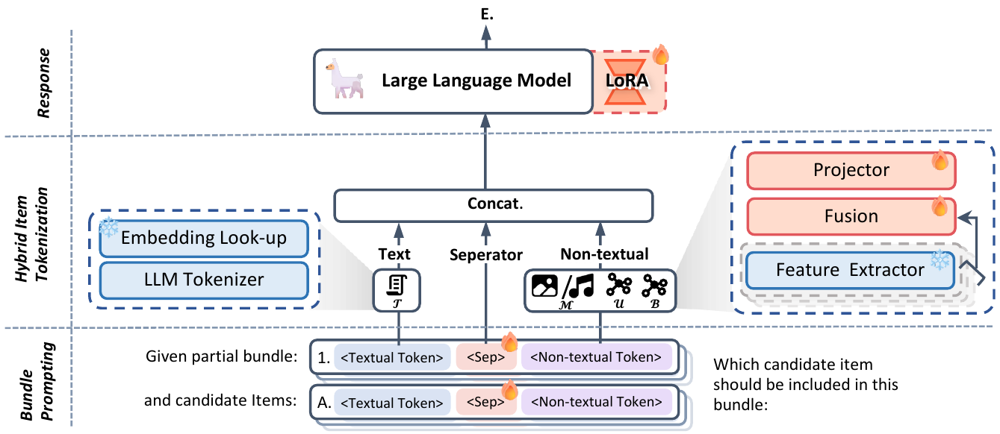

# Bundle completion as a multiple-choice question: each item enters the prompt as "text + one multimodal token"; first fine-tune the LLM on text alone to answer, then train the multimodal token to fit it

> [中文版](nus-bundle-mllm.md)

### Paper: Fine-tuning Multimodal Large Language Models for Product Bundling (KDD 2025)
### Link: https://arxiv.org/abs/2407.11712
### Institution: National University of Singapore, Communication University of China, et al.
### Ideas: product bundling, multiple-choice prompting, multimodal LLM, LoRA, hybrid item tokenization, LightGCN, two-stage fine-tuning
### Area: i2i (bundle completion, LLM)

## Breakdown:
Given part of a bundle and 10 candidates, the LLM picks the one that belongs in the bundle. The paper writes each item as "title text + one multimodal token": image or audio features, a vector learned from user interactions, and a vector learned from bundle co-membership are fused and compressed into one vector, inserted into the prompt as a single token.

Training has two steps: first drop the multimodal tokens and LoRA-fine-tune on text-only prompts so the LLM learns to answer the question; then freeze the LLM and train only the fusion module that produces the multimodal token, fitting it to the LLM that already knows the task.

The authors see two difficulties.
* **LLMs only read text.** Images, audio and interaction relations can't enter the prompt, yet bundling depends heavily on them (color, season, which items are often bought together).
* **Off-the-shelf multimodal LLMs can't do bundling questions.** They are aligned for captioning, handle many items in one question poorly, and have no modality for interaction relations.

### Method
(1) defines how the question is written, including how each item is written into it; (2) is the training. The deployed model is the LLM with LoRA plus the fusion module in (1) that produces the multimodal token. The authors are the same team as CLHE, and the fusion follows CLHE.

#### (1) Multiple-choice prompt
"Given the partial bundle: 1. item 1; 2. item 2; ... which candidate should be included in this bundle? Options: A. item A; B. item B; ... Answer with a single letter." The answer is the correct option's letter, e.g., "E". Chosen items are numbered and candidates lettered.

**How each item is written.** Each "item" slot is filled with three parts: title text, separator token, multimodal token.
* **Title text.** The title or category tags, using the LLM's own tokenizer and embedding table; it is not fused and is left for the LLM to read.
* **Separator token.** A learnable vector separating the text from the multimodal token.
* **Multimodal token.** First get three vectors: image features from BLIP2 or audio features from CLAP, plus one LightGCN trained on the user–item graph and another on the bundle–item graph, each giving an item vector. Each is linearly projected to a common dimension, the three are stacked as 3 tokens through self-attention and averaged, then an MLP projects the result to the LLM's embedding dimension, giving 1 token.

**Example.** Given a pullover sweater, a painter hat and pencil pants, the filled-in question is (<sep> and <mm> are one vector each):

> Given the partial bundle: 1. pullover sweater <sep> <mm>; 2. painter hat <sep> <mm>; 3. pencil pants <sep> <mm>. Which candidate should be included in this bundle? Options: A. pumpkin beret <sep> <mm>; B. black crossbody bag <sep> <mm>; ...; J. sports shorts <sep> <mm>. Answer with a single letter.

The LLM should answer "B".

**Why compress into one token.** Alternatively each feature could take its own token, preceded by text cues such as "image feature:". In the authors' experiments this is worse, makes prompts longer and inference slower, and the gap grows with the number of items per question.

#### (2) Two-stage training
The goal is first to teach the LLM the task, then to make the multimodal token readable by the LLM. Both stages use the same questions and differ only in which parameters are updated.
* **Building questions.** Take a real bundle from the training set and shuffle it; the first half is the partial bundle, another item from the same bundle not shown is the correct answer, and 9 items randomly drawn from outside the bundle are wrong options; the 10 candidates are shuffled (not stated in the paper; see utils.py in the official code). E.g., for the bundle {sweater, painter hat, pencil pants, crossbody bag}, the sweater and painter hat are given, and the crossbody bag is mixed with 9 random items.
* **Loss.** The LLM reads the question and, at the answer position, outputs probabilities over the whole vocabulary (about 32K tokens); cross-entropy looks only at the correct letter, so the higher its probability, the lower the loss. The question itself carries no loss.
* **Stage 1: text-only fine-tuning.** Remove the separator and multimodal tokens from the question, keep only text, and LoRA-fine-tune the LLM (Llama2-7B).
* **Stage 2: training the fusion module.** Freeze the LLM and stage-1 LoRA, and train the fusion module and projection MLP with the full question.
* **Training size.** Only 1024 bundles, reshuffled with freshly drawn wrong options each epoch, up to 10 epochs.

**Why two stages.** Training both parts jointly does worse than stage 1 alone on the fashion and playlist data with sparse user interactions. The authors' explanation is that the LLM and fusion module both start from unsuitable states and interfere with each other.

#### Inference
Write the chosen items and 10 candidates into the prompt; the LLM generates a letter. Each question picks one item, and candidates must be given in advance, so it can't retrieve from the whole catalog.

### Data and results
The same datasets as CLHE: POG outfits, POG_dense with denser interactions, Spotify playlists and Spotify_sparse with smaller bundles, split 8:1:1 by bundle. Each question has 10 candidates, 1 correct and 9 random; the metric is HitRate@1 (fraction answered correctly). Baselines such as CLHE use all training data and are adapted to pick the highest-scoring of the same 10 candidates. Offline only.
* **Overall.** 0.4131 on POG vs. 0.3477 for CLHE; 0.8242 on Spotify vs. 0.7569; 5% to 19% above the strongest baseline on the four datasets. GPT-4 with in-context examples gets only 0.1850 on POG.
* **Ablation.** Text alone already reaches 0.3759 on POG, above CLHE; adding the multimodal token raises it to 0.4131.
* **Cold start.** With POG re-split so no test item appears in training, it gets 0.6172 with 10 candidates vs. 0.1061 for CLHE.
* **Model size.** Gemma-2B gets only 0.1113; Llama2-13B gets 0.4492.

Code is open source.

## Takeaways
* Framing bundle completion as a multiple-choice question lets an LLM fine-tuned on very few samples (1024) beat a dedicated model trained on all data, mostly through text understanding.
* Compressing all non-text features of an item into one token keeps prompts short when a question lists many items.

## Caveats
* Evaluation uses 10 candidates with 9 random negatives and reports only HitRate@1; the method can't rank a full catalog, and its practical use needs a retrieval stage in front, which isn't evaluated.
* Text alone already beats CLHE on POG (0.3759 vs. 0.3477), so much of the gain comes from the LLM reading titles; the multimodal token adds less, and on POG Text+Media (0.3631) is below Text alone.
* In the cold setting CLHE scores 0.1061 with 10 candidates and 0.0239 with 20, at or below random guessing (0.10 and 0.05), so the large relative gains there mainly reflect the baseline failing.

## Credibility: offline

## Recommendation level: worth a look if you have time
