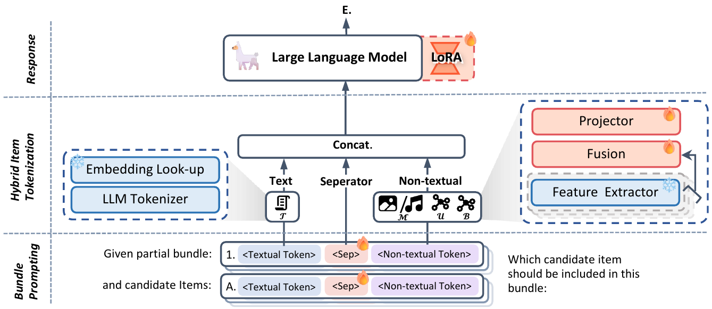

# 套装补全做成选择题：每件商品用「文字 + 一个多模态 token」写进提示词，先用纯文字微调 LLM 学会选，再训练多模态 token 去适配

关注我，每天为你精挑细选最优质、最新鲜的推荐算法paper，陪你一起保持进步、不断精进！

> [English version](nus-bundle-mllm.full.en.md)

### 论文：Fine-tuning Multimodal Large Language Models for Product Bundling
### 网址：https://arxiv.org/abs/2407.11712
### 公司：新加坡国立大学、中国传媒大学等
### 思想：
### 方向：i2i（套装补全、LLM）

## 解读：
给定半套已选好的商品和 10 个候选，让 LLM 选出该放进这一套的那一件。本文把每件商品写成「标题文字 + 一个多模态 token」：图像或音频特征、用户交互学出的向量、套装共现学出的向量，三者融合后压成一个向量，当作一个 token 塞进提示词。

训练分两步：先去掉多模态 token，只用文字提示词做 LoRA 微调，让 LLM 学会做这道选择题；再冻结 LLM，只训练生成多模态 token 的融合模块，让它适配已经会做题的 LLM。

作者认为难点有两个。
* **LLM 只读得懂文字。** 图像、音频、交互关系这些信息进不了提示词，而套装搭配很依赖它们（比如颜色、季节、谁常和谁一起买）。
* **现成的多模态 LLM 不会做套装题。** 它们是为看图说话对齐的，不擅长一道题里同时处理多件商品，也没有交互关系这种模态。

### 方法
（1）定义题目怎么写，包括每件商品怎么写进题目；（2）是训练。上线用的是 LLM 加 LoRA，再加（1）里生成多模态 token 的融合模块。作者和 CLHE 是同一个团队，融合方式也沿用 CLHE。

#### （1）选择题提示词
「已选的半套：商品1，商品2，…… 哪个候选该放进这一套？选项：商品A，商品B，…… 只回答一个字母。」答案是正确选项的字母，比如「E」。已选商品用数字编号，候选用字母编号。

**每件商品怎么写。** 每个「商品」位置填三段：标题文字、分隔 token、多模态 token。
* **标题文字。** 标题或类目标签，用 LLM 自己的分词器和词向量表，不参与融合。直接送进LLM，如何切分token，是llm的自己的事情。
* **分隔 token。** 一个可学习的向量，隔开文字和多模态 token。
* **多模态 token。** 先得到三个向量：图像用 BLIP2、音频用 CLAP 抽特征；在用户–商品图上训练一个 LightGCN，在套装–商品图上另训练一个，各取商品向量。三者各用一个线性层投影到同一维度，排成 3 个 token 过自注意力，取平均，再过一个 MLP 投影到 LLM 词向量的维度，得到 1 个 token。

**举个例子。** 已选套头毛衣、画家帽、铅笔裤，填好后的题目是（<分隔>、<多模态> 各是一个向量）：

> 已选的半套：1. 套头毛衣 <分隔> <多模态>；2. 画家帽 <分隔> <多模态>；3. 铅笔裤 <分隔> <多模态>。哪个候选该放进这一套？选项：A. 南瓜贝雷帽 <分隔> <多模态>；B. 黑色斜挎包 <分隔> <多模态>；……；J. 运动短裤 <分隔> <多模态>。只回答一个字母。

LLM 应回答「B」。

**为什么压成一个多模态token。** 也可以每种特征各占一个 token，前面加「图像特征：」这类文字提示。作者实验里这样效果更差，提示词也更长、推理更慢，一道题里商品越多，差得越多。

#### （2）两阶段训练
目标是先让 LLM 学会做题，再让多模态 token 被 LLM 读懂。两个阶段用同一批题目，只是更新的参数不同。
* **造题目。** 从训练集取一个真实套装，打乱后前一半当已选的半套，同一套里没给出的另一件当正确答案，再从这一套以外的商品里随机抽 9 件当错误选项，10 个候选打乱顺序（论文没写，见官方代码 utils.py）。比如套装是 {毛衣、画家帽、铅笔裤、斜挎包}，给出毛衣和画家帽，斜挎包混在 9 件随机商品里。
* **损失。** LLM 读完题目，在答案位置上输出整个词表（约 3.2 万个词元）的概率，交叉熵只看正确字母，它的概率越高，损失越小。题目部分不算损失。
* **第一阶段：纯文字微调。** 题目里去掉分隔 token 和多模态 token，只留文字，LoRA 微调 LLM（Llama2-7B）。
* **第二阶段：训练融合模块。** 冻结 LLM 和第一阶段的 LoRA，用完整题目训练融合模块和投影 MLP。
* **训练量。** 只用 1024 个套装，每轮重新打乱、重新抽错误选项，最多 10 个 epoch。

**为什么分两阶段。** 两部分一起训时，在用户交互稀疏的穿搭和歌单数据上，效果还不如只做第一阶段。作者的解释是 LLM 和融合模块都从不合适的初始状态出发，会互相干扰。

#### 推理
把已选商品和 10 个候选写进提示词，LLM 生成一个字母。每道题只选一件，候选要事先给定，不能在全库里检索。

### 数据与效果
数据集和 CLHE 相同：POG 穿搭、交互更稠密的 POG_dense、Spotify 歌单、套装更小的 Spotify_sparse，套装按 8:1:1 划分。每道题 10 个候选，1 个正确、9 个随机抽取，指标是 HitRate@1（选对的比例）。基线 CLHE 等用全部训练数据，并改成在这 10 个候选里选分最高的。只有离线实验。
* **整体。** POG 上 0.4131，CLHE 0.3477；Spotify 上 0.8242，CLHE 0.7569；四个数据集比最强基线高 5% 到 19%。GPT-4 加上下文示例在 POG 上只有 0.1850。
* **消融。** 只用文字，POG 上就有 0.3759，已经高于 CLHE；加上多模态 token 再涨到 0.4131。
* **冷启动。** 重新划分 POG，让测试商品都没在训练里出现过，10 个候选时 0.6172，CLHE 0.1061。
* **模型大小。** 换成 Gemma-2B 只有 0.1113，Llama2-13B 是 0.4492。

代码开源。

## 心得：

## 愚见

## 可信度：离线

## 推荐等级：有时间看看

**请帮忙点赞、转发，谢谢。欢迎干货投稿 \ 论文宣传\ 合作交流**

### 【铁粉】请入微信群，群内我会给出更深入的解读，还可以共同讨论技术方案、发招聘广告、内推和交友等。
* 铁粉标准：关注公众号一个月以上，且在公众号上累计15次互动（评论、爱心、转发）、或投稿1次，只欢迎技术同学。
* 入群方法：请您加个人微信lmxhappy，我拉您入群，请备注【公司】（只我个人看，不公开）。

## 推荐您继续阅读：
