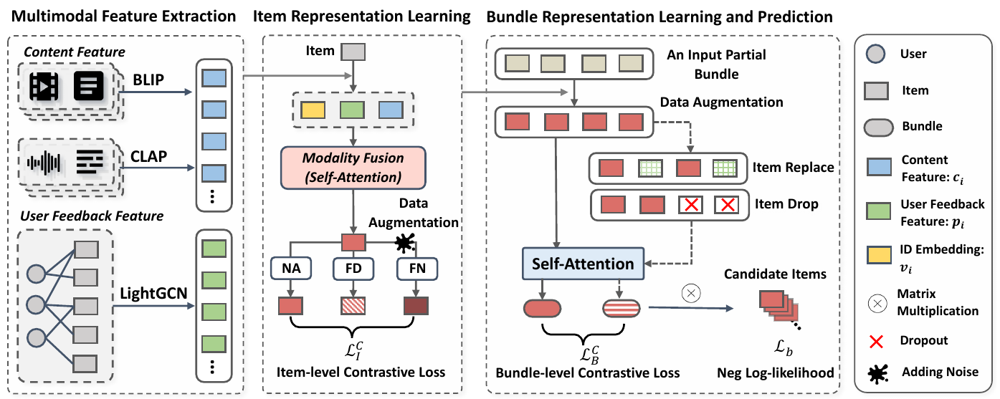

# Bundle completion: each item fuses content, collaborative and ID vectors, the chosen items are encoded into one bundle vector scored against candidates by inner product; two levels of contrastive learning handle cold start and incomplete input

> [中文版](nus-clhe.md)

### Paper: Leveraging Multimodal Features and Item-level User Feedback for Bundle Construction (WSDM 2024)
### Link: https://arxiv.org/abs/2310.18770
### Institution: National University of Singapore, University of Science and Technology of China, et al.
### Ideas: bundle construction, multimodal features, LightGCN collaborative features, hierarchical self-attention, contrastive learning, cold start
### Area: i2i (bundle completion)

## Breakdown:
Given part of a bundle (e.g., the top and pants of an outfit), complete the missing items. The paper uses self-attention to fuse each item's three features (image/text or audio content, a collaborative vector learned from user interactions, and an ID vector) into an item vector; the chosen items then pass through another self-attention layer to form a bundle vector, which ranks all items by inner product.

Training applies softmax over all items with the bundle's missing items as targets, plus two levels of contrastive learning: at the item level, features are randomly dropped or perturbed with noise; at the bundle level, a few items are randomly dropped or replaced; the vectors before and after perturbation should stay close.

The authors see three difficulties.
* **Few bundles.** A platform just starting bundle services has few bundles to learn from. User interactions with individual items are plentiful, though, and items often bought or played by the same users are good candidates for one bundle.
* **Cold start.** Many items have appeared in few bundles and new items in none, so no reliable ID vector can be learned for them.
* **Incomplete input.** At inference only part of the bundle is given, so the information is incomplete by nature and may include unrelated items.

### Method
(1) and (2) are the network and (3) is its training, done end to end. The item encoder in (1) is used twice, producing vectors for both the chosen items and the candidates; (2) fuses the chosen items' vectors into a bundle vector; (3) uses the inner-product score between the bundle vector and candidate item vectors as the main loss, plus two contrastive losses on the outputs of (1) and (2). This one model is what gets deployed.

#### (1) Item vector: fusing three features
* **Content feature.** Outfits use an off-the-shelf BLIP to extract image and text features; tracks use CLAP for audio and text. The two lie in a shared space and are averaged into a 768-dimensional content vector.
* **Collaborative feature.** A LightGCN is pretrained on the user–item interaction graph and its item vectors are taken. It captures which items are interacted with by the same users and needs no bundle data.
* **ID vector.** A trainable vector per item, learning from existing bundles which items it tends to go with.
* **Fusion.** The content and collaborative features are each linearly projected to 64 dimensions, stacked with the ID vector as 3 tokens, passed through self-attention and averaged into the item vector.

**Filling gaps.** Every item has a content feature. An item with no user interactions uses its content feature in the collaborative slot; a new item never seen in training bundles has no ID vector and uses its content feature there too.

#### (2) Bundle vector
Each chosen item goes through (1) to get its item vector; these form a sequence, pass through another self-attention layer, and are averaged into the bundle vector.

#### (3) Training
The main loss scores candidates, and two levels of contrastive learning are added so that items with missing features and partial bundles that are incomplete or contain unrelated items still get stable vectors.
* **Scoring (main loss).** The bundle vector takes an inner product with every candidate item's vector (also produced by (1)), followed by softmax over all items and a negative log-likelihood loss, with the bundle's missing items as targets. E.g., given a top and pants, the shoes that complete this outfit should rank near the top of all items.
* **Item-level contrast (auxiliary loss 1).** Add small noise to the item vector, randomly drop some dimensions, or pick a random item and drop one whole feature; the perturbed version and the original are positives, and other items in the batch are negatives (InfoNCE).
* **Bundle-level contrast (auxiliary loss 2).** Randomly drop some items from the bundle, or replace them with items not in it; the perturbed bundle vector and the original are positives, and other bundles in the batch are negatives.
* **Total loss.** The main loss plus auxiliary losses 1 and 2 (each weighted), plus L2 regularization. Perturbed versions are used only for the contrastive losses; scoring and inference use the unperturbed vectors.

**Why contrastive learning.** At inference only part of the bundle is given, so the input is incomplete by nature; new and long-tail items often lack collaborative features or ID vectors. Dropping items and features on purpose during training makes the vectors in these cases close to those of the complete versions.

#### Inference
Encode the chosen items into a bundle vector, take inner products with all items, and return the highest-scoring ones.

**Differences between the code and the paper.** The official code (models/CLHE.py) differs from the paper in four places:
* Training feeds the full bundle as input with the full bundle as target; only testing gives a partial bundle.
* The candidate side has its own item encoder with separate parameters, not shared with the chosen items.
* New items' ID vectors are not filled with content features; only the collaborative slot is filled.
* Bundle-level contrast compares the full bundle with a version missing some items, effectively teaching the model to encode a partial bundle close to the full one.

### Data and results
Four datasets in two domains: POG outfits (49K items, 3.6 items per bundle on average) and POG_dense with denser user interactions; Spotify playlists (254K tracks, 63 tracks per playlist on average, user interactions from Last.fm) and Spotify_sparse with smaller bundles. Bundles are split 8:1:1 at random, so test bundles contain items never seen in training bundles. Metrics are Recall@20 and NDCG@20. All baselines are adapted by the authors and given the same three features and the same loss. Offline only.
* **Overall.** NDCG@20 is 6% to 44% higher than the strongest baseline (Transformer or its contrastive variant) across the four datasets, the largest gain on POG (0.0193 vs. 0.0134).
* **Ablation.** Removing the collaborative feature lowers all four datasets (e.g., Spotify from 0.1806 to 0.1695); replacing both self-attention layers with average pooling hurts most (Spotify drops to 0.0418); removing both contrastive losses hurts less (Spotify to 0.1730, Spotify_sparse from 0.1212 to 0.1084).
* **Cold start.** When the test set keeps only warm items, CLHE's lead over the strongest baseline shrinks markedly (on POG from 44% to 6.5%), which the authors take as indirect evidence that the advantage comes mainly from new items.

Code and data are open source.

## Takeaways
* When bundle data is scarce, user interactions with individual items are a ready substitute signal: items co-interacted by the same users are natural bundle candidates.
* Filling a missing feature slot with the content feature, plus training with randomly dropped features, lets new items share one model with warm items.

## Caveats
* The official code trains by reconstructing the full bundle rather than completing a partial one as the paper describes, and doesn't fill cold items' ID vectors; the reported numbers come from the code's version.
* Cold start is evaluated only indirectly (the lead shrinks on warm-only items); results restricted to bundles containing new items aren't reported.
* With both self-attention layers replaced by average pooling, Spotify NDCG@20 falls to 0.0418, far below the MultiDAE baseline (0.0944), which also aggregates by average pooling; the paper doesn't explain the gap.
* The paper doesn't say how many seed items are given when a bundle is split into input and targets; the data augmentation choice is reported on test-set NDCG and the best one differs by dataset.

## Credibility: offline

## Recommendation level: worth a look if you have time
