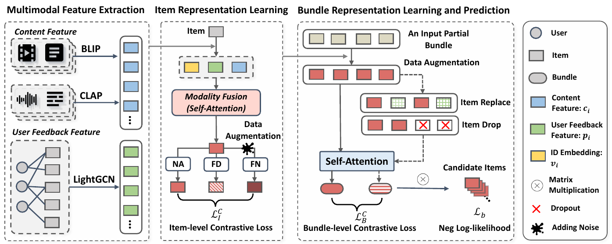

# 套装补全：每件商品融合图文、协同和 ID 三种向量，已选的几件再编码成一个套装向量去和候选做内积；两级对比学习应对冷启动和残缺输入

关注我，每天为你精挑细选最优质、最新鲜的推荐算法paper，陪你一起保持进步、不断精进！

> [English version](nus-clhe.full.en.md)

### 论文：Leveraging Multimodal Features and Item-level User Feedback for Bundle Construction
### 网址：https://arxiv.org/abs/2310.18770
### 公司：新加坡国立大学、中国科学技术大学等
### 思想：
### 方向：i2i（套装补全）

## 解读：
给定半套已选好的商品（比如一套穿搭里的上衣和裤子），补出缺的那几件。本文用自注意力把每件商品的三种特征（图文或音频内容、用户交互学出的协同向量、ID 向量）融合成商品向量，已选的几件再过一层自注意力融合成套装向量，与全部商品做内积排序。
* **套装级对比（辅助损失 2）。** 随机丢掉套装里的几件，或换成不在这一套里的其他商品，扰动后的套装向量和原版本互为正样本，同批其他套装为负样本。

训练时在全部商品上做 softmax，目标是这一套里缺的那几件；另加两级对比学习，商品级随机丢特征、加噪声，套装级随机丢掉或替换几件商品，要求扰动前后的向量接近。

作者认为难点有三个。
* **套装数据少。** 刚开始做套装业务的平台没多少套装可学。用户对单件商品的交互却很多，经常被同一批用户买或听的商品，适合放进一套。
* **冷启动。** 很多商品很少进过套装，新品从没进过，学不出可靠的 ID 向量。
* **输入残缺。** 推理时只给半套，信息本来就不全，还可能混进不相干的商品。

### 方法
（1）（2）是网络，（3）是它的训练，一起端到端进行。（1）的商品编码器用了两次，已选的几件和候选商品都由它出向量；（2）把已选几件的向量融合成套装向量；（3）用套装向量和候选商品向量的内积打分作为主损失，再在（1）（2）的输出上加两个对比损失。上线用的就是这个模型。

#### （1）商品向量：融合三种特征
* **内容特征。** 穿搭用现成的 BLIP 抽图像和文本特征，歌曲用 CLAP 抽音频和文本特征，两者在同一空间，取平均得到 768 维的内容向量。
* **协同特征。** 在用户–商品交互图上预训练一个 LightGCN，取它的商品向量。它记录的是「哪些商品常被同一批用户交互」，不需要任何套装数据。
* **ID 向量。** 每件商品一个可训练的向量，从已有套装里学「它常和谁放在一起」。
* **融合。** 内容和协同特征各用一个线性层投影到 64 维，和 ID 向量一起排成 3 个 token，过自注意力后取平均，得到商品向量。

**缺了就补位。** 内容特征每件商品都有。没有用户交互的商品，拿内容特征填协同特征的位置；从没进过训练套装的新品没有 ID 向量，也拿内容特征填上。

#### （2）套装向量
已选的几件商品各自过（1）得到商品向量，排成一个序列，再过一层自注意力，取平均得到套装向量。

#### （3）训练
主损失给候选打分，另加两级对比学习，让缺特征的商品、残缺或混进杂项的半套也能得到稳定的向量。
* **打分（主损失）。** 套装向量和每件候选商品的向量（同样由（1）得到）做内积，在全部商品上做 softmax，用负对数似然训练，目标是这一套里缺的那几件。比如已选上衣和裤子，这一套剩下的鞋子要排在全部商品的前面。
* **商品级对比（辅助损失 1）。** 对商品向量加小噪声、随机丢掉部分维度，或随机挑一件商品丢掉它的一整种特征，扰动后的版本和原版本互为正样本，同批其他商品为负样本（InfoNCE）。
* **总损失。** 主损失加上辅助损失 1 和辅助损失 2（各乘一个权重），再加 L2 正则。扰动出的版本只用来算对比损失，打分和推理都用没扰动的向量。

**为什么要对比学习。** 推理时给的只是半套，本身就残缺；新品、冷门商品又常缺协同特征或 ID 向量。训练时故意丢商品、丢特征，让模型在这些情况下给出的向量和完整时接近。

#### 推理
已选的几件编码成套装向量，和全部商品内积，取分最高的几件。

**代码和论文的出入。** 官方代码（models/CLHE.py）和论文有四处不同：
* 训练时输入整套、目标也是整套，只有测试时才给半套；
* 候选一侧另有一套参数独立的商品编码器，不和已选商品共用；
* 新品的 ID 向量没有用内容特征补，只有协同特征一格会补；
* 套装级对比拿整套和丢掉部分商品后的版本比，相当于教模型看到半套也编码出接近整套的向量。

### 数据与效果
两个领域四个数据集：POG 穿搭（4.9 万件商品，平均每套 3.6 件）及用户交互更稠密的 POG_dense，Spotify 歌单（25 万首歌，平均每单 63 首，用户交互取自 Last.fm）及套装更小的 Spotify_sparse。套装按 8:1:1 随机划分，测试套装里会有没进过训练套装的新品。指标是 Recall@20 和 NDCG@20。基线都由作者改造，统一用同样的三种特征和同样的损失。只有离线实验。
* **整体。** NDCG@20 在四个数据集上比最强基线（Transformer 或其加对比学习的版本）高 6% 到 44%，POG 上提升最大（0.0193 对 0.0134）。
* **消融。** 去掉协同特征，四个数据集都下降（如 Spotify 0.1806 降到 0.1695）；两层自注意力都换成平均池化，掉得最多（Spotify 降到 0.0418）；去掉两级对比学习降幅较小（Spotify 降到 0.1730，Spotify_sparse 从 0.1212 降到 0.1084）。
* **冷启动。** 测试集只留老商品时，CLHE 比最强基线的领先幅度明显缩小（POG 从 44% 缩到 6.5%），作者以此间接说明优势主要在新品上。

代码和数据开源。

## 心得：

## 愚见

## 可信度：离线

## 推荐等级：有时间看看

**请帮忙点赞、转发，谢谢。欢迎干货投稿 \ 论文宣传\ 合作交流**

### 【铁粉】请入微信群，群内我会给出更深入的解读，还可以共同讨论技术方案、发招聘广告、内推和交友等。
* 铁粉标准：关注公众号一个月以上，且在公众号上累计15次互动（评论、爱心、转发）、或投稿1次，只欢迎技术同学。
* 入群方法：请您加个人微信lmxhappy，我拉您入群，请备注【公司】（只我个人看，不公开）。

## 推荐您继续阅读：
