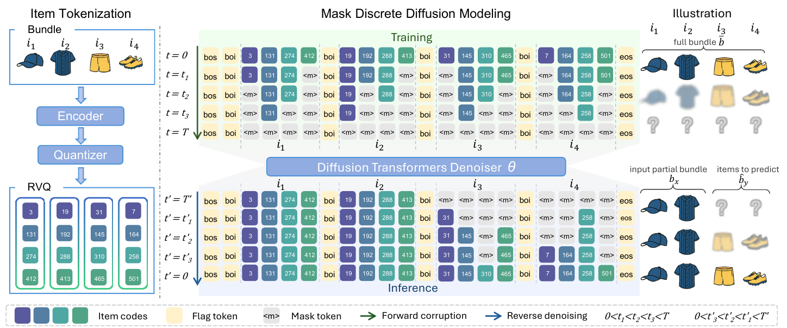

# Bundle completion: write the whole bundle as a sequence of semantic IDs, randomly mask and restore it during training; at inference mask the missing items and fill them in over several rounds

> [中文版](nus-ddbc.md)

### Paper: Discrete Diffusion for Bundle Construction (ICLR 2026)
### Link: https://openreview.net/forum?id=dKyhgfe50H
### Institution: National University of Singapore, Institute of Computing Technology (CAS), Singapore Management University, Shandong University
### Ideas: masked discrete diffusion, semantic IDs, residual vector quantization, order-agnostic decoding, token validity constraints, bundle construction
### Area: i2i (bundle completion, generative recommendation)

## Breakdown:
Given part of a bundle already chosen (e.g., the first 15 tracks of a playlist, or the hat and top of an outfit), complete the remaining items. The paper quantizes every item into a 4-token semantic ID and lays out the whole bundle as one token sequence. During training, a random portion of the tokens is masked and a bidirectional Transformer learns to restore them (masked discrete diffusion). At inference, all tokens of the items to be completed are masked and filled in over 25 rounds, and the semantic IDs are then mapped back to items.

Most existing approaches generate one item after another in a fixed order, but the items in a bundle have no inherent order. The catalog is also large (Spotify has 250k tracks), so with one ID per item, each ID appears in very few bundles and is poorly learned.

### Method
First turn items into semantic IDs ((1)), then train a diffusion model on semantic-ID sequences ((2)), and use it at inference to complete a partial bundle ((3)).

#### (1) Semantic IDs
* **Item vectors.** The paper takes item vectors from a trained CLHE (a WSDM 2024 bundle-completion model that fuses image/text or audio content, a collaborative vector learned from user interactions, and an ID vector) and doesn't train them further. All baselines use the same vectors, so the comparison is only about the generation method.
* **Residual quantization.** Find the codeword closest to the item vector in the level-1 codebook to get the first token; subtract that codeword and look up what remains in the level-2 codebook, and so on for 3 levels. The first token is the coarse category, and later tokens refine it level by level. Each codebook has 128 codewords (256 in the released code's config).
* **Dedup token.** The 4th token carries no semantics; it just numbers items whose first 3 tokens are identical, so each semantic ID maps to exactly one item.

**Why not use item IDs directly.** With semantic IDs, a category token is shared by thousands of items, so each token gets far more training signal. In the ablation, replacing semantic IDs with item IDs (initialized from CLHE vectors) drops F1 on Spotify with 30 tracks from 0.282 to 0.021.

#### (2) Diffusion model: randomly mask, then restore
The goal is to teach the model to "see some tokens of a bundle and restore the rest", which is then used directly for completion.
* **Sequence.** "Start, separator, item 1's 4 tokens, separator, item 2's 4 tokens, …, end". The start, end and separators are never masked; the separators tell the model which 4 positions belong to the same item.
* **Random masking.** Each sample draws a random masking ratio, and each token is independently replaced by a mask symbol with that probability. A small ratio masks only a few tokens; a ratio near 1 masks almost everything.
* **Restoration.** A bidirectional-attention Transformer (6 layers, 64-dim hidden size, 0.79M parameters in total), trained from scratch, predicts the original token at every masked position, with cross-entropy loss.
* **Data augmentation.** Randomly swap adjacent items in a bundle several times, then cut a fixed-length segment, so the model doesn't memorize the fixed item order in the dataset. The model needs fixed-length sequences: long bundles are cut to a random contiguous segment, and short ones are dropped.

**Why it is order-agnostic.** Each sample masks different positions, so the model sees every kind of "know some part, guess the rest" case, and at inference it can fill positions in any order rather than left to right. Items still have positions in the sequence, though, and the authors acknowledge it is only approximately order-agnostic.

### Inference: fill over several rounds
* **Initial state.** The chosen part of the bundle is given as is; for the items to be completed only the separators remain, with all 4 tokens masked. The number of items to complete must be given in advance.
* **Filling.** 25 rounds in total, and filled tokens are never changed. In the code, each round picks a random subset of the still-masked positions (on average, the remaining positions divided by the remaining rounds) and fills them by sampling from the model's predicted distribution; in the last round, everything left takes the highest-probability token. The paper's algorithm lists several ways to choose positions (by confidence, by entropy, etc.) without saying which one the main experiments use.
* **Validity constraint.** Each position may only output tokens from its own level's codebook (e.g., a level-2 position can't output a level-1 token); scores of all other tokens are set to negative infinity. Without this constraint, invalid outputs rise to 2.5%.
* **Mapping back to items.** If the generated semantic ID exists in the catalog, take that item's vector; otherwise reconstruct a vector from the first 3 tokens via the codebooks. Then pick the candidate with the highest cosine similarity, never picking the same item twice. The paper doesn't describe this step; this follows the code.

### Data and results
Spotify playlists (250k tracks; each playlist is cut into versions of 30, 60 and 90 tracks, with the first half given and the second half to complete) and POG outfits (31k items, cut into 4-item bundles, give 2 and complete 2). The candidate set is 100 times the number of items to complete (all true answers plus randomly sampled other items). Metrics are F1, Jaccard, and the average cosine similarity under the best one-to-one matching (which measures how close the guesses are when they miss the exact items). Offline experiments only.
* **Long bundles.** On Spotify with 30, 60 and 90 tracks, F1 is 0.282, 0.285 and 0.287, versus the strongest baselines at 0.153 (BundleNAT, which outputs the whole bundle in parallel in one shot), 0.129 and 0.123 (both TIGER, which generates semantic IDs left to right). The longer the bundle, the bigger the lead.
* **Short bundles.** On POG, F1 is 0.139, below TIGER (0.213) and SASRec (0.169). The authors' explanation is that completing only 2 items is close to next-item prediction, where left-to-right generation has the edge.
* **Ablation (Spotify, 30 tracks).** Removing the separators drops F1 from 0.282 to 0.176; removing data augmentation drops it to 0.254.
* **Rounds.** With a single round, F1 is already 0.269; 25 rounds give 0.282, and more rounds barely help.

The code is open source.

## Takeaways
* Writing a bundle as a semantic-ID sequence and training by random masking turns completion into fill-in-the-blank, with no fixed generation order.
* Shared hierarchical tokens are what make a 250k-item catalog learnable: switching back to item IDs drops F1 from 0.282 to 0.021.
* Restricting each position to its own level's tokens is a cheap way to guarantee every output decodes to a valid code tuple.

## Caveats
* The candidate set always contains every true answer plus 99 times as many random items, and generated IDs are snapped to the nearest candidate, so the numbers reflect reranking a small pool rather than generating from the full catalog; the authors discuss this limitation in the appendix.
* A single round already reaches F1 0.269 against 0.282 for 25 rounds, so most of the gain comes from semantic IDs plus bidirectional masked training rather than from step-by-step refinement.
* The "over 100% improvement" headline holds only for long Spotify bundles; on POG, where 2 items are completed, the method trails TIGER and SASRec.
* The paper doesn't fix the decoding order (the code fills random positions by sampling) or describe how generated IDs are mapped to candidates, and its codebook size (128) differs from the released config (256).

## Credibility: offline

## Recommendation level: worth a look if you have time
