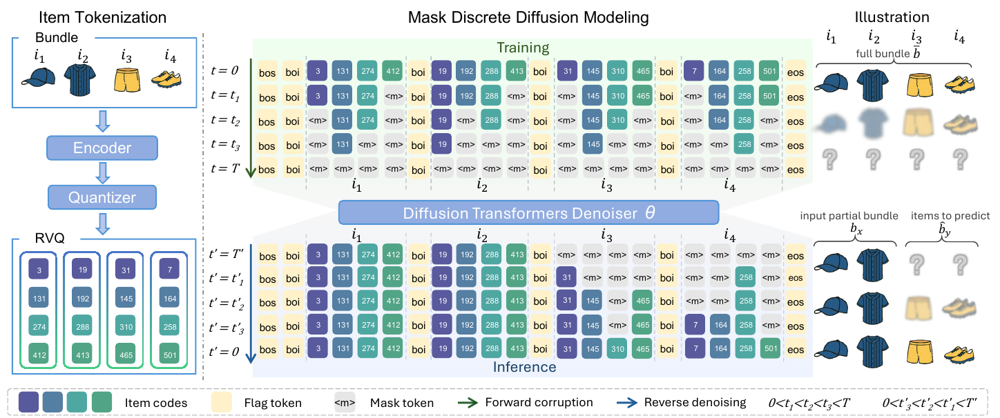

# 套装补全：整套商品写成语义 ID 序列，训练时随机遮住再还原；推理时遮住缺的几件，分轮填出来

关注我，每天为你精挑细选最优质、最新鲜的推荐算法paper，陪你一起保持进步、不断精进！

> [English version](nus-ddbc.full.en.md)

### 论文：Discrete Diffusion for Bundle Construction
### 网址：https://openreview.net/forum?id=dKyhgfe50H
### 公司：新加坡国立大学、中科院计算所、新加坡管理大学、山东大学
### 思想：
### 方向：i2i（套装补全、生成式推荐）

## 解读：
给定半套已选好的商品（比如歌单的前 15 首、一套穿搭里的帽子和上衣），补出剩下的几件。本文把每件商品量化成 4 个 token 的语义 ID，整套排成一个 token 序列。训练时随机遮住一部分 token，让双向 Transformer 还原（掩码离散扩散）。推理时把要补的几件全部遮住，分 25 轮填完，再把语义 ID 映射回商品。

已有做法大多一件接一件地按顺序生成，但一套商品本来没有先后顺序；商品库又很大（Spotify 有 25 万首歌），每件商品一个 ID 时，每个 ID 只在很少的套装里出现，学不充分。

### 方法
先把商品变成语义 ID（（1）），再在语义 ID 序列上训练扩散模型（（2）），推理时用它补全半套（（3））。

#### （1）语义 ID
* **商品向量。** 直接用 CLHE（WSDM 2024 的套装补全模型，融合图文或音频内容、用户交互学出的协同向量和 ID 向量）训好的商品向量，不再训练。所有基线也用同一套向量，对比只比生成方式。
* **残差量化。** 第 1 层码本里找离商品向量最近的码字，得到第 1 个 token；向量减去这个码字，剩下的部分再到第 2 层码本里找，如此做 3 层。第 1 个 token 是大类，后面逐层细化。每层码本 128 个码字（官方代码的配置里是 256）。
* **去重 token。** 第 4 个 token 不带语义，只给前 3 个 token 都相同的商品按顺序编号，保证一个语义 ID 只对应一件商品。

**为什么不直接用商品 ID。** 换成语义 ID 后，一个大类 token 由上千件商品共享，每个 token 得到的训练信号多得多。消融里把语义 ID 换回商品 ID（用 CLHE 向量初始化），Spotify 30 首的 F1 从 0.282 掉到 0.021。

#### （2）扩散模型：随机遮住再还原
目标是让模型学会「看到一套里的部分 token，还原其余的」，推理时直接拿来补全。
* **序列。** 「开始、分隔符、商品 1 的 4 个 token、分隔符、商品 2 的 4 个 token……、结束」。开始、结束和分隔符永远不遮，模型靠分隔符知道哪 4 个位置属于同一件商品。
* **随机遮。** 每条样本随机取一个遮盖比例，每个 token 按这个比例独立地换成遮盖符。比例小时只遮零星几个，比例接近 1 时几乎全遮。
* **还原。** 双向注意力的 Transformer（6 层、隐层 64 维，共 0.79M 参数）从头训练，对每个被遮住的位置预测原来的 token，用交叉熵训练。
* **数据增强。** 套装里随机交换相邻商品若干次，再截一段固定长度，避免模型记住数据集里的固定排列。模型要求序列定长，长套装随机截一段连续的，短的丢掉。

**为什么说不依赖顺序。** 每条样本遮的位置都不同，模型见过「已知任意一部分、猜其余」的各种情况，推理时可以按任意顺序填，不必从左到右。但商品在序列里仍有位置，作者也承认只是近似地不依赖顺序。

### 推理：分轮填
* **初始状态。** 已选的半套照常给出，要补的几件只留分隔符，4 个 token 全遮住。要补几件需事先给定。
* **填写。** 共 25 轮，填上的 token 不再改。按代码，每轮在还遮着的位置里随机挑一部分（平均约为剩余位置除以剩余轮数），从模型预测的分布里采样填上，最后一轮剩下的全部取概率最高的。论文的算法里列了按置信度、按熵等几种挑法，没说主实验用哪种。
* **合法性约束。** 每个位置只允许出对应层码本的 token（比如第 2 层的位置不能出第 1 层的 token），其他 token 的分数置为负无穷。去掉这一约束，不合法的输出升到 2.5%。
* **映射回商品。** 生成的语义 ID 在目录里有，就取那件商品的向量。没有就用码本把前 3 个 token 还原成向量，再在候选集合里找余弦最相近的商品，选过的不再选。这一步论文没写，按代码。

### 数据与效果
Spotify 歌单（25 万首歌，每个歌单截成 30、60、90 首三个版本，前一半给出、后一半要补）和 POG 穿搭（3.1 万件商品，截成 4 件一套，给 2 补 2）。候选集合是要补件数的 100 倍（全部真实答案加随机抽的其他商品）；指标是 F1、Jaccard，以及按最优一一配对算的平均余弦相似度（没猜中原商品时，看猜得像不像）。只有离线实验。
* **长套装。** Spotify 30、60、90 首上 F1 分别为 0.282、0.285、0.287，最强基线是 0.153（BundleNAT，一次并行输出整套）、0.129、0.123（后两个都是 TIGER，按语义 ID 从左到右生成），套装越长领先越多。
* **短套装。** POG 上 F1 为 0.139，低于 TIGER 的 0.213 和 SASRec 的 0.169。作者的解释是只补 2 件时接近预测下一件，从左到右生成更占优。
* **消融（Spotify 30 首）。** 去掉分隔符，F1 从 0.282 降到 0.176；去掉数据增强降到 0.254。
* **轮数。** 只填 1 轮 F1 就有 0.269，25 轮 0.282，再多基本不涨。

代码开源。

## 心得：

## 愚见

## 可信度：离线

## 推荐等级：有时间看看

**请帮忙点赞、转发，谢谢。欢迎干货投稿 \ 论文宣传\ 合作交流**

### 【铁粉】请入微信群，群内我会给出更深入的解读，还可以共同讨论技术方案、发招聘广告、内推和交友等。
* 铁粉标准：关注公众号一个月以上，且在公众号上累计15次互动（评论、爱心、转发）、或投稿1次，只欢迎技术同学。
* 入群方法：请您加个人微信lmxhappy，我拉您入群，请备注【公司】（只我个人看，不公开）。

## 推荐您继续阅读：
