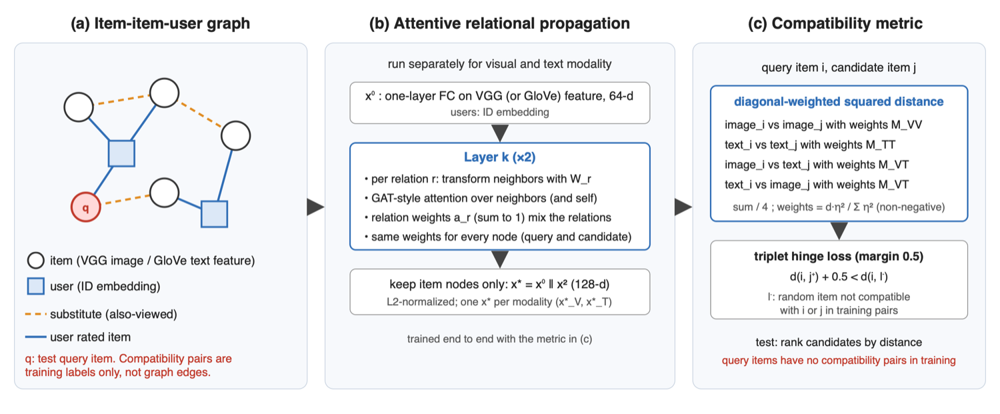

# Outfit matching: build a graph from substitute edges and user-rating edges only, propagate with relation-aware attention to get item vectors, then score pairs with a learned per-dimension weighted distance (including image-vs-text terms)

> [中文版](nus-drep.md)

### Paper: Learning to Match on Graph for Fashion Compatibility Modeling (AAAI 2020)
### Link: https://doi.org/10.1609/aaai.v34i01.5362
### Institution: National University of Singapore, University of Electronic Science and Technology of China, Hefei University of Technology
### Ideas: multi-relational graph, relation-aware graph attention, side connectivity (substitutes, user ratings), diagonal Mahalanobis metric, cross-modal distance, triplet hinge loss, cold-start query items
### Area: i2i (complementary recommendation, outfit matching)

## Breakdown:
When a user is looking at a clothing item (say, a red floral maxi dress), recommend items from complementary categories that go with it (say, high-heel sandals). The paper's DREP puts items and users into one graph with only two kinds of edges (substitute relations between items, and a user having rated an item), runs two layers of relation-aware attention graph propagation, and gets an image vector and a text vector for every item. A pair of items is then scored with a squared distance whose per-dimension weights are learned (image vs. image, text vs. text, and also image vs. text). At test time the query items have no compatibility records at all in the training set; they rely only on their substitute edges, rating edges and their own image/text features.

Existing approaches mainly learn visual matching from pairwise compatibility or co-purchase records and ignore the other connections around an item. For example, if a user views one item and ends up buying another, the two are substitutes and tend to go with the same set of items; items rated by the same users are also related. In addition, scoring is mostly a fixed Euclidean distance or inner product that treats every dimension of the vectors equally.

(The paper has no framework figure; the diagram above is drawn from the paper's equations.)

### Method
First propagate on the graph to get item vectors ((1)), then score a pair of items with a learned distance ((2)); both parts are trained end to end together.

#### (1) Propagate on the graph to get item vectors
* **Input vectors.** Images go through a pretrained VGG to get 4096-dim features; text is the average of GloVe word vectors (300-dim). Each passes through one fully connected layer to 64 dims. Users get ID vectors.
* **Graph.** Nodes are items and users. There are only two kinds of edges (Amazon's "also viewed" substitute relation between items, and a user having rated an item), and every node gets a self-loop. Compatibility relations are not put into the graph; they are only training labels.
* **Relation-aware attention propagation.** In each layer, for each relation, the neighbors' and the node's own vectors are first transformed by a matrix specific to that relation; attention then weights the neighbors (concatenate the node's and the neighbor's transformed vectors, score with a single-layer network, normalize with softmax) and they are summed. The results of the two relations are added with relation weights (non-negative, summing to 1) and passed through an activation. The paper doesn't say whether the relation weights are learned or set by hand. With 2 layers stacked, an item receives information from two hops away (e.g., item ← user ← item, item ← substitute ← substitute).
* **Output.** Only item nodes are kept. The input vector and the layer-2 output are concatenated (64+64 = 128 dims) and L2-normalized. Propagation runs once for images and once for text, so every item gets an image vector and a text vector. Query and candidate items go through the same graph network with the same parameters; the paper doesn't say whether the two modalities share parameters.

**Why concatenate the input vector.** The authors explain that after several propagation layers an item's vector gets diluted by its neighbors, and keeping the original vector prevents a loss of representational power.

#### (2) Score with a learned distance
The goal is to score a pair of items from different categories; the smaller the distance, the better they match.
* **Per-dimension weighted squared distance.** Subtract the two vectors dimension by dimension, square, and sum with a set of weights (a Mahalanobis-style distance with a diagonal matrix). The weights come from a set of learnable parameters, squared and normalized (weight of dimension i = number of dimensions × square of the i-th parameter ÷ sum of all squared parameters), which keeps them non-negative with an average of 1.
* **Cross-modal terms.** The query item's image vector vs. the candidate's image vector, text vs. text, image vs. text, and text vs. image: each of the four distances gets its own set of weights (image-vs-text and text-vs-image share one set, so 3 sets in total); they are added and divided by 4.
* **Loss.** Triplet hinge loss (margin 0.5). For each compatible pair (i, j), randomly draw an item l that has no compatibility relation with either i or j in the training set as the negative, and require the distance from i to j to be at least 0.5 smaller than from i to l. Negatives come from random sampling only.

**Why not Euclidean distance or cosine.** The authors argue that image and text vectors have very different statistical distributions, so Euclidean distance or cosine on the concatenation works poorly; per-dimension weights can adjust the contribution of every dimension and every modality combination.

### Inference
* **Cold-start setting.** Train, validation and test are split by item (80%/10%/10%). Query items in validation and test have no compatibility relations in the training set, but they are still in the graph, with substitute and rating edges.
* **Ranking.** Compute the distance to each item in the query's candidate list and sort from small to large. The paper only ranks a given candidate list and doesn't discuss retrieval over the full catalog. Working from the formula (the paper doesn't say this), every term of the distance is a per-dimension weighted squared difference, so multiplying the square roots of the weights into the vectors rewrites it as a Euclidean distance between two concatenated vectors, which works directly with nearest-neighbor search.

### Data and results
The data is Amazon clothing (Men: 74k items, 96k users; Women: 111k items, 135k users). Compatibility relations are "bought together" and "also bought" between different categories, substitute edges are "also viewed", and rating edges are user ratings; the authors note that the first three relations are outputs of Amazon's recommendation system rather than direct user behavior. Each query's candidate list keeps at most 5 correct answers; the paper doesn't say how large the candidate list is. Metrics are Recall@5, Hit@5 and NDCG@5. Offline experiments only.
* **Overall (image + text).** Recall@5 is 0.735 on Men and 0.728 on Women; SiaNet without a graph (Euclidean distance on image vectors) gets 0.576 and 0.547, and BPR-DAE (inner product of image/text vectors) gets 0.564 and 0.538.
* **Breaking it down.** Within the same framework, RGCN (no attention, Euclidean distance) gets 0.609 and 0.616, switching to the learned distance (RGCN-ML) gives 0.719 and 0.713, and switching further to attention propagation (DREP) gives 0.735 and 0.728. Most of the gain comes from the distance function; attention adds about 1.5 points more.
* **Image only.** On Men, Recall@5 is 0.587, versus 0.561 for RGCN-ML and 0.449 for SiaNet.
* **Grouped by number of graph connections (Men, image only).** When a query item has no substitute or rating edge at all, DREP and RGCN-ML are slightly below SiaNet; with 1 to 5 edges they lead clearly; beyond 10 edges SiaNet drops quickly.

## Takeaways
* Side relations (substitutes, user ratings) can stand in for missing compatibility records: query items with no compatibility history still get useful vectors from their neighbors, as long as they have a few edges.
* A learned diagonal weighting of the distance, including image-vs-text terms, gave a larger gain (Recall@5 0.609 to 0.719 on Men) than relation-aware attention (0.719 to 0.735).
* A diagonal-weighted squared distance stays decomposable into a plain Euclidean distance on rescaled vectors, so it keeps nearest-neighbor retrieval possible.

## Caveats
* The candidate list size and how negatives in it are drawn are not reported, and Hit@5 (0.805) is higher than Recall@5 (0.735) without a precise definition, which makes the absolute numbers hard to compare with other papers.
* Compatibility labels ("bought together", "also bought") and substitute edges ("also viewed") are all outputs of Amazon's recommender, as the authors note, so the graph and the labels may share signal from the same upstream system.
* The gain of attention over RGCN-ML is about 0.015 to 0.016 Recall@5 on a single split with no variance or significance test, and baselines are limited to SiaNet, BPR-DAE and RGCN variants (no type-aware or category-conditioned compatibility models).
* Query items are cold only with respect to compatibility; they keep their substitute and rating edges in the graph (the paper groups test queries by edge count), and items with no side edges fall slightly below the graph-free SiaNet. No official code was found, so details such as how relation weights are obtained and whether modalities share parameters cannot be checked.

## Credibility: offline

## Recommendation level: worth a look if you have time
