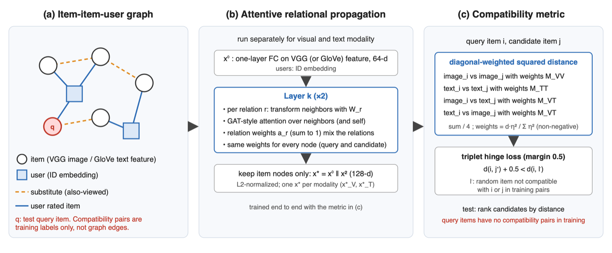

# 穿搭搭配：只用替代边和用户评分边建图，按关系做注意力传播得到商品向量，再用学出的逐维加权距离（含图文跨模态项）打分

关注我，每天为你精挑细选最优质、最新鲜的推荐算法paper，陪你一起保持进步、不断精进！

> [English version](nus-drep.full.en.md)

### 论文：Learning to Match on Graph for Fashion Compatibility Modeling
### 网址：https://doi.org/10.1609/aaai.v34i01.5362
### 公司：新加坡国立大学、电子科技大学、合肥工业大学
### 思想：
### 方向：i2i（互补推荐、穿搭搭配）

## 解读：
用户在看一件衣服（比如红色碎花长裙）时，从互补类目里推荐能和它搭配的单品（比如高跟凉鞋）。本文的 DREP 把商品和用户建成一张图，边只有两种（商品之间的替代关系、用户给商品打过分），用按关系区分的注意力图网络传播两层，得到每件商品的图像向量和文本向量；再用一个逐维学权重的平方距离（图像对图像、文本对文本，也包括图像对文本）给一对商品打分。测试时的查询商品在训练集里没有任何搭配记录，只靠图上的替代边、评分边和自身图文特征。

已有做法主要用成对的搭配或共购记录学视觉上的匹配，没有用上商品周围的其他连接。比如用户看了一件、最后买了另一件，这两件可以相互替代，往往能搭配同一批单品；被同一批用户打过分的商品也有关联。另外，打分大多用固定的欧氏距离或内积，向量各维一视同仁。

（论文没有框架图，上图是按论文公式画的示意图。）

### 方法
先在图上传播得到商品向量（（1）），再用学出的距离给一对商品打分（（2）），两部分端到端一起训练。

#### （1）图上传播得到商品向量
* **建图。** 节点是商品和用户。商品节点的初始向量来自图文特征（图像用预训练 VGG 抽 4096 维特征，文本把 GloVe 词向量平均成 300 维，各过一层线性变换变成 64 维），用户节点用 ID 向量。边是无向的，只有两种（亚马逊「看了又看」的商品替代关系、用户给商品打过分），每个节点加自环。搭配关系不进图，只当训练标签。
* **图网络。** 叠 2 层，按关系区分的注意力图网络。每层对每种关系，先用这种关系专属的矩阵变换自身和邻居的向量，再用注意力加权求和（把自身和邻居变换后的向量拼起来，过单层网络算分，对自身加邻居做 softmax）；两种关系的结果再按关系权重相加（非负、和为 1，是学出来的还是人为设定的，论文没说），过激活函数。商品和用户都按这个规则更新，区别只在邻居。
    * **商品。** 替代关系下是它的替代品（「看了又看」连着的其他商品），评分关系下是给它打过分的用户。叠 2 层后，商品能收到两跳外的信息（如 商品←用户←商品、商品←替代品←替代品）。
    * **用户。** 评分关系下是它打过分的商品。替代关系下没有邻居，只有自环，这一项只是把自己的向量做一次线性变换。
* **输出。** 用户向量只在传播时当中转，不参与打分。每件商品把输入向量和第 2 层输出拼起来（64+64=128 维），再做 L2 归一化。图像、文本各用一套图网络、各跑一遍传播，每件商品得到一个图像向量和一个文本向量（论文只说两种模态分别传播，没明说参数各一套）。查询商品和候选商品走同一个图网络、同一套参数。

**为什么拼上输入向量。** 作者的解释是多层传播后商品向量会被邻居冲淡，保留原始向量可以避免表达能力下降。

#### （2）计算距离
给一对来自不同类目的商品计算距离，距离越小越搭。查询商品的图像向量对候选商品的图像向量、文本对文本、图像对文本、文本对图像，四个距离各乘一组权重（图像对文本、文本对图像共用一组，共 3 组），相加后除以 4。
    * **逐维加权的平方距离。** 两个向量逐维相减、平方，再按一组权重加权求和（对角矩阵的 Mahalanobis 式距离）。权重由一组可学参数平方后归一化得到（第 i 维权重 = 维数 × 第 i 个参数的平方 ÷ 所有参数平方之和），保证非负、平均为 1。
* **训练。** 用的是三元组铰链损失（间隔 0.5）。对每对搭配商品 (i, j)，随机抽一个与 i、j 在训练集里都没有搭配关系的商品 l 当负例，要求 i 到 j 的距离比 i 到 l 至少小 0.5。负例只有随机采样。

**为什么不用欧氏距离或余弦。** 常见做法是把图像向量和文本向量拼成一个长向量，再算欧氏距离或余弦。作者认为两种模态的统计分布差别很大，这样效果不好。

### 推理
对查询商品的候选列表逐个算距离，从小到大排。论文只在给定候选列表上排序，没有讨论全库检索。按公式推（论文没说），距离的每一项都是逐维加权的平方差，把权重开方乘进向量后可改写成两个拼接向量之间的欧氏距离，能直接用近邻检索。

### 数据与效果
数据是 Amazon 服饰（Men 7.4 万件商品、9.6 万用户；Women 11.1 万件商品、13.5 万用户）。搭配关系取不同类目之间的「一起买」「买了又买」，替代边取「看了又看」，评分边取用户评分；作者指出前三种关系来自亚马逊推荐系统的输出，并非直接的用户行为。按商品划分训练、验证、测试（80%/10%/10%），验证和测试的查询商品在训练集里没有任何搭配关系，但仍在图上，有替代边和评分边（冷启动设定）。每个查询商品的候选列表里最多留 5 个正确答案，候选列表多大论文没说。指标是 Recall@5、Hit@5、NDCG@5，只有离线实验。
* **整体（图像+文本）。** Recall@5 在 Men、Women 上为 0.735、0.728；不用图的 SiaNet（图像向量的欧氏距离）为 0.576、0.547，BPR-DAE（图文向量内积）为 0.564、0.538。
* **拆开看。** 同一框架下，RGCN（无注意力、欧氏距离）为 0.609、0.616，换成学出的距离（RGCN-ML）为 0.719、0.713，再换成注意力传播（DREP）为 0.735、0.728。提升大部分来自距离函数，注意力再加 1.5 个点左右。
* **只用图像。** Men 上 Recall@5 为 0.587，RGCN-ML 0.561，SiaNet 0.449。
* **按图上连接数分组（Men，只用图像）。** 查询商品在图上一条替代边、评分边都没有时，DREP 和 RGCN-ML 略低于 SiaNet；有 1 到 5 条边就明显领先；超过 10 条边时 SiaNet 下降很快。

## 心得：

## 愚见

## 可信度：离线

## 推荐等级：有时间看看

**请帮忙点赞、转发，谢谢。欢迎干货投稿 \ 论文宣传\ 合作交流**

### 【铁粉】请入微信群，群内我会给出更深入的解读，还可以共同讨论技术方案、发招聘广告、内推和交友等。
* 铁粉标准：关注公众号一个月以上，且在公众号上累计15次互动（评论、爱心、转发）、或投稿1次，只欢迎技术同学。
* 入群方法：请您加个人微信lmxhappy，我拉您入群，请备注【公司】（只我个人看，不公开）。

## 推荐您继续阅读：
