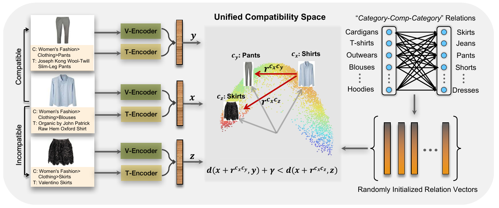

# Outfit compatibility: learn one translation vector per pair of complementary categories; the pants closest to "shirt vector + shirt–pants vector" are the best match

> [中文版](nus-transnfcm.md)

### Paper: TransNFCM: Translation-Based Neural Fashion Compatibility Modeling (AAAI 2019)
### Link: https://arxiv.org/abs/1812.10021
### Institution: National University of Singapore, Hefei University of Technology
### Ideas: TransE-style translation, category-pair relation vectors, multimodal item encoder, end-to-end training, margin ranking loss, complementary recommendation
### Area: i2i (complementary recommendation, outfit matching)

## Breakdown:
On a fashion e-commerce site, when a user is looking at one item (say, a shirt), recommend items from other categories that go with it (pants, skirts). The paper learns one translation vector for each pair of complementary categories (e.g., "shirt–pants"): add this vector to the shirt's vector, and the closer a pair of pants is to the result, the better it matches. Item vectors come from an image encoder and a text encoder trained end to end, jointly with the translation vectors, under a ranking loss.

Existing approaches map items into one vector space and measure compatibility with an inner product or Euclidean distance, using the same yardstick for every pair of categories. But what matters for a match depends on the categories (a top and pants may be matched on color and cut, a top and shoes more on style). And when one shirt matches both a pair of pants and a pair of shoes, both pairs are pulled together, so the pants and the shoes are indirectly pulled toward each other even if they don't go together.

### Method
The whole model is a single stage trained end to end. It has two parts (the item encoder and the category-pair translation vectors), updated together by one ranking loss.

#### Multimodal item encoder
Image and text each go through their own branch and produce a 128-dim vector; each is L2-normalized and the two are concatenated into a 256-dim item vector.
* **Image.** An ImageNet-pretrained AlexNet with its last fully connected layer removed; a new fully connected layer on top of the 4096-dim output of the second fully connected layer compresses it to 128 dims. AlexNet is fine-tuned jointly at one tenth of the learning rate.
* **Text.** A text CNN (Kim 2014). Each word of the title (plus the category path in FashionVC) is a 300-dim word2vec vector; these go through convolutions with window sizes 2, 3, 4 and 5 (50 channels each) and max pooling, then a fully connected layer to 128 dims. The paper doesn't say whether the word2vec vectors are updated.
* **Shared by both sides.** The trigger item (the shirt) and the candidate item (the pants) go through the same encoders; the paper has one image encoder and one text encoder and makes no distinction between the two sides.

#### Category-pair translation vectors and scoring
There is one translation vector per pair of complementary categories (30 pairs in FashionVC, 101 in PolyvoreMaryland), with the same dimension as item vectors. They are randomly initialized and normalized once at the start, with no constraint during training. The paper doesn't say whether the two directions of a category pair (shirt→pants, pants→shirt) share one vector.
* **Scoring.** Whether shirt x and pants y match depends on how far x plus the "shirt–pants" translation vector is from y (squared Euclidean distance); the closer, the better the match. Scoring is a fixed formula, with no scoring network.

**Loss.** Positives are two items that appear in the same outfit. For each positive, either the head (the shirt) or the tail (the pants) is randomly replaced with an item that doesn't match, to form a negative; the replacement comes from a complementary category and has never appeared in an outfit with the item that is kept. When the head is replaced, the negative uses the translation vector for the new head's category pair. The positive's distance must be smaller than the negative's by at least a margin (set to 1); if the gap is too small, the loss is the shortfall (hinge loss). Each batch holds 128 such groups, trained with SGD.

**Why separate out the category term.** Expanding the distance and dropping the item-vector norms (constant after normalization) leaves three terms: the inner product of x and y (category-independent overall compatibility); the projection of y−x onto the translation vector (which only acts for this category pair); and the squared norm of the translation vector itself (effectively a fixed bias per category pair). With the inner product alone, all category pairs share one space, so the pants and the shoes that match the same shirt get pulled together. With translation vectors, the same shirt points to its matches in different categories through different translation vectors, so the pants and the shoes need not be close to each other; the translation vector also acts as a soft feature selection that only works along the directions this category pair cares about. On FashionVC, the authors score with each of the two trained parts separately: the inner-product term alone is usually better than the category term alone, and the two together are best.

**Why no cross-modal consistency loss.** Earlier work often requires an item's image vector and text vector to be close to each other. The authors tried it and found it weakens how the two branches complement each other and hurts results, so they left it out.

### Inference
Given a trigger item, the query vector is the trigger vector plus the translation vector for the (trigger category, target category) pair (x + r); it depends only on the trigger item and the target category, one per target category. Candidates are ranked by squared Euclidean distance to the query vector, smallest first. The experiments only rank 101 candidates; the paper doesn't describe retrieval over the full catalog.

Working from the formula (the paper doesn't do this), ANN retrieval is straightforward. Candidate vectors don't depend on the query, so one index is built offline; at query time x + r is computed for the target category and an L2 nearest-neighbor search runs over that category's candidates, with no need to store a copy of each candidate per category pair.

### Data and results
Two public outfit datasets crawled from Polyvore; two items appearing in the same outfit form a positive pair. FashionVC has 14,871 tops and 13,663 bottoms, only top–bottom pairs, and each item has an image plus category and title. PolyvoreMaryland keeps only tops, bottoms, shoes and bags among the first 5 items of each outfit, with titles as the only text. Positive pairs are split 8:1:1 at random. At test time, each positive keeps its head and the tail is replaced by 100 items from complementary categories that never appeared with the head; the 101 candidates are ranked and measured by AUC (the share of negatives ranked below the true match) and Hit@K (the share of queries whose true match is in the top K). The baselines (Siamese network, triplet network, BPR, Monomer, CSN) are all re-implemented by the authors in the same framework, differing mainly in scoring function and loss. Offline experiments only.
* **Image + text.** AUC 76.9% and Hit@10 38.1% on FashionVC; 74.7% and 34.4% on PolyvoreMaryland. In the same setting, BPR (inner-product scoring) gets 75.4%, 33.4% and 73.8%, 32.7%.
* **Image only.** Against the triplet network (same distance and loss, just without translation vectors), AUC 73.6% vs 70.6% and Hit@10 32.3% vs 28.0% on FashionVC; CSN, which masks a category-pair subspace, gets 71.6% and 28.4%. With text only, it is roughly on par with the triplet network on PolyvoreMaryland (AUC 68.8% vs 68.4%).
* **Target category known.** When candidates are drawn only from the target category, the gain over the triplet network shrinks from about 4 points to about 2 points (FashionVC, image only, for both AUC and Hit@10).

## Takeaways
* A translation vector per category pair is a cheap way to make a single embedding space category-aware while scoring stays a plain distance.
* The inner-product term carries most of the signal; the category-specific term is a complement, not a replacement.
* One shared item encoder for both sides plus one offset per target category keeps the model as simple as a Siamese network.

## Caveats
* In the main test, the 100 negatives come from any complementary category, so part of the gain may come from the per-category-pair bias favoring the right target category: when candidates are restricted to the target category, the gain over the triplet network halves from about 4 to about 2 points.
* In the image + text setting, Table 1 reports only TransNFCM; BPR's image + text numbers are given in the text (75.4% vs 76.9% AUC on FashionVC), and the other baselines are only compared on single modalities.
* All baselines are re-implemented by the authors, no significance tests are reported, and the evaluation ranks 101 candidates per query rather than retrieving from the full catalog.
* No official code was found, so details such as whether the two directions of a category pair share a vector, and whether word vectors are fine-tuned, can't be checked.

## Credibility: offline

## Recommendation level: worth a look if you have time
