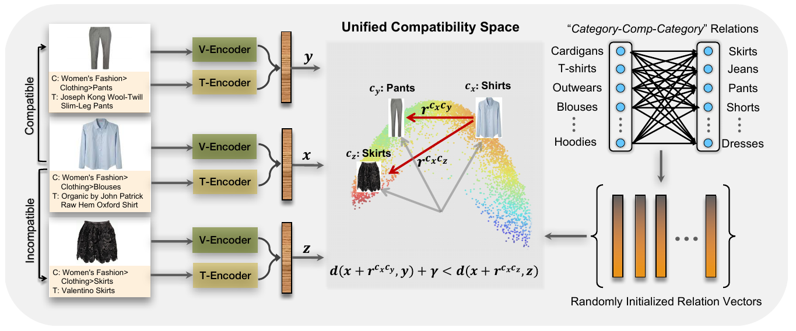

# 穿搭互补：每对互补类目学一个平移向量，衬衫向量加上「衬衫—裤子」向量后离得近的裤子就是搭配

关注我，每天为你精挑细选最优质、最新鲜的推荐算法paper，陪你一起保持进步、不断精进！

> [English version](nus-transnfcm.full.en.md)

### 论文：TransNFCM: Translation-Based Neural Fashion Compatibility Modeling
### 网址：https://arxiv.org/abs/1812.10021
### 公司：新加坡国立大学、合肥工业大学
### 思想：
### 方向：i2i（互补推荐、穿搭搭配）

## 解读：
服饰电商里用户在看一件单品（比如一件衬衫）时，给用户推荐能搭在一起的其他类目单品（裤子、半裙）。本文给每一对互补类目（如「衬衫—裤子」）学一个平移向量，衬衫的向量加上这个平移向量后，离得越近的裤子越搭。商品向量由图片、文字两路编码器端到端学出，和平移向量一起用排序损失训练。

已有做法把单品映射到同一个向量空间，用内积或欧氏距离衡量搭不搭，不管是哪两个类目都用同一把尺子。可搭配时看什么因类目而异（上衣配裤子看颜色和版型，配鞋可能更看风格）；而且一件衬衫既配某条裤子又配某双鞋时，两个搭配对都被拉近，裤子和鞋也被间接拉到一起，哪怕它们并不相配。

### 方法
整个模型只有一个阶段，端到端训练，由两部分组成（商品编码器、类目对平移向量），用同一个排序损失一起更新。

#### 多模态商品编码器
图片和文字各走一路，各出一个 128 维向量，分别做 L2 归一化后拼成 256 维的商品向量。
* **图片。** ImageNet 预训练的 AlexNet，去掉最后一个全连接层，在第二个全连接层的 4096 维输出后接一个新的全连接层压到 128 维。AlexNet 用十分之一的学习率一起微调。
* **文字。** 文本 CNN（Kim 2014）。标题（FashionVC 还带类目路径）的每个词用 300 维 word2vec 表示，过窗口为 2、3、4、5 的卷积（各 50 个通道）和最大池化，再接全连接层到 128 维。论文没说 word2vec 是否跟着更新。
* **两侧共用。** 触发单品（衬衫）和候选单品（裤子）走同一套编码器，论文只有一套图片编码器和一套文字编码器，没有区分两侧。

#### 类目对平移向量与打分
每一对互补类目一个平移向量（FashionVC 有 30 对，PolyvoreMaryland 有 101 对），和商品向量同维。随机初始化后只在开头归一化一次，训练中不加任何约束。论文没说同一对类目的两个方向（衬衫→裤子、裤子→衬衫）是否共用一个向量。
* **打分。** 衬衫 x 和裤子 y 搭不搭，看 x 加上「衬衫—裤子」平移向量后离 y 多远（平方欧氏距离），越近越搭。打分是固定公式，没有打分网络。

**损失。** 正例是同一套穿搭里同时出现的两件单品。每个正例随机把头（衬衫）或尾（裤子）之一换成一件不搭的单品作为负例，换上的单品来自互补类目、和留下的那件没在同一套里出现过；换了头时，负例用新头的类目对应的平移向量。要求正例距离比负例距离至少小一个间隔（margin，设为 1），差距不够就按差多少罚多少（hinge 损失）。每个 batch 128 组，SGD 训练。

**为什么要拆出类目那一项。** 把距离展开，除去商品向量的模长（归一化后是常数），剩下三项（x 和 y 的内积，即不分类目的通用搭配度；y−x 在平移向量上的投影，只对这一对类目起作用；平移向量自身的模长平方，相当于每对类目一个固定偏置）。只用内积时所有类目对共用一个空间，衬衫配的裤子和衬衫配的鞋会被拉近。加上平移向量后，同一件衬衫通过不同的平移向量指向不同类目的搭配品，裤子和鞋不必彼此靠近；平移向量还相当于软的特征选择，只在这对类目关心的方向上起作用。作者在 FashionVC 上把训好的两部分拆开单独打分，只用内积那项大多比只用类目那项好，两者合起来最好。

**为什么不加跨模态一致性损失。** 以前的做法常要求同一商品的图片向量和文字向量相互接近。作者试过，发现这会削弱两路特征的互补、效果变差，所以没加。

### 推理
给定触发单品，查询向量是触发向量加上「触发类目—目标类目」的平移向量（x + r），只取决于触发单品和目标类目，每个目标类目一个。候选按到查询向量的平方欧氏距离从小到大排。论文的实验只在 101 个候选里排序，没讲全库怎么检索。

按公式推（论文没做），可以直接做 ANN。候选向量不依赖查询，离线建一份索引；查询时按目标类目算出 x + r，在该类目的候选里做 L2 近邻检索即可，候选不用按类目对各存一份。

### 数据与效果
两个从 Polyvore 爬取的公开穿搭数据集，同一套穿搭里同时出现的两件算一个搭配正例。FashionVC 有 14,871 件上衣、13,663 件下装，只有上衣—下装搭配，每件有图片和类目加标题；PolyvoreMaryland 每套只保留前 5 件里的上衣、下装、鞋、包，文字只有标题。正例对按 8:1:1 随机划分。测试时每个正例保留头，把尾换成 100 件来自互补类目、没和头一起出现过的单品，在 101 个候选里排序，看 AUC（真搭配排在负例前面的比例）和 Hit@K（真搭配排进前 K 的比例）。基线（孪生网络、三元组网络、BPR、Monomer、CSN）都由作者在同一框架下复现，主要区别在打分函数和损失。只有离线实验。
* **图片+文字。** FashionVC 上 AUC 76.9%、Hit@10 38.1%，PolyvoreMaryland 上 74.7%、34.4%。同设置下 BPR（内积打分）为 75.4%、33.4% 和 73.8%、32.7%。
* **只用图片。** 对比三元组网络（同样的距离和损失，只是没有平移向量），FashionVC 上 AUC 73.6% 对 70.6%、Hit@10 32.3% 对 28.0%；按类目对做掩码子空间的 CSN 为 71.6%、28.4%。只用文字时，PolyvoreMaryland 上和三元组网络基本持平（AUC 68.8% 对 68.4%）。
* **目标类目已知时。** 候选只从目标类目里抽时，相对三元组网络的提升从约 4 个点降到约 2 个点（FashionVC，只用图片，AUC 和 Hit@10 都如此）。

## 心得：

## 愚见

## 可信度：离线

## 推荐等级：有时间看看

**请帮忙点赞、转发，谢谢。欢迎干货投稿 \ 论文宣传\ 合作交流**

### 【铁粉】请入微信群，群内我会给出更深入的解读，还可以共同讨论技术方案、发招聘广告、内推和交友等。
* 铁粉标准：关注公众号一个月以上，且在公众号上累计15次互动（评论、爱心、转发）、或投稿1次，只欢迎技术同学。
* 入群方法：请您加个人微信lmxhappy，我拉您入群，请备注【公司】（只我个人看，不公开）。

## 推荐您继续阅读：
