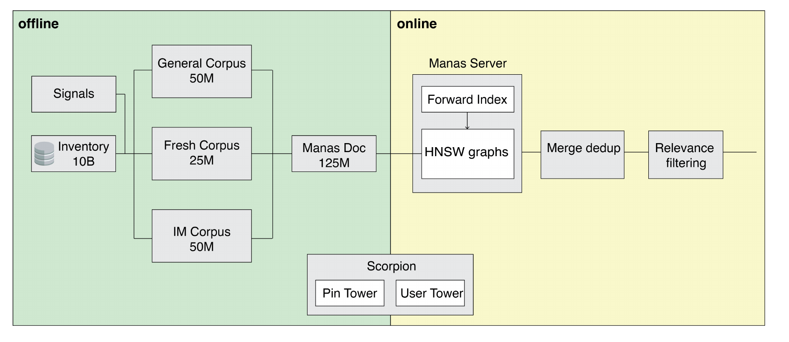

# Pinterest detail-page product retrieval: no full-catalog index, repins +33%

> [中文版](pinterest-closeup-shopping-ebr.md)

### Paper: Optimize Visual Shopping Journey with Embedding-based Retrieval in Pinterest Closeup (SIGIR'25)
### Link: https://doi.org/10.1145/3726302.3731958
### Company: Pinterest
### Idea: priority corpora, multi-task contrastive learning, two-tower retrieval
### Area: i2i

## Overview:
Closeup is Pinterest's detail page: when a user opens a Pin, related content is recommended below it, a kind of "search without typing". This paper covers the retrieval of product Pins on it: the input is the opened Pin (the query Pin) and the current user, the output is related products that can be bought. The previous retrieval simply looked up nearest neighbors among 2 billion products using the pretrained product embedding ItemSage, with no personalization and no awareness of the query Pin's context.

The paper does two things: first, it stops indexing the full product catalog and instead picks 3 small corpora by business goal, 125 million in total; second, it switches to a personalized, end-to-end trained two-tower model that uses multi-task contrastive learning to balance relevance and several kinds of engagement.

### Data side: priority corpora (offline, left of the figure)
The product catalog has over 2 billion items with a heavily skewed distribution: indexing all of it is too expensive, and many tail items are almost never shown; it's also hard for a model to serve business goals such as product diversity and merchant fairness at the same time. So 3 corpora are picked by goal and rebuilt every three days:
* **General (50M):** exploitation. The score is the lower bound of the Wilson confidence interval on the engagement rate over the past N days: when two items have the same engagement rate, the one with more impressions is more trustworthy and scores higher, which keeps items that happened to get engagement on a few impressions from ranking high.
* **Fresh (25M):** new items, with exploration. Scored with Thompson sampling: each item draws a random number from a Beta distribution whose prior is the average engagement rate of all the merchant's items. New items have little data, so they borrow the merchant's track record, while the randomness gives them a chance to be picked.
* **IM (50M):** products from about 10,000 Influential Merchants, to guarantee those merchants' exposure.

The same product is often sold by several merchants and comes in variants, so items are deduplicated by merchant and variant, saving index space and improving diversity. Corpus sizes are set by online A/B tests: simply making a corpus bigger has diminishing returns, because tail items are rarely shown anyway.

### Model side: a personalized two-tower model
#### Inputs: pretrained embeddings instead of raw text and images, plus ordinary features
A product's title, description, multiple images and merchant link are very noisy and expensive to process online. So the model doesn't take raw text and images directly but uses several pretrained embeddings Pinterest already has in their place: ItemSage (product multimodal), LinkSage (merchant web pages), PinSage (graph embedding) and PinnerSage (user multi-interest). Beyond these, both towers also have ordinary categorical and continuous features.

#### The two towers
* **Query tower (User Tower in the figure):** its input is the user plus the query Pin's features, with the same structure as the item tower below plus an MMoE layer after DCNv2 that outputs one query vector per engagement type.

* **Item tower (Pin Tower in the figure):** sees only the candidate's features. Categorical features are looked up as embeddings, continuous features are normalized and passed through LayerNorm, everything is concatenated and passed through DCNv2 for feature crossing, then a few fully connected layers output a 64-dimensional, L2-normalized vector.

#### Loss: one contrastive loss per engagement type
Closeup has 4 engagement types: closeup (opening the Pin), repin (saving), click (visiting the merchant's site) and long-click (a click with more than 35 seconds of dwell).
* **Contrastive loss:** each engagement type gets its own sampled softmax: the query vector for that engagement is dot-multiplied with the item vector, other items in the batch serve as negatives, and batches from several GPUs are gathered into a larger negative pool; a logQ correction is applied by item frequency (estimated in streaming fashion during training with a count-min sketch). The 4 losses are summed with per-engagement weights.
* **Binary loss:** in addition, each engagement's dot product, scaled and shifted, is used for a binary prediction of whether that engagement happened, with weight 0.01.

The training data is about 1 billion records over 31 days, trained for 1 epoch.

### Online serving (online, right of the figure)
The item tower encodes the items in the 3 corpora offline, and HNSW indexes are built. At request time the query tower computes its vector in real time, approximate nearest-neighbor search runs on each corpus, and the results are merged, deduplicated and filtered for relevance and content safety.

### A/B results
The control is the previous ItemSage retrieval over 2 billion products. The shipped combination (General 50M + Fresh 25M + IM 50M): impressions +9.38%, closeups +11.86%, repins +33.40%, clicks +1.45%, long-clicks +1.98%. With General 50M alone, closeups (+4.69%) and repins (+22.21%) already beat ItemSage over 2 billion, while clicks are flat and long-clicks dip slightly; growing General from 50M to 100M adds a limited amount.

Multi-task ablation: against a single-objective baseline where any engagement counts as a positive, training on one engagement type mainly lifts that engagement's metric, showing that the different engagement objectives can't stand in for each other, which is the basis for splitting into several objectives.

## Takeaways:
* Using the platform's existing pretrained embeddings instead of raw text and images greatly cuts online cost. An improvement on top of the baseline approach like this can be shipped quickly to capture gains, with further iteration later.

## My take

## Credibility: production

## Recommendation level: practical value
