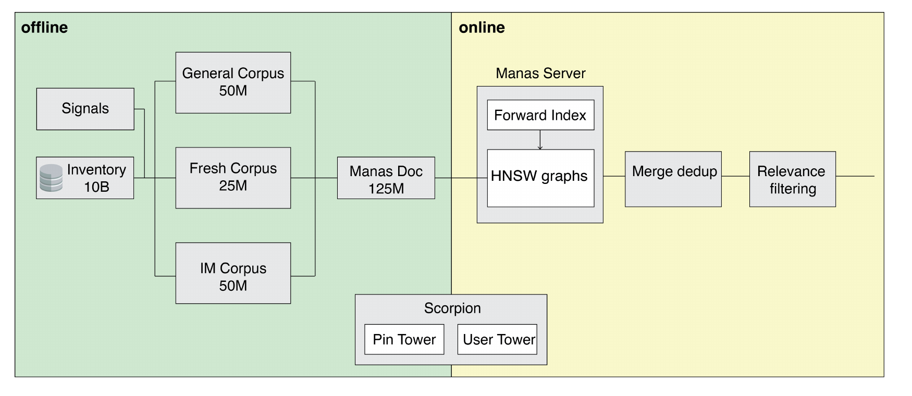

# Pinterest 详情页商品召回，不给全量库建索引，转存+33%

关注我，每天为你精挑细选最优质、最新鲜的推荐算法paper，陪你一起保持进步、不断精进！

> [English version](pinterest-closeup-shopping-ebr.full.en.md)

### 论文：Optimize Visual Shopping Journey with Embedding-based Retrieval in Pinterest Closeup（SIGIR'25）
### 网址：https://doi.org/10.1145/3726302.3731958
### 公司：Pinterest
### 思想：优先语料库、多任务对比学习、双塔召回
### 方向：i2i

## 解读：
Closeup 是 Pinterest 的详情页：用户点开一个 Pin，下方会推荐相关内容，相当于「不用打字的搜索」。本文负责其中商品 Pin 的召回：输入是被点开的 Pin（query Pin）和当前用户，输出是能买的相关商品。原来的召回直接用预训练的商品向量 ItemSage 在 20 亿商品上找近邻，不个性化，也不看 query Pin 的上下文。

本文做了两件事：一是不再给全量商品库建索引，而是按业务目标挑出 3 个小语料库，总共 1.25 亿；二是换成端到端训练的个性化双塔，用多任务对比学习同时照顾相关性和多种互动。

### 数据侧：优先语料库（图左 offline）
商品库超过 20 亿且分布极度偏斜：给全量建索引太贵，大量尾部商品几乎不会被曝光；模型也很难同时照顾商品多样性、商家公平这些业务目标。所以按目标挑出 3 个语料库，每三天重建一次：
* **General（5000 万）：** 主打利用。对过去 N 天的互动率取 Wilson 置信区间的下界作为分数：两个商品互动率一样时，曝光多的置信度高、分数也高，避免几次曝光碰巧有互动的商品排到前面。
* **Fresh（2500 万）：** 新品，兼顾探索。用 Thompson 采样打分：每个商品从一个 Beta 分布里随机抽一个数，Beta 分布的先验用该商家所有商品的平均互动率。新品数据少，就借商家的历史表现，同时随机性给新品被选中的机会。
* **IM（5000 万）：** 约 1 万家知名商家（Influential Merchants）的商品，保证这些商家的曝光。

同一件商品常被多个商家卖，还有不同规格，所以按商家和规格去重，省索引、提高多样性。语料库大小靠线上 A/B 定：一味加大收益递减，因为尾部商品本来就很少被曝光。

### 模型侧：个性化双塔
#### 输入：预训练向量代替原始图文，再加普通特征
商品的标题、描述、多张图片、商家链接噪声都很大，在线处理成本也高。所以模型不直接吃原始图文，而是用 Pinterest 已有的几种预训练向量代替：ItemSage（商品多模态）、LinkSage（商家网页）、PinSage（图向量）、PinnerSage（用户多兴趣）。除此之外，两个塔还有普通的类别特征和连续特征。

#### 两个塔
* **query 塔（图中 User Tower）：** 输入是用户加 query Pin 的特征，结构和下面的商品塔相同，只是在 DCNv2 后面多一层 MMoE，为每种互动输出一个 query 向量。

* **商品塔（图中 Pin Tower）：** 只看候选商品的特征。类别特征查表成向量，连续特征归一化后过 LayerNorm，全部拼接后过 DCNv2 做特征交叉，再过几层全连接，输出 64 维、L2 归一化的向量。

#### 损失：每种互动各一个对比损失
Closeup 上有 4 种互动：点开（closeup）、转存（repin）、点进商家网站（click）、停留超过 35 秒的点击（long-click）。
* **对比损失：** 每种互动各算一个 sampled softmax：用该互动对应的 query 向量和商品向量做内积，batch 内其它商品当负样本，还把多张 GPU 上的 batch 汇总成更大的负样本池；按商品出现频率做 logQ 纠偏（频率用 count-min sketch 在训练中流式估计）。4 个损失按互动类型加权求和。
* **二分类损失：** 再用每种互动的内积经缩放和平移后，做二分类预测这条样本有没有发生该互动，权重 0.01。

训练数据是 31 天约 10 亿条记录，只训 1 个 epoch。

### 线上部署（图右 online）
商品塔离线把 3 个语料库的商品编成向量，建 HNSW 索引。请求来时，query 塔实时算出向量，在各语料库里做近似最近邻检索，再合并去重、做相关性和内容安全过滤。

### A/B效果
对照是原来在 20 亿商品上用 ItemSage 召回。上线的组合（General 5000 万 + Fresh 2500 万 + IM 5000 万）：曝光 +9.38%，点开 +11.86%，转存 +33.40%，点击 +1.45%，长点击 +1.98%。只用 General 5000 万，点开（+4.69%）、转存（+22.21%）就已经超过 ItemSage 20 亿，点击持平、长点击略降；General 从 5000 万扩到 1 亿，收益有限。

多任务的消融：以「有任何一种互动就算正样本」的单一目标为基线，单独训哪种互动，就主要拉动哪个指标，说明不同互动目标不能互相替代，这是拆成多个目标的依据。

## 心得：
* 输入用平台已有的预训练向量，而不是原始图文，能大幅降低在线成本。这种在 baseline 方案上的提高，可以快速落地，拿到收益，后面慢慢迭代。

## 愚见

## 可信度：生产

## 推荐等级：有实践价值

**请帮忙点赞、转发，谢谢。欢迎干货投稿 \ 论文宣传\ 合作交流**

### 【铁粉】请入微信群，群内我会给出更深入的解读，还可以共同讨论技术方案、发招聘广告、内推和交友等。
* 铁粉标准：关注公众号一个月以上，且在公众号上累计15次互动（评论、爱心、转发）、或投稿1次，只欢迎技术同学。
* 入群方法：请您加个人微信lmxhappy，我拉您入群，请备注【公司】（只我个人看，不公开）。

## 推荐您继续阅读：
