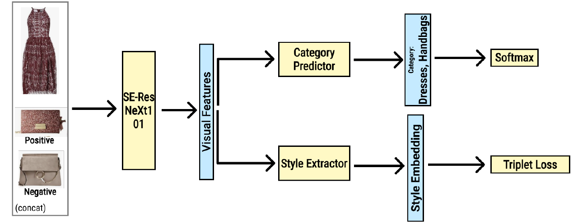

# Outfit matching: automatically crop a million outfits out of on-site collage images to train style embeddings; online, predict the category, expand it to complementary categories, then run ANN within each category

> [中文版](pinterest-ctl.md)

### Paper: Bootstrapping Complete The Look at Pinterest (KDD 2020)
### Link: https://arxiv.org/abs/2006.10792
### Institution: Pinterest
### Ideas: complementary fashion recommendation, outfit dataset mining, object detection, style embedding, triplet loss, category-restricted negative sampling, category expansion, per-category ANN retrieval
### Area: i2i (complementary recommendation, outfit matching)

## Breakdown:
When a user views an apparel product on Pinterest (e.g., a red striped blouse), recommend products from other categories that complete the outfit (shoes, sunglasses, jewelry). The paper first crops 1 million outfits automatically out of on-site outfit collage images, then adds a category head and a style head on top of Pinterest's pre-trained visual model (Unified Embedding, SE-ResNeXt101) and continues training it on these outfits, giving an image model that outputs both the product's category and a style embedding.

Existing outfit systems either rely on products hand-picked and matched by stylists, or on past user engagement ("people who bought this also bought…"), and a newly launched product has neither. Public Polyvore outfit datasets have only 20k to 70k outfits, and the site has shut down. Academic outfit models are mostly classifiers that score a whole outfit, not designed for retrieval over tens of millions of products.

### Method
Two steps: first generate an outfit dataset automatically ((1)), then train the image model on it ((2)).

#### (1) Mining outfits from Pinterest images
The goal is a large number of "items from the same outfit" as positives, with item crops that look like the white-background product images served online. Three filtering steps in sequence narrow all site images down to about 1M outfits.
1. **Filter collages (all site images → about 35M).** Only outfit collages are wanted, i.e., several items laid out on one white-background image (common on the Polyvore site), because items cropped from them have clean backgrounds and look like the white-background product images served online. An existing on-site image-type classifier (telling collages, white-background product shots, model photos, etc. apart); it scores all images on the site, and those scoring above 0.9 as a collage are kept.
2. **Crop items from the collages (about 35M → about 10M).** On the collages kept by the previous step, the on-site fashion detector (Faster R-CNN trained on 251k images) boxes every item and its category, keeping only 21 apparel categories. Images with at least one box are kept; the rest, with none boxed, are dropped. The boxes in one image form one outfit.
3. **Clean up (about 10M outfits → about 1M).** The outfits from the previous step are filtered one by one. Drop overlapping boxes and boxes smaller than 5% of the image; require 3 to 8 items and at least 3 different categories per outfit; drop outfits where all items share one color, so the model doesn't just learn to match colors. Filtering by clicks, repins or image age was also tried, with no visible difference.

The result is 1,006,519 outfits and 4.246M items, with 24,960 outfits held out for testing.

#### (2) Image model: category + style embedding
One image model outputs both the category and the style embedding; query products and catalog products are encoded by the same model.
The backbone is SE-ResNeXt101, initialized from the weights of Unified Embedding. Unified Embedding is Pinterest's own visual model, also with an SE-ResNeXt101 backbone, trained on on-site images with multi-task learning for three products: visual search (Lens), similar-image search (Flashlight) and Shop The Look. The backbone's visual features feed the two heads below.
* **Category head.** Two fully connected layers predicting one of 21 categories, with labels from the detector in (1); accuracy 98.15%. Online it decides the query's category and is used to build per-category catalog indices.
* **Style head.** Two fully connected layers (with BatchNorm and dropout 0.5) output a 128-dim style embedding. Whether two products go together is just the Euclidean distance between their style embeddings; there is no separate scoring network. The paper doesn't say whether the two heads are trained jointly or separately.

**Loss.** Each head has its own loss. The category head uses softmax cross-entropy over the 21 categories. The style head uses a triplet loss computed on the style embedding. Two items of different categories from the same outfit are the trigger (the paper calls it the anchor) and positive; the negative is a random item from another outfit in the same category as the positive (if the trigger is a top and the positive is the shoes from that outfit, the negative is a pair of shoes from another outfit). The squared trigger-positive distance must be smaller than the trigger-negative one by at least a margin. "Trigger and positive in different categories" is not in the paper's text; this follows the sampling script in the official dataset repo.

**Two other style-head losses compared (not deployed).** The category head stays the same. One is a contrastive loss, with positive pairs being two items of different categories from the same outfit and negative pairs random regardless of category, at a 1:1 ratio; the other is proxy classification, where each outfit is a class and an item image must be classified into its own outfit, with each softmax over only 2048 sampled outfits (following how Unified Embedding is trained). Each of the three trains its own model; the comparison is below.

**Why negatives are sampled by category.** When the negative is in the same category as the positive, the model can't tell them apart by category differences like "is it a shoe"; it must learn "does this shoe go with this top". Forcing positive pairs in the contrastive loss to differ in category likewise keeps the model from treating "looks alike" as "goes together".

### Inference
* **Indexing.** The image-type classifier from (1) first filters the catalog, keeping only white-background product shots; model photos and outfit photos are left out. The remaining products go through the model offline to get the category predicted by the category head and the style embedding output by the style head. The inverted index is keyed by the predicted category (not the product's own catalog category), and each category gets its own ANN index built from its products' style embeddings. Queries likewise trigger only on white-background product shots.
* **Category expansion.** When a user views a product, the model predicts its category and style embedding in real time, and the category is expanded into several complementary categories (e.g., "Shirts & Tops" expands to shoes, sunglasses, and jewelry & watches). The paper doesn't say how the expansion rules are defined.
* **Per-category retrieval.** The query's style embedding searches each complementary category's ANN index for nearest neighbors, giving one list per category.
* **Blending.** The per-category lists are merged into a final order; the paper doesn't say how.

The model is exported to the C++ serving stack via TorchScript.

### Data and results
Offline evaluation uses test outfits with exactly 5 items. Each item is a query against a retrieval pool of 200 items (the other items of the same outfit as positives, the rest randomly sampled, with pools built per category and averaged), measuring Recall@1/5/10. There is also a fill-in-the-blank task (remove one item from an outfit and pick it among the true item and 3 random items of the same category).
* **Training methods.** Triplet loss with category-restricted negatives reaches R@1 of 20.3%, triplet with random negatives 18.5%, contrastive loss 16.0%, proxy classification 15.8%, and Pinterest's earlier "scene image to product" model (Kang et al., 2018, also called CTL) used as is only 3.9%; fill-in-the-blank accuracy is 78.5%, 77.6%, 74.3%, 71.9% and 40.1% respectively.
* **Initialization.** Initializing the backbone from Unified Embedding instead of ImageNet raises R@1 from 17.6% to 20.3%.
* **Data size.** With 10k, 100k and 1M training outfits, R@1 is 12.1%, 16.4% and 20.3%, still rising.
* **Human evaluation.** 120 Pinterest products are run through the full online pipeline, and in-house fashion specialists judge whether each (query, recommendation) pair is compatible. Precision is 55.0% for triplet, 50.6% for proxy classification and 47.7% for contrastive. The specialists report that the model relies too much on color and pattern matching.
* **User study.** As of early 2020 the prototype had only been released internally; 5 users each took part in a one-hour session, and the conclusion was that users see value in the feature. There is no online A/B test or business metric.

The dataset is partly open source (100k training outfits and the full test set, with a triplet sampling script); the model code is not released.

## Takeaways
* Collage images plus an existing detector turn on-site content into a million-outfit training set without any user engagement data.
* Sampling the negative from the positive's category makes the embedding learn compatibility rather than category, worth about 2 points of R@1 over random negatives.
* Serving with one shared encoder, a category classifier and per-category ANN indices keeps complementary retrieval as cheap as visual search.

## Caveats
* There are no online metrics: the system had only an internal prototype, and the user study involved 5 people, so the production value is unmeasured.
* The human evaluation covers 120 query products with no inter-annotator agreement or confidence intervals, and the 55.0% vs. 50.6% gap is reported without a significance test.
* Offline positives come from the same collage images the training data is mined from, and the retrieval pool is only 200 items, while serving runs on product shots over millions of products; the domain gap between crops and product shots is not quantified.
* The complementary-category expansion rules and the cross-category blending are not described, and the paper's text ("any two items from the same outfit") differs from the released sampling script, which also requires the trigger and positive to be in different categories.

## Credibility: offline

## Recommendation level: worth a look if you have time
