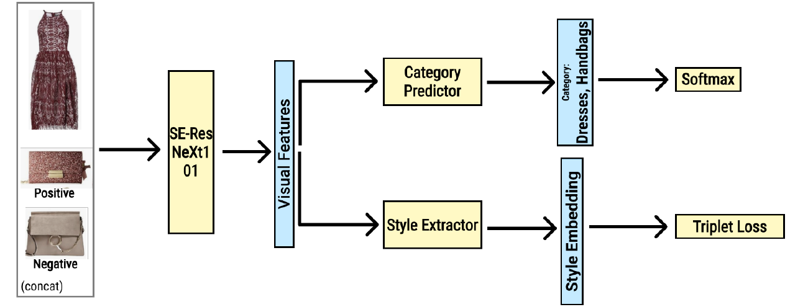

# 穿搭搭配：从站内拼贴图里自动抠出百万套穿搭训练风格向量；线上先预测类目、扩成互补类目，再在各类目里做 ANN

关注我，每天为你精挑细选最优质、最新鲜的推荐算法paper，陪你一起保持进步、不断精进！

> [English version](pinterest-ctl.full.en.md)

### 论文：Bootstrapping Complete The Look at Pinterest
### 网址：https://arxiv.org/abs/2006.10792
### 公司：Pinterest
### 思想：
### 方向：i2i（互补推荐、穿搭搭配）

## 解读：
用户在 Pinterest 上看一件服饰商品（比如一件红色条纹上衣）时，推荐能和它搭成一套的其他类目商品（鞋、墨镜、首饰）。本文先从站内的穿搭拼贴图里自动抠出 100 万套穿搭，再在 Pinterest 预训练好的视觉模型（Unified Embedding，SE-ResNeXt101）上接类目头和风格头，用这些穿搭继续训练，得到一个同时输出商品类目和风格向量的图像模型。

推理时，先预测查询商品的类目，扩展成几个互补类目，再在每个类目里按风格向量做近似最近邻（ANN）检索。

已有的搭配系统要么依赖造型师人工挑选、搭配好的商品，要么依赖用户的历史互动（买了这件的人还买了什么），新产品上线时这两样都没有；公开的 Polyvore 穿搭数据集只有 2 到 7 万套，网站也已关闭。学术界的搭配模型多是给一套穿搭打分的分类模型，不是为从千万级商品里检索设计的。

### 方法
分两步，先自动生成穿搭数据集（（1）），再用它训练图像模型（（2））。

#### （1）从 Pinterest 图片里挖穿搭
目标是得到大量「同一套里的几件单品」当正样本，而且单品图要和线上的白底商品图长得像。三步依次过滤，从全站图片一路缩到约 100 万套穿搭。
1. **筛拼贴图（全站图片 → 约 3500 万张）。** 只要穿搭拼贴图，即几件单品拼在一张白底图上的那种（Polyvore 网站上常见），因为从里面抠出的单品背景干净，和线上的白底商品图长得像。站内已有一个图片类型分类器（区分拼贴图、白底商品图、模特图等），拿它给全站图片打分，拼贴图得分超过 0.9 的留下。
2. **从拼贴图里抠单品（约 3500 万张 → 约 1000 万张）。** 对上一步留下的拼贴图，用站内的服饰检测模型（Faster R-CNN，在 25.1 万张图上训练）框出每件单品和它的类目，只保留 21 个服饰类目。每张至少框出一件的图留下，其余一件都没框出的丢掉。一张图里的几个框就算一套穿搭。
3. **清洗（约 1000 万套 → 约 100 万套）。** 对上一步得到的穿搭逐套过滤。去掉重叠框和面积不到整图 5% 的小框；每套要有 3 到 8 件、至少 3 种不同类目；所有单品同一颜色的整套丢掉，避免模型只学会配颜色。按点击、转存或图片新旧筛选也试过，没看到区别。

最后得到 1,006,519 套穿搭、424.6 万件单品，留 24,960 套做测试。

#### （2）图像模型：类目 + 风格向量
一个图像模型同时给出类目和风格向量，查询商品和商品库用同一个模型编码。
骨干网络是 预训练的SE-ResNeXt101（Unified Embedding 是 Pinterest 自己的视觉模型，骨干同样是 SE-ResNeXt101，在站内图片上为拍照搜（Lens）、相似图搜索（Flashlight）、Shop The Look 三个任务多任务训练过）。骨干抽出的视觉特征分给下面两个头。
* **类目头。** 两层全连接，在 21 个类目里预测一个，标签来自（1）里检测模型给的类目，准确率 98.15%。线上靠它定查询商品的类目、给商品库建分类目索引。
* **风格头。** 两层全连接（带 BatchNorm 和 0.5 的 dropout），输出 128 维风格向量。两件商品搭不搭就看风格向量的欧氏距离，没有单独的打分网络。论文没说两个头是联合训练还是分开训练。

**损失。** 两个头各接一个损失。类目头在 21 个类目上做 softmax 交叉熵。风格头用三元组损失，距离在风格向量上算。同一套里两件不同类目的单品做 trigger（论文叫锚点，anchor）和正样本，负样本是从别的套里随机挑一件和正样本同类目的（trigger 是上衣、正样本是这套里的鞋，负样本就是别的套里的一双鞋），要求 trigger 到正样本的平方距离比到负样本的至少小一个间隔。「trigger 和正样本类目不同」论文正文没写，按官方数据集仓库里的采样脚本。

**风格头另外比过的两种损失（只做对比，没上线）。** 类目头不变。一是对比损失，正样本对是同一套里不同类目的两件，负样本对不限类目随机挑，正负 1:1；二是代理分类，每套穿搭当一个类别，单品图要分到自己那一套，每次只在抽出来的 2048 个套里做 softmax（沿用 Unified Embedding 的训法）。三种各训一个模型，效果对比见下文。

**为什么负样本按类目采。** 负样本和正样本同类目，模型就不能靠「是不是鞋」这种类目差异区分正负，只能学「这双鞋和这件上衣搭不搭」。对比损失里正样本对强制不同类目，也是为了不让模型把「长得像」当成「搭得上」。

### 推理
* **建库。** 先用（1）里那个图片类型分类器筛商品库，只留白底商品图，模特图、穿搭图都不进库。留下的商品离线过一遍模型，得到类目头预测的类目和风格头输出的风格向量。按预测的类目（不是商品自带的类目）建倒排索引，每个类目再用该类商品的风格向量单独建一个 ANN 索引。查询同样只对白底商品图触发。
* **类目扩展。** 用户看一件商品时，模型实时预测它的类目和风格向量，再把类目扩展成几个互补类目（比如「上衣」扩成鞋、墨镜、首饰手表）。扩展规则怎么定的论文没写。
* **分类目检索。** 在每个互补类目的 ANN 索引里用查询的风格向量找最近邻，各得一个列表。
* **融合。** 把各类目的列表合并、排出最终顺序，怎么合论文没写。

模型用 TorchScript 导出到 C++ 线上服务。

### 数据与效果
离线评测用测试集里恰好 5 件的穿搭，每件单品当查询，检索池 200 件（同套其他单品当正样本，其余随机抽，按类目分别建池再平均），算 Recall@1/5/10；另有填空题（一套去掉一件，在正确答案和 3 件同类目随机商品里选）。
* **训练方式。** 按类目采负样本的三元组 R@1 为 20.3%，随机负样本的三元组 18.5%，对比损失 16.0%，代理分类 15.8%，直接拿 Pinterest 此前「场景图配商品」的模型（Kang 等，2018，也叫 CTL）只有 3.9%；填空准确率依次为 78.5%、77.6%、74.3%、71.9%、40.1%。
* **初始化。** 骨干从 Unified Embedding 初始化比从 ImageNet 初始化，R@1 从 17.6% 升到 20.3%。
* **数据量。** 训练套数 1 万、10 万、100 万时，R@1 为 12.1%、16.4%、20.3%，还在涨。
* **人工评测。** 抽 120 件 Pinterest 商品跑完整线上链路，站内时尚专员判每个（查询，推荐）对搭不搭，准确率三元组 55.0%、代理分类 50.6%、对比损失 47.7%。专员反馈模型过于依赖颜色和图案匹配。
* **用户研究。** 截至 2020 年初只在公司内部上线了原型，请 5 位用户各做一小时访谈，结论是用户认可这个功能。没有线上 A/B 或业务指标。

数据集部分开源（10 万套训练集和全部测试集，附三元组采样脚本），模型代码未开源。

## 心得：

## 愚见

## 可信度：离线

## 推荐等级：有时间看看

**请帮忙点赞、转发，谢谢。欢迎干货投稿 \ 论文宣传\ 合作交流**

### 【铁粉】请入微信群，群内我会给出更深入的解读，还可以共同讨论技术方案、发招聘广告、内推和交友等。
* 铁粉标准：关注公众号一个月以上，且在公众号上累计15次互动（评论、爱心、转发）、或投稿1次，只欢迎技术同学。
* 入群方法：请您加个人微信lmxhappy，我拉您入群，请备注【公司】（只我个人看，不公开）。

## 推荐您继续阅读：
