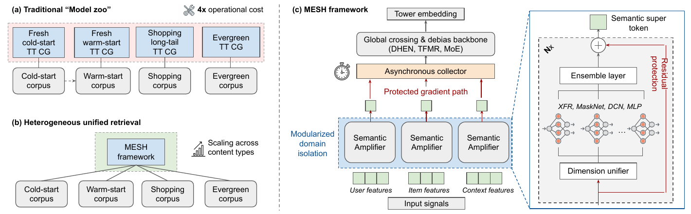

# Pinterest Related Pins retrieval: a bigger model only helped old content; after splitting features into three sub-towers, fresh-content repins +4.9%

> [中文版](pinterest-mesh.md)

### Paper: MESH: Scaling Up Retrieval with Heterogeneous Content Unification (RecSys 2026 Industry Track)
### Link: https://arxiv.org/abs/2607.12392
### Company: Pinterest
### Ideas: feature-group sub-towers, retrieval model scaling, context-gated bias correction
### Area: i2i, retrieval

## Breakdown:
**The bigger the retrieval model, the more it favors old content; the paper fixes this with three sub-towers.**

The setting is Pinterest's Related Pins (the related recommendations below a Pin you've opened; billion-scale I2I), with two-tower retrieval. Content falls into several tiers (just-published Pins, fresh Pins with some early engagement, long-tail shopping Pins, long-lived popular "evergreen" Pins), and their engagement density differs by orders of magnitude. To make sure fresh and long-tail content can still be retrieved, each tier used to get its own two-tower retrieval model, which is expensive to maintain. The goal is to replace them with one unified model, but when a single model is scaled up, almost all of the gain lands on evergreen content.

The paper changes only the query tower (the candidate tower is untouched). Query-side features are split into three groups (user, query Pin, context). Each group is first crossed thoroughly in its own sub-tower; the user and query-Pin groups are then multiplied element-wise, the product is gated by the context group, and only then does everything enter the global crossing layer.

### One observation: a bigger model only helped old content
The baseline is a "flat" architecture (all feature embeddings concatenated into one vector and fed straight into DHEN for global crossing). Scaling the model up in FLOPs and fitting "Recall@10 ∝ FLOPs to the power β", evergreen content gets β = 0.0274 while fresh content (published less than 28 days ago) gets only 0.0059: more compute barely helps. The authors' explanation is that in the global crossing layer all features are coupled, so the gradient is dominated by high-frequency evergreen content (measured during training, the evergreen gradient norm is 12.4× the fresh one). Fresh-content signal gets drowned out, and the gap widens as the model grows.

### Model architecture
Figure (a) is the old approach (one two-tower retrieval model per content tier, four in all), Figure (b) is the paper's goal (one MESH model serving all four corpora), and Figure (c) is MESH's query tower. The query tower has three steps, following Figure (c) from bottom to top. Steps (1) and (2) correspond to the blue box, one sub-tower per group, with the red lines showing gradient paths that don't interfere across groups; step (3) corresponds to the "Global crossing & debias backbone" at the top. The zoomed-in panel on the right is the sub-tower's internal structure.

### (1) Grouping
Features are split into three groups (user, query Pin, context). Within each group the embeddings are concatenated and passed through their own LayerNorm, giving the group's initial vector. Normalizing each group separately keeps the query-Pin group's value distribution from being skewed by the other two groups.

### (2) Within-group amplification: one DHEN sub-tower per group
Each group has an independent sub-tower (the paper calls it a Semantic Amplifier) that turns the initial vector into a high-dimensional "super token". The sub-tower is built from DHEN (each layer runs several crossing operators in parallel and merges them into one output, with layers stacked), N layers deep. Each layer does the following.
* **Unify dimensions.** The input is first projected to a common dimension.
* **Parallel crossing.** Transformer, MaskNet, DCNv2 and MLP operators process the same input in parallel.
* **Merge.** An ensemble layer combines the outputs into one vector.
* **Residual.** The layer input is added back, followed by normalization.

**Why cross within a group first.** Fresh-content embeddings are under-trained; thrown straight into the global crossing layer, their signal disappears after a few nonlinear layers. Amplifying it repeatedly within the group via residuals lets the features be fully expressed before crossing with other groups. The three sub-towers share no parameters, so fresh-content gradients don't have to compete with evergreen content on the same path.

**Asynchronous collector (the orange box in the figure).** The three sub-towers run inference asynchronously in parallel; the collector waits until all of them finish, then gathers the three super tokens and passes them to step (3). So the latency of this stage depends only on the slowest sub-tower.

### (3) Cross-group merge and global crossing (the top box in the figure)
The top box, "Global crossing & debias backbone", holds two consecutive operations. The name puts crossing first, but per the paper's formulas debias comes first and crossing second, because the debias step is also what merges the three super tokens into one vector, and global crossing can only run on the merged vector.
* **Debias (the paper calls it RGBC).** The user token and the query-Pin token are multiplied element-wise to give their match vector. The context token goes through an MLP and a sigmoid to produce a gate of the same dimension, which multiplies the match vector; the context token itself is then added (residual), followed by LayerNorm, giving a single vector.
* **Global crossing.** That vector goes through another DHEN crossing layer, then several fully connected layers (ReLU + LayerNorm), outputting a 64-dim L2-normalized query vector (the "Tower embedding" at the very top of the figure), which is dotted with the candidate-tower vector for ANN retrieval.

**Why it's called debias.** Context such as device and time of day correlates with whether a user engages, but has little to do with how good the content is; the paper treats the engagement variance it causes as bias. Using context both as the gate and as a residual lets it absorb this variance, so the user–query-Pin match vector only has to capture content matching.

**Offline results in one paragraph.** Fresh-content β rises from 0.0059 to 0.0826 (14×), while evergreen β drops to 0.0160; the evergreen-to-fresh gradient-norm ratio falls from 12.4× to 4.7×. In the ablation, removing the within-group sub-towers hurts most, with β nearly back to baseline. Adding a fourth group (splitting the query Pin into engagement and content sub-towers) adds only 0.3%–0.5%, so production uses three groups.

### Training data and corpora
15 days of Related Pins logs, about 1B records, with repins as positives. In-batch negatives with logQ correction by item frequency. Offline evaluation uses samples from the following 3 days drawn from 5% uniformly random traffic (450M examples), avoiding the selection bias introduced by the production ranking policy. The retrieval corpus is split into four tiers (just-published cold start, fresh content with early engagement, long-tail shopping, evergreen), each with its own inclusion and pruning rules, and one model serves all four corpora.

### Serving
The three sub-towers have no data dependencies, so TorchScript is used to run them in parallel. The thread count turns out to be the key. Sequential execution gives a P99 of 42.5ms; one thread per sub-tower (3 in total) actually rises to 187.4ms due to context switching and resource contention; a 48-thread pool sized to the hardware brings it down to 14.8ms (2.87× speedup).

### A/B results
3 weeks, user-level split. Control is the production flat two-tower model, retrained on the same dates of data.
* **Fresh content:** impressions +5.5%, repins +4.9%. Broken down by Pin age, 7–28 days gains the most (engagement +2.49% and +2.77%), while 0–7 days gets only +0.96% engagement.
* **Long-tail shopping:** impressions +1.46%, repins +2.33%.
* **Overall:** impressions +0.41%, repins +0.96%. Total app time +0.45%, sessions longer than 5 minutes +0.46%, and time on Search and Home Feed also went up (+0.49%, +0.41%), so the gains weren't moved over from other surfaces.
* **Funnel:** two metrics, one is how many retrieved candidates survive ranking (survival rate), the other is how many make it into the final top 50 (CE@50). For fresh content with early engagement, CE@50 +55.0% and survival rate +6.0%; for long-tail shopping, CE@50 +58.2% and survival rate +4.36%; for evergreen content, survival rate −0.21% and CE@50 −21.0%.
* **Versus RankMixer:** also tested online, the flat RankMixer architecture at 28M gives fresh repins −1.42% and at 135M −2.99% (relative to MESH). Making the model bigger widens the gap rather than closing it.

## Takeaways:
* Before adding capacity to a retrieval model, look at the scaling slope separately per content tier (fresh, long-tail, evergreen); the overall metric hides the case where gains land only on the head.
* Grouping features into user, query and context, crossing within groups first and across groups afterward, is a cheap structural change, and fresh and long-tail retrieval benefit the most.
* When running several sub-towers in parallel, size the thread pool to the hardware cores rather than one thread per tower; the latter made P99 4× worse.

## Caveats
* Several numbers don't match. The abstract says fresh-content repins +5.5%, while the body says impressions +5.5% and repins +4.9%; Related Pins time spent is +0.51% in the text and +0.55% in Table 5.
* In the Pin-age breakdown (Table 4), no band exceeds +2.77%, yet fresh content overall shows impressions +5.5% and repins +4.9%. If fresh content means published within 28 days, the overall lift should fall within the range of the bands; the paper doesn't explain the difference in definitions.
* The gradient argument is about item embeddings, but the change is only in the query tower and the candidate tower is unchanged. The paper doesn't make clear how fresh candidates benefit, or on which parameters the 12.4× gradient ratio was measured.
* The title and Figure 1 claim one model can replace multiple per-tier retrieval models (the figure labels it 4× operational cost), but the A/B control is a single flat two-tower model; the paper doesn't say whether the per-tier retrievers were retired, and gives no cost numbers.
* Evergreen CE@50 is −21%, which the paper interprets as giving retrieval slots to fresh content and improving diversity, but no diversity metric is reported.

## Credibility: production

## Recommendation: practically useful
