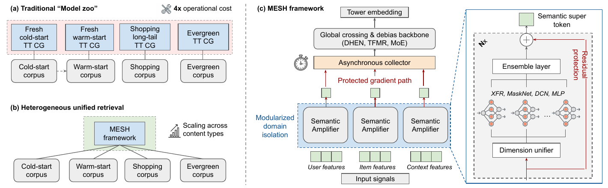

# Pinterest 相关 Pin 召回，加大模型只帮了老内容；特征拆成三个子塔后，新内容转存+4.9%

关注我，每天为你精挑细选最优质、最新鲜的推荐算法paper，陪你一起保持进步、不断精进！

> [English version](pinterest-mesh.full.en.md)

### 论文：MESH: Scaling Up Retrieval with Heterogeneous Content Unification（RecSys 2026 Industry Track）
### 网址：https://arxiv.org/abs/2607.12392
### 公司：Pinterest
### 思想：特征分组子塔、召回模型 scaling、上下文门控纠偏
### 方向：i2i、召回

## 解读：
**召回模型越大越偏老内容，本文拆三个子塔解决。**

场景是 Pinterest 的 Related Pins（点开一个 Pin 后下方的相关推荐，十亿级 I2I），召回用双塔。内容分好几层（刚发布的新 Pin、有了点互动的新 Pin、长尾商品 Pin、长期热门的老 Pin），每层的互动密度差几个数量级。为了让新内容和长尾也召得回来，以前是每层各训一个双塔召回模型，维护成本高。想换成一个统一模型，问题是一个模型加大容量后，收益几乎全落在老内容上。

本文的做法是只改 query 塔（候选塔不动）。把 query 侧特征按用户、query Pin、上下文拆成三组，每组先在自己的子塔里充分交叉，用户和 query Pin 两组再做逐元素乘，乘积由上下文门控，最后才进全局交叉层。

### 一个观察：模型加大只帮了老内容
基线是「平铺」结构（所有特征 embedding 拼成一个向量，直接进 DHEN 做全局交叉）。按 FLOPs 加大模型，拟合「Recall@10 ∝ FLOPs 的 β 次方」，老内容的 β 是 0.0274，新内容（发布不到 28 天）只有 0.0059，加算力基本不涨。作者的解释是全局交叉层里所有特征耦合在一起，梯度被高频的老内容主导（训练中实测老内容的梯度范数是新内容的 12.4 倍），新内容的信号被淹没，模型越大差距越大。

### 模型结构
图 (a) 是以前的做法（四层内容各配一个双塔召回模型），图 (b) 是本文的目标（一个 MESH 模型服务四个语料库），图 (c) 是 MESH 的 query 塔。query 塔分四步。（1）（2）对应图 (c) 的蓝框，每组一个子塔，红线是各组互不干扰的梯度路径；（3）（4）对应顶部的 Global crossing & debias backbone。右侧放大的是子塔内部结构。

### （1）分组
特征分成三组（用户、query Pin、上下文）。每组内的 embedding 拼接后各自过一次 LayerNorm，得到组的初始向量。各组单独归一化，query Pin 组的数值分布不会被另外两组带偏。

### （2）组内放大：每组一个 DHEN 子塔
每组一个独立的子塔（论文叫 Semantic Amplifier），把初始向量变成一个高维的「超级 token」。子塔用 DHEN 搭（每层并行跑几种交叉算子，再合成一个输出，层层堆叠），堆 N 层，每层的步骤如下。
* **统一维度。** 输入先投影到统一维度。
* **并行交叉。** Transformer、MaskNet、DCNv2、MLP 几种算子并行处理同一输入。
* **合并。** ensemble 层把几路输出合成一个向量。
* **残差。** 加回本层输入，再归一化。

**为什么要先在组内交叉。** 新内容的 embedding 训练得少，直接扔进全局交叉层，信号经过几层非线性就没了。先在组内用残差反复放大，特征表达充分了再去和别的组交叉；三个子塔互不共享参数，新内容的梯度不用和老内容抢同一条路径。

### （3）组间门控纠偏（RGBC）
用户 token 和 query Pin token 逐元素相乘，得到两者的匹配向量。上下文 token 过 MLP 和 sigmoid 得到同维的门控值，乘到匹配向量上，再加上上下文 token 本身（残差），过 LayerNorm，作为全局交叉层的输入。

**为什么上下文单独处理。** 设备、时段这类上下文和「会不会互动」相关，但和内容本身好不好关系不大。让上下文既当门控、又走残差，它能吸收这部分互动波动，用户和 query Pin 两组就只管内容匹配。

### （4）全局交叉与输出
再过一个 DHEN 全局交叉层，接几层全连接（ReLU + LayerNorm），输出 64 维、L2 归一化的 query 向量，和候选塔的向量做内积，ANN 检索。

**离线结果一句话。** 新内容的 β 从 0.0059 升到 0.0826（14 倍），老内容的 β 降到 0.0160；老内容与新内容的梯度范数比从 12.4 倍降到 4.7 倍。消融里去掉组内子塔掉得最多，β 几乎回到基线。再拆一组（query Pin 分成互动和内容两个子塔）只多涨 0.3%–0.5%，线上用三组。

### 训练数据与语料库
15 天的 Related Pins 日志，约 10 亿条，正样本是转存（repin）。batch 内负样本，按物品频率做 logQ 纠偏。离线评估用之后 3 天、5% 均匀随机流量的样本（4.5 亿条），避开线上排序策略带来的选择偏差。召回语料库分四层（新发布冷启动、已有初步互动的新内容、长尾商品、长期热门），各有入选和淘汰规则，同一个模型服务四个库。

### 线上部署
三个子塔没有数据依赖，用 TorchScript 让它们并行推理。线程数是关键。顺序执行 P99 是 42.5ms；一个子塔配一个线程（共 3 个）反而因为上下文切换和资源争抢涨到 187.4ms；按硬件配 48 线程的线程池降到 14.8ms（2.87 倍加速）。

### A/B效果
3 周，按用户分流。对照是线上的平铺双塔，用同样日期的数据重训。
* **新内容：** 曝光 +5.5%，转存 +4.9%。按发布天数拆，7–28 天的涨得最多（互动 +2.49%、+2.77%），0–7 天互动只有 +0.96%。
* **长尾商品：** 曝光 +1.46%，转存 +2.33%。
* **大盘：** 曝光 +0.41%，转存 +0.96%。App 总时长 +0.45%，5 分钟以上的会话 +0.46%，搜索和首页的时长也涨了（+0.49%、+0.41%），说明不是从别的页面挪过来的。

## 心得：
* 召回模型加容量前，先按内容层（新、长尾、老）分别看 scaling 斜率，整体指标会掩盖收益只落在头部的问题。
* 特征按用户、query、上下文分组，组内先交叉、组间再交叉，是低成本的结构改动，新内容和长尾的召回涨得最明显。
* 多个子塔并行推理时，线程池按硬件核数配，不要一塔一线程，后者 P99 反而翻了 4 倍。

## 愚见
* 几处数字不一致。摘要写新内容转存 +5.5%，正文是曝光 +5.5%、转存 +4.9%；Related Pins 时长正文写 +0.51%，表 5 是 +0.55%。
* 按发布天数拆的结果（表 4）每一段都不超过 +2.77%，而新内容整体是曝光 +5.5%、转存 +4.9%。如果新内容就是发布 28 天以内，整体涨幅应落在各段之间，两者口径的差别论文没交代。
* 梯度论证针对的是物品 embedding，但改动只在 query 塔，候选塔没变。新内容候选是怎么受益的，12.4 倍的梯度比是在哪些参数上测的，论文没讲清楚。
* 标题和图 1 的主张是用一个模型替代多个分层召回模型（图中标注运维成本 4 倍），但 A/B 的对照是单个平铺双塔，没说原来的分层召回是否下线，也没给成本数字。
* 老内容 CE@50 −21%，论文解读为把召回名额让给了新内容、提升了多样性，但没有给多样性指标。

## 可信度：生产

## 推荐等级：有实践价值

**请帮忙点赞、转发，谢谢。欢迎干货投稿 \ 论文宣传\ 合作交流**

### 【铁粉】请入微信群，群内我会给出更深入的解读，还可以共同讨论技术方案、发招聘广告、内推和交友等。
* 铁粉标准：关注公众号一个月以上，且在公众号上累计15次互动（评论、爱心、转发）、或投稿1次，只欢迎技术同学。
* 入群方法：请您加个人微信lmxhappy，我拉您入群，请备注【公司】（只我个人看，不公开）。

## 推荐您继续阅读：
