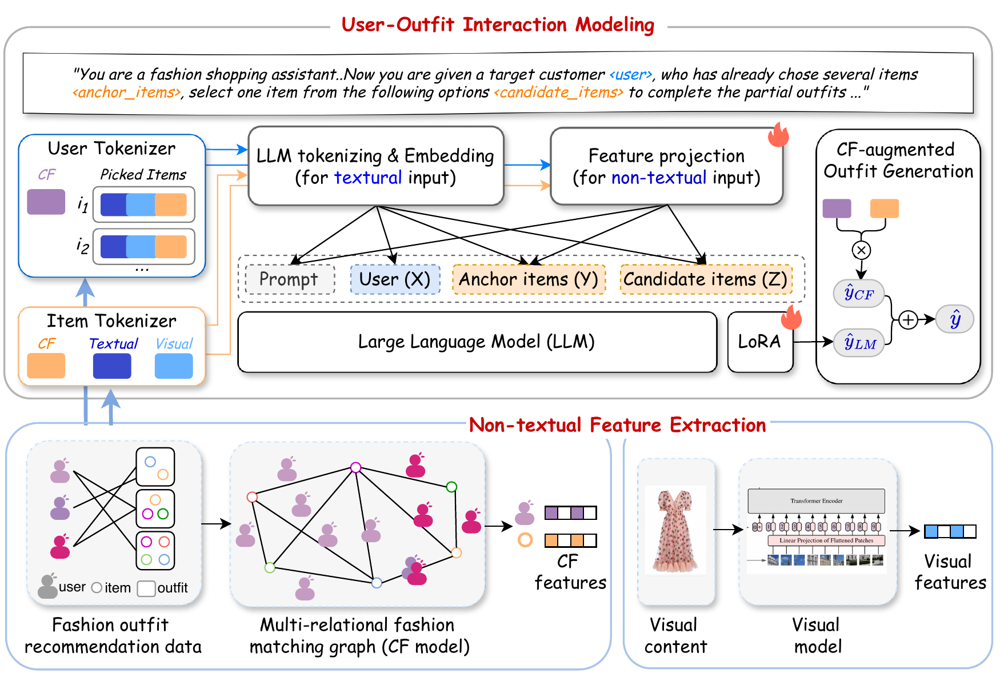

# Personalized outfit completion with an LLM: images and CF vectors as one token each, plus CF scores mixed in for whole-outfit generation

> [中文版](polyu-cfalr.md)

### Paper: CFALR: Collaborative Filtering-Augmented Large Language Model for Personalized Fashion Outfit Recommendation (ACM TOIS 2026)
### Link: https://doi.org/10.1145/3829367 (arXiv 2606.13001)
### Company: The Hong Kong Polytechnic University, National University of Singapore, Singapore Management University, Tongji University, University of Electronic Science and Technology of China
### Idea: LLM-based recommendation, LoRA fine-tuning, injecting collaborative-filtering features, personalized outfits
### Area: i2i (complementary recommendation for a partial outfit)

## Overview:
The paper addresses personalized outfit recommendation: a user is putting together an outfit, has already picked one or two items, and the system helps fill in the rest. The recommended items must go with the picked ones and also suit this user's taste. The trigger is the items the user has already picked, together with the user.

The paper proposes CFALR: it fine-tunes Vicuna-7B with LoRA, writes the user, the picked items and the candidates into one prompt, and lets the LLM choose among the candidates. Besides text, each item's image vector and its vector from a pretrained CF model (CPTM) are each compressed into one token in the prompt, and the user also carries their own CPTM vector. For whole-outfit generation, the LLM's probabilities are mixed with CPTM's probabilities. Published in ACM TOIS 2026, with offline experiments only.

### Model side

Three parts: first, encode users and items into input the LLM can read; then let the LLM pick one item from the candidates, which is the training task; for whole-outfit generation, pick items one by one, mixing in the CF model's score at each step.

#### (1) Hybrid encoding of users and items
This step produces a sequence of vectors for every item and every user (each vector takes one token position in the prompt, so items and users alike have more than one vector), filling the prompt's three placeholders: user, picked items and candidate items.

**CF features.** A CF model, CPTM, is trained separately first: score = target item's bias − ‖user vector + picked item vector − target item vector‖², trained with BPR. Afterwards, each user's and item's 32-dimensional vector is taken.

**Items.** The text description goes through the LLM's word embeddings; the 2048-dimensional ResNet-50 image feature and the 32-dimensional CF vector each go through a trainable linear layer, each mapped to one token. One item = text tokens + 1 image token + 1 CF token.

**Users.** A few historical items are sampled (5 on Polyvore, 3 on IQON) and encoded as above, plus 1 user CF token.

#### (2) Picking one item from the candidates
The prompt reads roughly: "You are a fashion shopping assistant. Given the user <user>, who has already picked <anchor_items>, choose one item from <candidate_items> to complete the outfit; it should match the user's preferences and go well with the picked items."

**Loss.** Instead of a per-token language-modeling loss, it uses cross-entropy over the candidate set: the model's logits for the candidates are compared, and the correct one should be highest.

**Two-stage training.** LoRA is applied only to the attention q and v projections. Stage 1 trains LoRA on the text-only part of the prompt; stage 2 adds the image and CF tokens and trains the projection layers, together with LoRA according to the method section.

#### (3) Mixing in CF for whole-outfit generation
When only one item is picked and a whole outfit is needed, items are picked greedily one at a time starting from it: at each step the picked items act as anchors, a candidate's score = λ × LLM probability + (1 − λ) × CF model probability, and the top one is added; at most 5 items are picked, and the best length is chosen from the per-step scores. λ around 0.4 works best. The authors' explanation is that with only one user and one item as input, the LLM cannot show its strengths, while CF is better at such simple interaction patterns.

### Data side
**Datasets.** Polyvore-519 (519 users, 20K items, 36K outfits, 2.5 items per outfit on average) and a subset of IQON (699 users, 34K items, 11K outfits, 3.7 items per outfit, each item interacted with only 1.1 times on average).

**Samples.** For each user–outfit interaction, any one item serves as the answer and the various subsets of the remaining items serve as the picked part, so one interaction yields many training samples: 161K for Polyvore and 198K for IQON.

### Results (offline only)
Fill-one accuracy: with 4 candidates, 0.650 on Polyvore and 0.610 on IQON, vs. strongest baselines of 0.478 (Bundle-MLLM) and 0.565 (Qwen3.5-VL-35B); with 20 candidates, 0.246 and 0.202, vs. 0.206 (CPTM) and 0.119. Baselines include CF methods (GP-BPR, CPTM), LLMs and VLMs used directly (GPT-4, the Qwen-VL series, GPT-5.4-mini) and bundle recommenders. Whole-outfit generation is best on all three metrics but by small margins, e.g., overlap with existing outfits in the dataset on Polyvore is 0.463 vs. 0.451 for CPTM. Inference takes 0.21 s per sample vs. 0.02 s for CPTM.

## Takeaways:
* An existing CF model can be plugged into an LLM by treating its vector as one token mapped into the word-embedding space with a linear layer.
* When choosing among given candidates, cross-entropy over the candidate set works better than a per-token language-modeling loss (Table 6).
* With very little input, the LLM falls behind CF; mixing the CF model's probability into the output layer is a simple and effective fix.

## My take
* The ablation does not match the text's conclusion: the text says adding all three feature types is consistently better, but on IQON, removing either the CF features or the image features gives higher accuracy than the full model at 4, 10 and 20 candidates (with 20 candidates: without CF 0.212, without image 0.209, full 0.202); on Polyvore with 20 candidates, removing image features is also higher (0.250 vs. 0.246).
* Which training strategy the main results use is inconsistent: the method section says stage 2 trains LoRA and the projection layers together (T_3 in Table 7), yet the main results in Table 2 are identical to T_2 (stage 2 trains only the projection layers); and the Polyvore column of Table 6 uses T_3's numbers.
* Negatives are randomly sampled "items the user does not like" from all items, with no mention of restricting them to the same category; if not restricted, the model can rule out some candidates by category alone. With at most 20 candidates written directly into the prompt, this is a re-ranking setup and does not involve retrieving from the full catalog.
* The whole-outfit metrics measure overlap with outfits already in the dataset, so new but reasonable combinations count as wrong; the LLM and human ratings cover only 70 samples, with no inter-rater agreement reported.
* Inference at 0.21 s per sample is 10 times CPTM's. The paper considers this acceptable for near-real-time use, but there are no online experiments.

## Credibility: offline

## Recommendation level: worth a look if you have time
