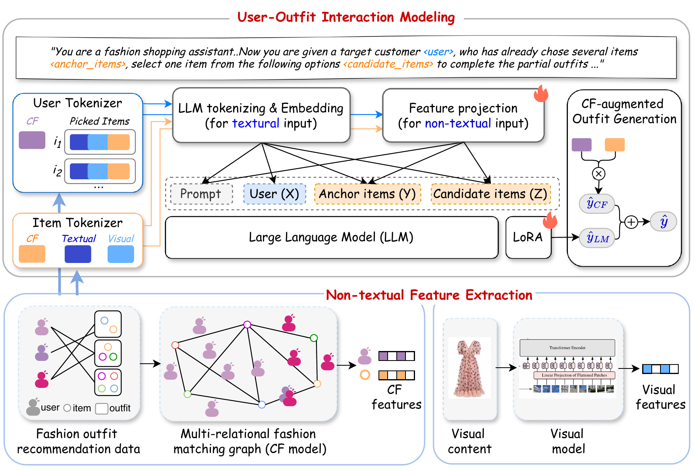

# 用 LLM 做个性化搭配补全：图像、CF 向量各压成一个 token，整套生成时混入 CF 分数

关注我，每天为你精挑细选最优质、最新鲜的推荐算法paper，陪你一起保持进步、不断精进！

> [English version](polyu-cfalr.full.en.md)

### 论文：CFALR: Collaborative Filtering-Augmented Large Language Model for Personalized Fashion Outfit Recommendation
### 网址：https://doi.org/10.1145/3829367
### 公司：香港理工大学、新加坡国立大学等
### 思想：LLM 推荐、LoRA 微调、协同过滤特征注入、个性化搭配
### 方向：i2i

## 解读：
本文做的是个性化搭配推荐（用户在搭一套衣服，已经选了一两件，系统帮他把剩下的配齐）。推荐的单品既要和已选的搭，又要合这个用户的口味。trigger 是用户已经选好的单品，另外带上用户。

本文提出用 LoRA 微调 Vicuna-7B，把用户、trigger、候选单品写进一段 prompt，让 LLM 从候选里选；每件单品除了文本，还把它的图像向量、它在一个预训练 CF 模型（CPTM）里学到的向量各压成一个 token 塞进去，用户也带上自己在 CPTM 里的向量；整套生成时，再把 LLM 的概率和 CPTM 的概率加权混合。

### 模型侧

分三部分。先把用户和单品编码成 LLM 能读的输入；再让 LLM 从候选里选一件，这是训练的任务；整套生成时逐件选，每步混入 CF 模型的分数。

#### （1）用户和单品的混合编码
这一步给每件单品、每个用户各产出一串向量（每个向量占 prompt 里的一个 token 位置，单品和用户都不止一个向量），填进 prompt 的三个占位符（用户、已选单品、候选单品）。

**CF 特征。** 先单独训练一个 CF 模型 CPTM（打分 = 目标单品的偏置 − ‖用户向量 + 已选单品向量 − 目标单品向量‖²，用 BPR 训练）。训完后取每个用户、每件单品的 32 维向量。

**单品。** 文本描述走 LLM 的词嵌入；ResNet-50 的 2048 维图像特征、32 维 CF 向量各过一个可训练的线性层，各映射成一个 token。一件单品 = 文本 token + 1 个图像 token + 1 个 CF token。

**用户。** 抽几件历史单品（Polyvore 5 件、IQON 3 件），用上面的方式编码，再加 1 个用户 CF token。

#### （2）从候选里选一件
prompt 大意是「你是时尚购物助手。给定用户 <user>，他已经选了 <anchor_items>，请从 <candidate_items> 里选一件补全这套 outfit，既要符合他的偏好，又要和已选的单品搭。」

**损失。** 不用逐 token 的语言模型损失，而是在候选集合上做交叉熵（比较模型给各个候选的 logit，正确的那件要最高）。

**两阶段训练。** LoRA 只加在注意力的 q、v 投影上。第一阶段只用 prompt 的纯文本部分训 LoRA；第二阶段加入图像和 CF token，训练映射层，方法部分写的是和 LoRA 一起训。

#### （3）整套生成时混入 CF
只选了一件、要配成整套时，从这一件开始逐件贪心地选。每一步把已选的单品当作 anchor，候选的分数 = λ × LLM 的概率 + (1 − λ) × CF 模型的概率，取最高的那件加入；最多选 5 件，最后按每步的得分挑出最好的长度。λ 取 0.4 左右最好。作者的解释是，输入只有一个用户、一件单品时，LLM 发挥不出来，CF 更擅长这种简单的交互模式。

### 数据侧
**数据集。** Polyvore-519（519 个用户、2 万件单品、3.6 万套 outfit，平均每套 2.5 件）；IQON 的子集（699 个用户、3.4 万件单品、1.1 万套，平均每套 3.7 件，每件单品平均只被交互 1.1 次）。

**样本。** 每条「用户–outfit」交互，任挑一件当答案，其余单品的各种子集当已选部分，一条交互能拆出多条训练样本（Polyvore 16 万条、IQON 20 万条）。

## 心得：

## 愚见

## 可信度：离线

## 推荐等级：有时间看看

**请帮忙点赞、转发，谢谢。欢迎干货投稿 \ 论文宣传\ 合作交流**

### 【铁粉】请入微信群，群内我会给出更深入的解读，还可以共同讨论技术方案、发招聘广告、内推和交友等。
* 铁粉标准：关注公众号一个月以上，且在公众号上累计15次互动（评论、爱心、转发）、或投稿1次，只欢迎技术同学。
* 入群方法：请您加个人微信lmxhappy，我拉您入群，请备注【公司】（只我个人看，不公开）。

## 推荐您继续阅读：
