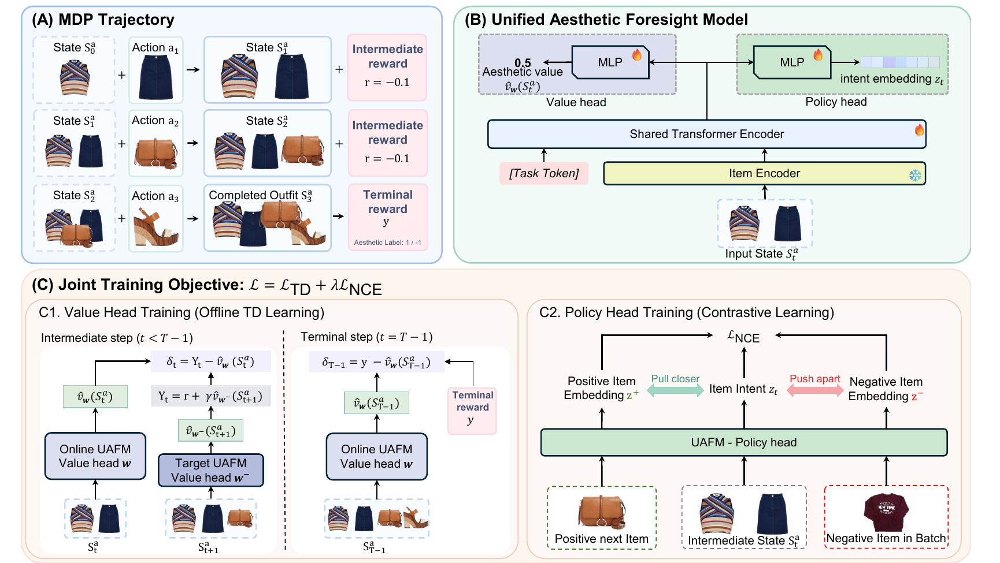

# Outfit composition one item at a time: one Transformer with two heads, a policy head retrieves the next item and a value head estimates the outfit's potential with TD and decides when to stop

> [中文版](polyu-uafm.md)

### Paper: Autonomous Fashion Outfit Composition via Unified Aesthetic Foresight Model (arXiv 2608.13888v2)
### Link: https://arxiv.org/abs/2608.13888
### Company: The Hong Kong Polytechnic University, Laboratory for Artificial Intelligence in Design (AiDLab), The University of Queensland
### Idea: Markov decision process, TD learning, policy head + value head, contrastive learning, automatic stopping
### Area: i2i (a seed item / partial outfit → the next complementary item)

## Overview:
The paper addresses outfit composition. The user gives one item (say, a top), and the system adds items from the catalog one at a time until it has a complete outfit (a full set of clothing, e.g., top, skirt, bag, shoes). The trigger is the seed item, plus whatever items have been assembled so far at each step. There are two difficulties. First, only complete outfits carry a "compatible / not compatible" label; a half-assembled outfit has no supervision at all, so the model cannot tell whether it is "promising". Second, outfits have different numbers of items, so the model has to decide on its own when to stop.

The paper proposes UAFM, which treats item-by-item composition as a Markov decision process (the state at each step is the items assembled so far, and the action is adding one more). A shared Transformer feeds two heads: the policy head retrieves the next item from the catalog, and the value head scores the potential of "the outfit after adding this item", using TD learning (temporal difference: instead of waiting for the final outcome, the estimated value of the next state serves as the training target for the current one) to pass the complete outfit's label back step by step to half-assembled outfits. At inference, composition stops when adding an item no longer raises the potential score enough. Offline experiments only.

### Model side

Three steps overall. First, each outfit is broken into an item-by-item trajectory as training data; then one shared encoder trains the policy head and the value head together; at inference, the policy head retrieves candidates, the value head scores them, and composition stops when the gain is too small.

#### (1) Building training samples: breaking outfits into item-by-item trajectories
This is (A) in the figure.

* **Trajectories.** An outfit is first randomly shuffled, then built up from the first item, adding one item per step until complete. The outfit after each addition is a state (e.g., "top + skirt").
* **Rewards.** Each intermediate addition gets a fixed −0.1 (a step penalty that discourages adding too many items); on completion, the final label is given: +1 for a real outfit, −1 for a constructed negative outfit.
* **Negative outfits.** Each real outfit is paired with a negative outfit of the same length, built by one of three randomly chosen methods. One replaces every item with a random item from the same category (the category structure is kept, but the style pairing is scrambled); another picks a random item and adds its nearest neighbors in CLIP space (a set of near-identical items); the third picks a random item and fills the remaining slots with other items from its category (e.g., an outfit made entirely of tops).

**Output.** Each step of a trajectory yields one sample for each head. The value head gets (current state, next state, reward for this step), e.g., (top + skirt, top + skirt + bag, −0.1); the policy head gets (current state, the real next item), e.g., (top + skirt, bag). Negative outfits are used only by the value head; since the policy head's positive is the human-chosen next item, presumably only real outfits' trajectories are used for it (not stated explicitly). Each batch has a 1:1 ratio of positive and negative state transitions.

#### (2) Shared encoder + two heads
This is (B) and (C) in the figure. The value head learns "how good this outfit can eventually be" (it scores the potential of an outfit that may not be complete yet), and the policy head learns "what to search the catalog with for the next item" (given the current outfit, it outputs a query vector under which the item a person would choose next ranks high by similarity). The two heads share one item encoder and one Transformer (shared parameters), and each runs its own forward pass with its own task token; their inputs, outputs and losses differ.

**Shared part.** A frozen FashionCLIP takes only the image and gives each item a 512-dimensional vector (text is not used, since the authors note it is often missing in practice). A task token is prepended to the outfit's item vectors, and the sequence goes through a 6-layer Transformer with no positional encoding, so the result does not depend on item order. The final-layer hidden state at the task-token position (like BERT's [CLS], gathering information about the whole outfit) goes into the corresponding head (each an MLP).

**Value head.** Structurally this is a scorer for an outfit (complete or half-assembled), like a traditional compatibility model; the difference lies in the training objective: a traditional model is trained only on complete outfits, while this one is trained on every intermediate state as well.
* **Scoring.** <VAL_TOKEN> is prepended to the outfit; its final-layer hidden state goes through the value head's MLP to output a scalar. The input already includes the item added at this step: during training, the item actually added in the trajectory (or in the negative outfit); at inference, a candidate retrieved by the policy head. For example, [<VAL_TOKEN>, top, skirt, bag].
* **What the score means.** Not "is this compatible right now", but the potential of this outfit (possibly not yet complete) to end up as a good outfit.
* **Loss (TD).** At the completing step, the target is the label (+1 or −1); at every intermediate step, the target is "−0.1 + 0.9 × the value of the next state", where the next state's value comes from a slowly updated target network (the usual DQN practice). For a real 4-item outfit, going back from completion, the states' targets are +1, 0.80 and 0.62 in turn; this is how the complete outfit's label is passed back step by step to half-assembled states.

**How the value head differs from a traditional compatibility model.** The traditional approach trains a "compatible / not" classifier on complete outfits only; half-assembled outfits never appear in training, so their scores are unreliable, whereas TD gives every intermediate state a supervision signal. And since each extra step costs 0.1, once an outfit is complete, adding more items no longer raises its value, which is exactly what the stopping decision relies on. Its negatives are also much harder than the policy head's (same-category substitution, near-identical items, an outfit filled with one category), so judging whether the whole outfit has duplicates or clashes is its job. This is the only part of the paper that uses reinforcement learning, and it is trained offline, using only existing trajectories without interacting with an environment.

**Policy head.** Structurally this is Siamese retrieval: the query side and the item side share one Transformer and policy head with identical parameters (not a two-tower model with a separate tower per side).
* **Query side.** <POL_TOKEN> is prepended to the current outfit (without the next item to be predicted), e.g., [<POL_TOKEN>, top, skirt] with "bag" as the target; its final-layer hidden state goes through the policy head's MLP to give the intent vector z_t, a query vector for retrieving the next item: the more similar an item is to it, the better it fits as the next item.
* **Item side.** Each candidate item forms a sequence of length 1 on its own (without a task token) and goes through the same Transformer and policy head, giving a retrieval vector. With only one position, self-attention can only attend to itself, so the Transformer acts as a multi-layer MLP. Since both sides share parameters, z_t and the item vectors live in the same space by construction; an item's vector depends only on the item itself, so all catalog items can be computed offline and indexed, and only z_t is computed at inference time.
* **Loss (InfoNCE).** z_t should be close to the vector of the real outfit's next item and far from other samples' items in the same batch (in effect a softmax over a small batch of items rather than the whole catalog).

**Why the policy head encodes the two sides separately rather than cross-encoding.** It has to search the whole catalog for the next item. If, like the value head, it put each candidate into the sequence, every step would need one Transformer pass per catalog item with the current outfit, tens of thousands to millions of passes, which is infeasible; with the two sides encoded separately, item vectors are computed offline, and each step computes z_t once and queries the index once. Fine-grained cross scoring is left to the value head, applied only to the 10 shortlisted candidates.

**How the policy head differs from GPT.** The generation loop resembles GPT (given what came before, add one item at a time). But the input is an unordered set, attention is bidirectional, and instead of a softmax over a fixed vocabulary it outputs a vector to search the catalog. Despite the name "policy head", it is trained only to imitate the human-chosen next item (behavior cloning in RL terms, which is supervised learning), not optimized with rewards; reinforcement learning is used only in the value head.

**Total loss.** TD and InfoNCE are added with a 1:1 weight and trained end to end together.

**Why the two heads run separate forward passes.** During training, the same trajectory state (e.g., "top + skirt + bag") is both scored by the value head and used by the policy head to predict the item after it, so both heads see the same items, differing only in the task token (the policy head uses only real outfits' intermediate states, while the value head also uses negatives and the completing step). But at inference the two heads do not look at the same set. The policy head encodes the current outfit once per step; the value head has to score "current outfit + each candidate" one by one (with beam width 10 and 10 candidates retrieved per beam, up to 100 sets per step). The paper does not say explicitly that there are two passes; the description suggests so.

#### (3) Inference: retrieve, score, stop automatically
Starting from the seed item, at each step the policy head uses z_t to retrieve 10 candidates from the catalog, the value head scores "current outfit + each candidate", and beam search (width 10) keeps the highest-scoring paths. If no candidate brings a value gain of at least 0, composition stops and the current outfit is the result. Here the two heads divide the work like retrieval plus ranking: the policy head narrows the whole catalog down to 10 candidates, and the value head picks the best among them and decides when to stop.

### Data side
**Dataset.** Polyvore-Outfits (the conventional tasks use the disjoint version, where training and test items do not overlap; the version used for composition is not stated). Training runs 50K steps with batch size 1,000 and a 1:1 positive/negative ratio, taking about 10 hours on one RTX 4090 D.

**Evaluation protocol.** The composition task starts from one major-category item (top, bottom, all-body, outerwear, shoes) taken from a real test outfit, with 9,000 test cases. When comparing against baselines, all methods are told the real outfit's length and forced to compose to that length. Two conventional tasks are also evaluated (whole-outfit compatibility AUC; fill-in-the-blank, 1 of 4; retrieval against 3,000 distractors, Recall@K).

### Results (offline only)
On composition, the LLM-judged score (Gemini rates 5 dimensions on a 1–5 scale) is 3.57, above OutfitTransformer's 3.18 and Gemini-3.5-flash composing directly at 3.28 (real outfits get 3.55); the category duplication rate is 5.69% vs. 20.58% and 15.48% for those baselines; the win rate in a blind study with 40 people is 46%. Each outfit takes 0.13 s. On the conventional tasks, AUC is 0.93 and fill-in-the-blank 70.8%, slightly above OutfitTransformer (0.90, 69.0%). In the ablation, when the value head uses a classification loss instead, the share of trajectories that stop on their own within the real length drops from 96.2% to 34.7%, and outfits grow to 5.5 items on average (real: 4.1).

## Takeaways:
* Bundle or outfit completion can be framed as an MDP over the partial set: TD learning passes the label of the complete set back to partial sets, and the step penalty turns "marginal value gain < 0" into a stopping rule.
* Retrieve-then-score with a shared backbone: a Siamese policy head retrieves top-K candidates, and a set-level value head re-scores "current set + candidate".
* The value head is not optional: with the policy head alone (forced to the real length), category alignment drops from 78.2% to 53.9% and the judged score from 3.60 to 3.43.

## My take
* The negative outfits are built by three generators, two of which directly produce category duplication and visual redundancy; Category Duplication and Visual Redundancy are also two of the composition metrics. The value head is trained to penalize exactly the patterns these metrics measure, so part of the advantage on them comes from the training data design. How the baselines' negatives were built is not stated.
* The natural stop rate counts stopping at or before the real length as success, so stopping early is never penalized; UAFM averages 3.61 items vs. 4.13 for real outfits. In Table 3 (no length constraint), UAFM's outfits are about 3.6 items while the BCE variant's are about 5.5, and fewer items mechanically leave less room for duplication and redundancy.
* On static compatibility, TD is not better: the BCE variant's AUC in Table 3 is 0.96, above UAFM's 0.93, which Table 2 reports as state of the art.
* The judge model is described inconsistently: §3.1 says Gemini-3.5-flash, Appendix E.2 says gemini-3.7-flash, and Gemini-3.5-flash is also one of the baselines. The human study covers 30 comparisons with 40 evaluators.
* Offline only on Polyvore, with no personalization; the authors themselves list the lack of user context and the untested sensitivity to the −0.1 step penalty as limitations.

## Credibility: offline

## Recommendation level: worth a look if you have time
