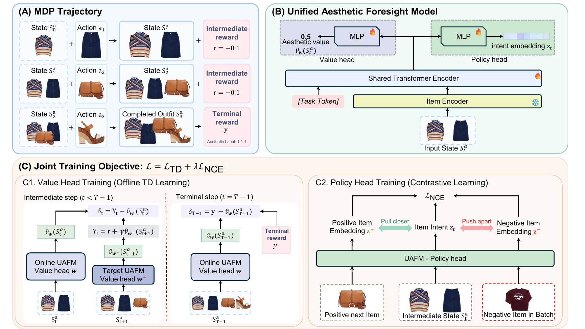

# 穿搭逐件补全：一个 Transformer 两个头，策略头检索下一件，价值头用 TD 估这套的潜力并决定何时停

关注我，每天为你精挑细选最优质、最新鲜的推荐算法paper，陪你一起保持进步、不断精进！

> [English version](polyu-uafm.full.en.md)

### 论文：Autonomous Fashion Outfit Composition via Unified Aesthetic Foresight Model
### 网址：https://arxiv.org/abs/2608.13888
### 公司：香港理工大学、AiDLab（香港人工智能设计研究所）、昆士兰大学
### 思想：马尔可夫决策过程、TD 学习、策略头 + 价值头、对比学习、自动停止
### 方向：i2i

## 解读：
本文做的是穿搭组合。用户给一件单品（比如一件上衣），系统从商品库里一件件往上加，凑成一整套 outfit（一整套穿搭，如上衣、裙子、包、鞋）。trigger 是这件起始单品，以及每一步已经凑好的那几件。

难点有两个。一是只有完整的套装才有「搭 / 不搭」的标签，凑到一半的套装没有任何监督信号，模型不知道它「有没有前途」。二是不同套装件数不同，要自己判断什么时候该停。

本文，把逐件组合看成一个马尔可夫决策过程（每一步的状态是已经凑好的那几件，动作是再加一件）。一个共享的 Transformer 接两个头，策略头负责从库里检索下一件，价值头给「加上这件之后的套装」打一个潜力分，用 TD 学习（时间差分，不等到最终结果，拿下一步状态的估计值当这一步的训练目标）把完整套装的标签一步步传回到凑了一半的套装上。

推理时，加一件带来的潜力分增益不够就停。

### 模型侧

整体分三步。先把每套 outfit 拆成逐件添加的轨迹，作为训练数据；再用一个共享编码器同时训策略头和价值头；推理时策略头检索候选、价值头打分，增益不够就停。

#### （1）构造训练样本：把套装拆成逐件添加的轨迹
对应图中（A）。

* **拆轨迹。** 一套 outfit 先随机打乱顺序，从第一件开始，每步加一件，直到凑齐。每加一件后的套装记为一个状态（如「上衣 + 裙子」）。
* **奖励。** 中间每加一件给一个固定的 −0.1（步数惩罚，鼓励别凑太多）；凑齐时给最终标签，真实套装 +1，构造出的负样本套装 −1。
* **负样本套装。** 每套真实 outfit 配一套同样件数的负样本，从三种方式里随机选一种造出来。一是每件都换成同品类的随机单品（品类结构不变，风格搭配被打乱）；二是随机选一件，再配上它在 CLIP 空间里最像的几件（一套看起来几乎一样的单品）；三是随机选一件，其余全换成同品类的其他单品（比如一整套全是上衣）。

**产出。** 轨迹的每一步给两个头各出一条样本。价值头拿到（当前状态，下一个状态，这一步的奖励），比如（上衣 + 裙子，上衣 + 裙子 + 包，−0.1）；策略头拿到（当前状态，真实的下一件），比如（上衣 + 裙子，包）。负样本套装只给价值头用；策略头的正样本是人选的下一件，推测只用真实套装的轨迹（原文没明说）。每个 batch 里正负样本的状态转移按 1:1 配比。

#### （2）共享编码器 + 两个头
对应图中（B）和（C）。价值头学的是「这套最终能有多好」（给一个可能还没凑齐的套装打潜力分），策略头学的是「拿什么去库里找下一件」（给定当前套装，输出一个查询向量，让人会选的下一件在相似度上排到前面）。两个头共用同一个单品编码器和同一个 Transformer（参数共享），各自换一个任务 token 单独前向，输入、输出和损失都不同。

**共享部分。** 冻结的 FashionCLIP 只取图像，每件单品得到一个 512 维向量（不用文本，作者认为实际场景里文本常常缺失）。套装的单品向量前面加一个任务 token，过一个 6 层 Transformer，不加位置编码，所以和单品顺序无关。取任务 token 位置的最后一层 hidden state（相当于 BERT 的 [CLS]，把整套信息汇总到自己身上），送进对应的头（各是一个 MLP）。

**价值头。** 结构上就是一个给套装打分的打分器（凑齐的、凑了一半的都能打），和传统的兼容性模型一样；区别在训练目标，传统模型只在完整套装上训练，它在每个中间状态上都训练。
* **打分。** 套装前面加 <VAL_TOKEN>，取它的最后一层 hidden state 过价值头的 MLP，输出一个标量。输入已经包含了这一步新加的那件，训练时是轨迹里真实（或负样本里）加进来的那件，推理时是策略头检索出的候选。比如 [<VAL_TOKEN>, 上衣, 裙子, 包]。
* **分数的含义。** 不是「现在搭不搭」，而是这套（可能还没凑齐）最终能成为一套好搭配的潜力。
* **损失（TD）。** 凑齐的那一步，目标就是标签（+1 或 −1）；中间的每一步，目标是「−0.1 + 0.9 × 下一步状态的价值」，下一步的价值由一个缓慢更新的目标网络给出（DQN 的常规做法）。比如一套 4 件的真实套装，从凑齐往前，各状态的目标依次是 +1、0.80、0.62，完整套装的标签就这样一步步传回到凑了一半的状态上。

**价值头和传统兼容性模型的区别。** 传统做法只在完整套装上训一个「搭 / 不搭」分类器，凑了一半的套装从没在训练里出现过，拿来打分就不准；TD 让每个中间状态都有监督信号。而且每多一步扣 0.1，凑齐之后再加单品价值就不再上涨，这正是判断何时停的依据。它的负样本也比策略头难得多（同品类换掉、几乎一样的单品、同一品类凑满），整套是否重复、是否冲突，靠它来判断。这是全文唯一用到强化学习的部分，而且是离线训练，只用现成的轨迹，不和环境交互。

**策略头。** 结构上是一个 Siamese 召回：query 侧和 item 侧共用同一个 Transformer 和策略头，参数完全相同（不是两侧各有一个塔的双塔）。
* **query 侧。** 当前套装（不含要预测的下一件）前面加 <POL_TOKEN>，比如 [<POL_TOKEN>, 上衣, 裙子]，目标是「包」；取它的最后一层 hidden state 过策略头的 MLP，得到意图向量 z_t，作为检索下一件的查询向量：和它越相似的单品，越适合作为下一件。
* **item 侧。** 每件候选单品单独组成一个长度为 1 的序列（不加任务 token），过同一个 Transformer 和策略头，得到检索用的向量。序列里只有一个位置，self-attention 只能看自己，这时 Transformer 相当于一个多层 MLP。两侧参数相同，所以 z_t 和单品向量天然在同一个空间里；单品向量只取决于单品自己，库里所有单品可以离线算好建索引，推理时只实时算 z_t。
* **损失（InfoNCE）。** z_t 要靠近真实套装里下一件的向量，远离同一批里其他样本的单品（相当于只在一小批单品上做 softmax，而不是在整个商品库上）。

**策略头为什么两侧分开编码、不做交叉。** 它要在整个商品库里找下一件。如果像价值头那样把候选塞进序列，每一步都要把当前套装和库里每一件单品各拼一次过 Transformer，几万到几百万次，算不动；两侧分开编码时，单品向量离线算好，每一步只算一次 z_t、查一次索引。精细的交叉打分留给价值头，只在筛出的 10 个候选上做。

**策略头和 GPT 的区别。** 生成流程像 GPT（给定前面的，一次加一件）。但输入是无序集合、注意力是双向的，也不在固定词表上做 softmax，而是输出一个向量去库里检索。它虽然叫「策略头」，训练却只是模仿人选的下一件（强化学习里叫行为克隆，本质是监督学习），没有用奖励去优化；强化学习只用在价值头上。

**总损失。** TD 和 InfoNCE 相加，权重 1:1，一起端到端训练。

**为什么两个头分开前向。** 训练时，轨迹里的同一个状态（如「上衣 + 裙子 + 包」）既给价值头打分，又给策略头去预测再下一件，两个头看的是同一组单品，只是任务 token 不同（策略头只用真实套装的中间状态，价值头还用负样本和凑齐的那一步）。但推理时两个头看的不是同一个集合。策略头每一步只对当前套装编码一次；价值头要对「当前套装 + 每个候选」逐个打分（beam 宽 10、每条检索 10 个候选，一步最多 100 个集合）。原文没明说是分两次前向，按描述更像这样。

#### （3）推理：检索、打分、自动停
从起始单品开始，每一步策略头用 z_t 从库里检索 10 个候选，价值头给「当前套装 + 每个候选」各打一个分，用 beam search（宽度 10）保留分数最高的几条路径。如果所有候选带来的价值增益都小于 0，就停止，当前套装就是结果。两个头在这里的分工相当于召回加排序，策略头从整个库里缩小到 10 个候选，价值头在候选里挑最好的，并决定什么时候停。

### 数据侧
**数据集。** Polyvore-Outfits（传统任务用的是 disjoint 版本，训练和测试的单品不重叠；组合任务用哪个版本没写）。训练 5 万步，batch 1000，正负样本 1:1，单张 RTX 4090 D 约 10 小时。

**评测方式。** 组合任务从测试集真实套装里取一件主品类单品（上衣、下装、连衣类、外套、鞋）当起点，共 9000 个测试用例。和基线对比时，所有方法都被告知真实套装的件数，强制凑到同样长度。另在两个传统任务上测（整套兼容性 AUC；填空，4 选 1；在 3000 个干扰项里检索，Recall@K）。

### 效果（仅离线）
组合任务上，大模型打分（Gemini 按 5 个维度打 1–5 分）为 3.57，高于 OutfitTransformer 的 3.18 和 Gemini-3.5-flash 直接组合的 3.28（真实套装为 3.55）；品类重复率 5.69%，基线为 20.58% 和 15.48%；40 人盲评的胜率 46%。每套耗时 0.13 秒。传统任务上 AUC 0.93、填空 70.8%，略高于 OutfitTransformer（0.90、69.0%）。消融里，价值头改用分类损失后，在真实长度内自动停下的比例从 96.2% 掉到 34.7%，平均凑到 5.5 件（真实为 4.1 件）。

## 心得：

## 愚见

## 可信度：离线

## 推荐等级：有时间看看

**请帮忙点赞、转发，谢谢。欢迎干货投稿 \ 论文宣传\ 合作交流**

### 【铁粉】请入微信群，群内我会给出更深入的解读，还可以共同讨论技术方案、发招聘广告、内推和交友等。
* 铁粉标准：关注公众号一个月以上，且在公众号上累计15次互动（评论、爱心、转发）、或投稿1次，只欢迎技术同学。
* 入群方法：请您加个人微信lmxhappy，我拉您入群，请备注【公司】（只我个人看，不公开）。

## 推荐您继续阅读：
