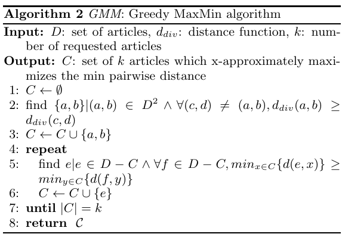

# Related-news recommendation from 2013: shortlist related articles by entity overlap, then use reader comments to diversify the list

> [中文版](qcri-diverse-related-articles.md)

### Paper: Real-Time Recommendation of Diverse Related Articles (WWW 2013)
### Link: https://doi.org/10.1145/2488388.2488390
### Institution: Qatar Computing Research Institute (QCRI), CNRS (France), MIT
### Ideas: entity Jaccard relevance, comment-driven diversity, min-hash LSH, greedy max-min dispersion
### Area: i2i (related-article recommendation, diversity)

## Breakdown:
A user is reading a news article and a few related articles are recommended alongside it. The paper works in two steps: first, it finds candidates sufficiently related to the current article by the overlap of entities mentioned in the articles (topics, people, places); then it picks the k candidates that differ most from one another, where "difference" is measured not by article content but by reader comments (entities and sentiment in the comments, the users who commented, and their countries). For real-time speed, step one uses min-hash LSH and step two a greedy max-min algorithm.

After talking with editors at Al Jazeera English, the authors found that news sites' related-article recommendations generally consider only content overlap, recency, user activity (how often an article is emailed or commented on) and editors' picks, without using what the comments say. Their premise: readers' comments amplify subtle differences between two similar articles (such as the journalist's leaning on a topic), so measuring differences between articles by their comments can spread out a recommendation list more than content alone.

### Method
Two steps: first shortlist related articles, then pick the k most dispersed among them.

#### (1) Shortlisting related articles
Open Calais (an off-the-shelf entity extraction service) extracts topics, people and places from each article into a feature set. The relevance distance between two articles = 1 − the Jaccard coefficient of their feature sets (intersection over union). Articles within a threshold r of the current article are candidates. Candidates aren't a fixed number but all articles within the distance threshold, however many there are: at the same r, some articles have many candidates and some none at all (Al Jazeera's articles are scattered, averaging only 0.28 candidates per article at r = 0, versus 38.3 for Reuters). The experiments use r from 0.5 to 0.8 for diversification.

Comparing against the whole collection one by one is too slow, so LSH (locality-sensitive hashing) speeds it up. The hash here is min-hash: randomly order all features, and an article's hash value is whichever of its features comes first in that order. The probability that two articles get the same hash value equals their Jaccard coefficient, so articles with more overlapping features are more likely to land in the same bucket. Offline, all articles are bucketed by hash value; online, only the articles in the current article's bucket are taken and then filtered by distance. In the experiments each bucket is determined by a combination of 2 min-hash values, and only one hash table is built.

#### (2) Picking the k most dispersed
Diversity is measured by a "difference distance" between articles, and the paper offers four, all based on comments. They are parallel alternatives: each run uses just one of them, the experiments compare them separately, and they are never combined into a single distance:
* **Entities in comments.** All of an article's comments are concatenated into one document, entities are extracted, and the distance is 1 − Jaccard of the two articles' comment entities.
* **Comment sentiment.** Each comment gets a sentiment score from −1 to 1 using a sentiment lexicon, averaged per article, and the distance is the absolute difference between two articles. An alternative uses the shares of positive and negative comments with Euclidean distance.
* **Commenting users.** 1 − Jaccard of the two articles' sets of commenting users.
* **Commenters' countries.** Same, with sets of countries.

A difference distance based on article-content entities is also defined, used only for comparison.

The goal is to choose k candidates so that the smallest difference distance between any two of them is as large as possible. This problem is NP-hard, so the greedy algorithm in the figure (GMM) approximates it: first pick the two most different articles, then repeatedly add the article whose minimum distance to those already picked is largest, until k are chosen. For distances satisfying the triangle inequality, this greedy is guaranteed to reach at least half the optimum.

**dLSH and dLSH\*.** The combination above is called dLSH. With many candidates, step two slows down, so the authors also propose dLSH\*: offline, GMM is run on each bucket, keeping only the k most dispersed articles per bucket, and online the final pick is made among these.

### Data and results
Two datasets: Al Jazeera English opinion articles (2,040 articles, 389K comments, 35K users), and Reuters news (13K articles with no comments, used only to test retrieval speed). Offline experiments plus a small crowdsourced user study only.
* **Speed.** LSH finds candidates 4.5 to 22.5 times faster than comparing one by one. But LSH uses only a single hash table and, at r = 0.4, recovers only about 30% of the true candidates. When producing recommendation lists, dLSH is faster than MMR (the classic relevance-minus-redundancy re-ranking); at k = 10, sentiment-based diversification is fastest at about 30 times, and commenting-user-based is slowest at about 7.5 times.
* **Diversity.** Taking content difference between articles as the yardstick, compared with simply taking the top k by relevance, the sentiment-diversified list at r = 0.5 has 37% more content difference while average relevance drops only 5%.
* **User study.** On Amazon Mechanical Turk, with only two articles (one politics, one economics) and workers seeing only titles, workers compared which of the dLSH and MMR lists was more diverse. For the economics article, over 65% found dLSH more diverse; for the politics article, only 30%.

## Takeaways
* Related-article recommendation can be split into two steps: first guarantee relevance (distance within a threshold), then seek dispersion among the relevant candidates, rather than blending relevance and dispersion into one score.
* Reader comments (sentiment, entities, who commented) are an independent signal for measuring differences between articles that doesn't depend on article content itself.
* For dispersion problems of the "maximize the smallest pairwise distance" kind, a greedy algorithm already gives a factor-2 approximation guarantee, suitable for real time.

## Caveats
* The abstract says the user study "validates the use of entities and sentiment in comments for diversity compared to content-based diversity", but the study actually compares dLSH with MMR, not comments with content; it uses only two articles, shows only titles, and the two articles lead to opposite conclusions. The sentiment-diversified list was judged clearly less diverse than MMR's for the politics article, which contradicts the results summary's claim that "users prefer sentiment-based diversity". Also, only 28.5% of workers preferred the list they themselves judged more diverse.
* The offline diversity evaluation uses "content difference between articles" as the yardstick and compares against taking the top k by relevance. Any diversification method raises content difference relative to the most-relevant list, so this comparison can't show that comments beat content; the paper doesn't include "diversify directly by content" as a control.
* When explaining why dLSH\* results defy expectations, the authors say Jaccard distance doesn't satisfy the triangle inequality. In fact 1 − Jaccard is a standard distance metric that does satisfy it, so this explanation doesn't hold.
* When comparing relevance with MMR, dLSH counts only articles with at least k + 1 candidates while MMR counts all articles, and the authors acknowledge the two aren't measured the same way. LSH uses a single hash table with very low recall: once r grows a little, most related articles can't be found.

## Credibility: offline

## Recommendation level: worth a look if you have time
