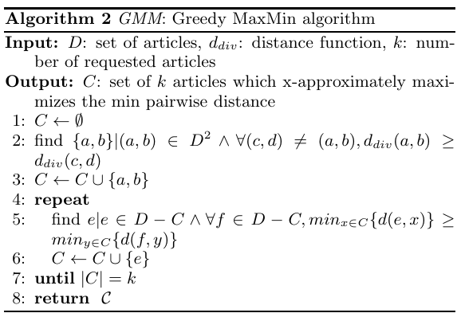

# 2013 年的相关新闻推荐：按实体重合度圈出相关文章，再用读者评论把推荐列表打散

关注我，每天为你精挑细选最优质、最新鲜的推荐算法paper，陪你一起保持进步、不断精进！

> [English version](qcri-diverse-related-articles.full.en.md)

### 论文：Real-Time Recommendation of Diverse Related Articles
### 网址：https://doi.org/10.1145/2488388.2488390
### 公司：卡塔尔计算研究所（QCRI）、法国 CNRS、MIT
### 思想：实体 Jaccard 相关度、评论驱动的多样性、最小哈希 LSH、贪心最大最小分散
### 方向：i2i（相关文章推荐、多样性）

## 解读：
用户正在读一篇新闻，旁边推荐几篇相关文章。本文分两步：先按文章里提到的实体（主题、人物、地点）的重合度，找出和当前文章足够相关的候选；再从候选里挑出彼此差别最大的 k 篇，「差别」不按文章内容算，而是按读者评论算（评论里的实体、情感倾向、评论的用户和用户所在国家）。为了实时，第一步用最小哈希做的 LSH，第二步用贪心最大最小算法。

作者和半岛电视台英文网的编辑交流后发现，新闻网站的相关推荐一般只看内容重合、时效、用户互动（被邮件转发、被评论的次数）和编辑精选，没有用到评论的内容。作者的设想是：读者在评论里会放大两篇相似文章之间的细微差别（比如撰稿人对某个话题的倾向），用评论来衡量文章之间的差别，比只看文章内容能把推荐列表打得更散。

### 方法
分两步：先圈出相关文章，再从中挑出最分散的 k 篇。

#### （1）圈出相关文章
用 Open Calais（一个现成的实体抽取服务）从每篇文章里抽出主题、人物、地点，组成一个特征集合。两篇文章的相关距离 = 1 − 两个特征集合的 Jaccard 系数（交集除以并集）。和当前文章的相关距离不超过阈值 r 的，算作候选。候选不是固定篇数，而是距离阈值以内的全部文章，有多少算多少：同一个 r 下，有的文章候选很多，有的一篇都没有（半岛电视台的文章很分散，r = 0 时平均每篇只有 0.28 篇候选，路透社则有 38.3 篇）。实验里打散用的 r 取 0.5 到 0.8。

全库逐篇比太慢，所以用 LSH（局部敏感哈希）加速。这里的哈希是最小哈希：把所有特征随机排一个顺序，一篇文章的哈希值是它的特征里排得最靠前的那个。两篇文章哈希值相同的概率正好等于它们的 Jaccard 系数，所以特征越重合的文章越容易落进同一个桶。离线时把所有文章按哈希值分桶，线上只取当前文章所在桶里的文章，再按距离过滤。实验里每个桶由 2 个最小哈希值组合决定，只建了一个哈希表。

#### （2）挑出最分散的 k 篇
多样性用文章之间的「差别距离」来衡量，论文给了四种，都基于评论。它们是并列的备选，每次只用其中一种，实验里分别比较，没有组合成一个综合距离：
* **评论里的实体。** 把一篇文章的全部评论拼成一篇文档，抽出实体，两篇文章评论实体的 1 − Jaccard。
* **评论的情感。** 每条评论用情感词典打一个 −1 到 1 的分，一篇文章取平均，两篇文章之差的绝对值。另一种写法是正面、负面评论的占比，算欧氏距离。
* **评论的用户。** 两篇文章评论用户集合的 1 − Jaccard。
* **评论用户所在国家。** 同上，换成国家集合。

另有一种按文章内容实体算的差别距离，只用来做对比。

目标是从候选里选 k 篇，使其中任意两篇之间的最小差别距离尽量大，这个问题是 NP 难的，所以用上图的贪心算法（GMM）近似求解：先选差别最大的两篇，之后每次加入一篇和已选文章的最小距离最大的，直到选够 k 篇。对满足三角不等式的距离，这个贪心能保证达到最优值的一半。

**dLSH 和 dLSH\*。** 上面的组合叫 dLSH。候选多时第二步变慢，所以作者又提出 dLSH\*：离线时就对每个桶跑一遍 GMM，每个桶只保留最分散的 k 篇，线上只需在这些文章里再挑一次。

### 数据与效果
两个数据集：半岛电视台英文网的评论文章（2,040 篇、38.9 万条评论、3.5 万用户），以及路透社新闻（1.3 万篇，没有评论，只用来测检索速度）。只有离线实验和一个小规模的众包用户调研。
* **速度。** LSH 找候选比逐篇比较快 4.5 到 22.5 倍。但 LSH 只用了一个哈希表，r = 0.4 时只能找回约 30% 的真实候选。出推荐列表时，dLSH 比 MMR（经典的相关性减冗余重排）快，k = 10 时按情感打散最快，约 30 倍，按评论用户打散最慢，约 7.5 倍。
* **多样性。** 以文章内容的差别作为衡量标准，和只按相关度取前 k 篇相比，r = 0.5 时按情感打散的列表内容差别高 37%，平均相关度只降 5%。
* **用户调研。** 在亚马逊众包平台上，只选了两篇文章（一篇政治、一篇经济），工人只看标题，比较 dLSH 和 MMR 的列表哪个更分散。经济那篇超过 65% 的人认为 dLSH 更分散，政治那篇只有 30%。

## 心得：

## 愚见

## 可信度：离线

## 推荐等级：有时间看看

**请帮忙点赞、转发，谢谢。欢迎干货投稿 \ 论文宣传\ 合作交流**

### 【铁粉】请入微信群，群内我会给出更深入的解读，还可以共同讨论技术方案、发招聘广告、内推和交友等。
* 铁粉标准：关注公众号一个月以上，且在公众号上累计15次互动（评论、爱心、转发）、或投稿1次，只欢迎技术同学。
* 入群方法：请您加个人微信lmxhappy，我拉您入群，请备注【公司】（只我个人看，不公开）。

## 推荐您继续阅读：
