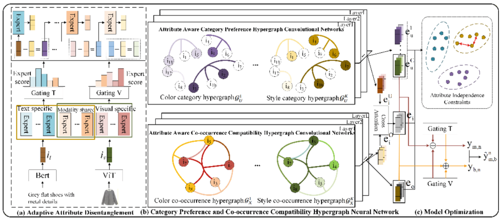

# Personalized outfit completion: disentangle attributes in order of importance, then learn user preference and outfit compatibility on two hypergraphs

> [中文版](qust-pcm-adhl.md)

### Paper: Personalized Compatibility Modeling with Adaptive Disentanglement and Hypergraph Learning (ICIC 2026, LNCS 16645)
### Link: https://doi.org/10.1007/978-981-92-3391-5_19
### Company: Qingdao University of Science and Technology
### Idea: attribute disentanglement, attribute expert networks, hypergraph neural networks, personalized compatibility
### Area: i2i (complementary recommendation for a partial outfit)

## Overview:
A user is putting together an outfit, has already picked a few pieces, and needs the next one from a set of candidates: it should go with the pieces already in the outfit and also match this user's preference within that category, such as the colors they usually pick for tops. The trigger is this incomplete outfit, together with the user.

The paper proposes PCM-ADHL. It first breaks each item's image and text features into attribute vectors such as color and style, in an order set by how important each attribute is for that item. It then propagates on two hypergraphs, one learning "a user's preference within a category" and one learning which items co-occur in the same outfit. Finally, it gives each attribute a preference score and a compatibility score and sums them weighted by attribute importance. It is an ICIC 2026 conference paper with offline experiments only.

### Model side

Three steps: first, break each item into several attribute vectors; then propagate per attribute on two hypergraphs to get attribute-level representations of users, items and outfits; finally, score per attribute and take a weighted sum.

#### (1) Disentangling attributes in order of importance
This is (a) in the figure. This step splits each item's text and image features into several attribute vectors (color, style and the like) and gives the importance of each attribute for that particular item (computed per item). The attribute vectors are the initial node features of the hypergraphs in (2), and the importances weight the per-attribute scores in (3).

* **Encoding.** Text goes through BERT and the image through ViT (Fig. 1), giving one feature each.
* **Attribute experts.** Each expert is a small network that extracts one attribute, in three groups (2 text-specific, 2 visual-specific and 4 shared, which is the best setting).
* **Importance scores.** Each expert first extracts its attribute once, and a gating network uses these to score each of the item's attributes, followed by softmax. Different items have different important attributes: color may matter most for one, material for another.
* **Extraction in order of importance.** The experts are lined up by importance. The first expert extracts its attribute from the raw feature and that part is subtracted; the residual goes to the next expert, and so on until all are done; the final leftover residual counts as one more modality-specific attribute.
* **Merging.** The shared attributes from the text and image paths are averaged. Each item ends up with 3 text-specific (2 + 1 residual), 3 visual-specific and 4 shared attribute vectors.

**Constraints.** An orthogonality constraint (squared cosine) is placed between each attribute vector and the final residual attribute, to keep the attributes separate from the residual.

**Why split into attributes.** So that preference and compatibility can be computed per attribute later: whether the colors go together and whether the styles go together are scored separately.

#### (2) Learning user preference and outfit compatibility on hypergraphs
This is (b) in the figure. This step builds two hypergraphs on each shared attribute (category preference and co-occurrence compatibility), propagates on them, and finally fuses each item's vectors from the two graphs into one (every item in the graph; scoring later takes the candidate item's copy). A hypergraph edge (hyperedge) can connect several nodes at once. Of the 10 attribute vectors from (1), only the 4 shared ones enter the hypergraphs (the 6 modality-specific ones are used only in the orthogonality constraint), so there are 4 graphs of each kind (illustrated in the figure as color and style), each propagating only that attribute's vectors.

**Category preference hypergraph.**
* **Edges.** The items a user has interacted with in one category form one hyperedge (e.g., all the tops they interacted with; the items within one outfit, by contrast, belong to different categories), whose vector is "this user's preference in this category" (the user–category vector). Each user has 4 per category, one per shared attribute; how the layer-0 initial value is obtained is not stated.
* **Connection weights.** The weights between items and hyperedges are learned: the similarity between the user–category vector and the item's vector for that attribute, with softmax across attributes.
* **Propagation.** Starting from the attribute vectors from (1), each layer first aggregates items into hyperedges to update the user–category vectors, then distributes back to items to update item vectors; there are 3 layers, and the per-layer results are averaged. An item interacted with by many users is still a single node with one vector per attribute, 4 in total.

**Co-occurrence compatibility hypergraph.** The items of each outfit form one hyperedge, with the same propagation, giving attribute-level vectors for every outfit; the item vectors are updated once more (now carrying information from the other items in the same outfit, so they differ from the ones updated on the preference graph). An item that appears in several outfits is still a single node with one vector per attribute, 4 in total.

**Fusion.** On each shared attribute, an item has one vector from each graph, fused into one with cross-attention (the preference-graph vector is the query, and the compatibility-graph vector is the key and value), so each item ends up with 4 fused vectors.

**Output.** Each attribute yields three kinds of vectors, all used for scoring in (3). User–category vectors are scored against the candidate item's vector for the preference score; outfit vectors are scored against the candidate's vector for the compatibility score; the fused item vector is the candidate vector in scoring.

#### (3) Per-attribute scoring
This is (c) in the figure. This step gives the candidate item one total score: each shared attribute is scored separately, and the attributes are then summed with weights.

* **Preference score.** On each shared attribute, the inner product between the user's vector for the candidate's category and the candidate's fused vector for that attribute, giving 4 preference scores.
* **Compatibility score.** On each shared attribute, the outfit's vector (the hyperedge vector of this partial outfit on the co-occurrence hypergraph; whether the hyperedge includes the candidate item itself is not stated) and the candidate's fused vector for that attribute are concatenated and passed through a two-layer MLP, giving 4 compatibility scores (the MLP parameters in the equation carry no attribute index, so the 4 attributes share one MLP).
* **One score per attribute.** On each attribute, β × preference score + (1 − β) × compatibility score, giving 4 attribute scores, with β a fixed hyperparameter (too small underweights personalization, too large leans too much on user history).
* **Weighted sum across attributes.** The 4 attribute scores are summed weighted by the candidate's own attribute importance, giving the total score. The importance is the α produced by the gates in (1) (written α^{t/v} in Eq. (10)). But each gate scores 6 experts, while only the 4 shared attributes are needed here; how they are picked, whether they are renormalized, and how the text and visual gates are combined into one set are not stated.

**Training.** The following are added together and optimized end to end (Eq. (14), plus L2 regularization).
* **BPR.** For the same (user, outfit), a positive candidate's total score should be higher than a negative one's (the positive is presumably the item removed from the outfit; how negatives are sampled, and whether from the same category, is not stated).
* **Orthogonality constraint.** The one from (1).
* **Independence constraints.** Applied to the user, outfit and item vectors produced by (2): one keeps different attributes apart, the other keeps each attribute from collapsing.

### Data side
Three public fashion datasets: IQON3000 (3,568 users, 309K outfits, 672K items), Polyvore-U (630 users, 163K outfits, 200K items) and Alibaba iFashion (3.57M users, 1.01M outfits, 4.46M items). Each item has a text description, an image and a category.

### Results (offline only)
The metrics are AUC and MRR. AUC is 0.897, 0.908 and 0.903 on the three datasets, 0.2–0.4 points above the strongest baseline, AesRec, and MRR is 0.1–0.3 points higher. In the ablation, removing attribute disentanglement drops AUC by 5–6 points, removing both hypergraphs by about 4 points, and keeping disentanglement but removing attribute-importance modeling by about 3 points.

## Takeaways:
* Split "does this outfit go together" and "does this user like it" into two scores: the former looks at the outfit, the latter at the user's preference within the candidate's category, then weight them. AUC drops when β is too large or too small.
* Making each outfit and each "user × category" a hyperedge directly expresses "a group of items that appear together", with no need to break it into pairwise edges.
* Attribute importance differs by item; ordering by each item's own importance and extracting one by one from the residual works better than a fixed order.

## My take
* Where the outfit vector comes from at test time is not explained. It is the vector of a hyperedge on the co-occurrence hypergraph; the test outfit is incomplete, and if hyperedges are built from complete outfits that include the item to be predicted, the answer leaks into the outfit vector. How train and test are split is not described either.
* Evaluation details are missing: how many negatives each positive gets and over how large a candidate set MRR is computed are not given; with MRR around 0.87 everywhere, the candidate set must be small. Results come without variance or significance.
* Removing only one regularizer, the independence constraint, drops AUC by about 3 points (IQON3000 0.897 → 0.865), roughly ten times the overall gain over the strongest baseline, and below most baselines from the last two years; the paper offers no explanation.
* Among the baselines, FashionDPO is an outfit generation model and the AesRec paper is mainly a dataset paper; how they were adapted to "score a candidate's compatibility" is not explained, nor whether baseline numbers were reproduced or copied.
* The hypergraphs are built only for the K shared attributes, yet the score sums over all attributes and uses weights from the text or visual gate; where the user and outfit vectors for the modality-specific attributes come from, and which gate's weights are used, is not explained.

## Credibility: offline

## Recommendation level: worth a look if you have time
